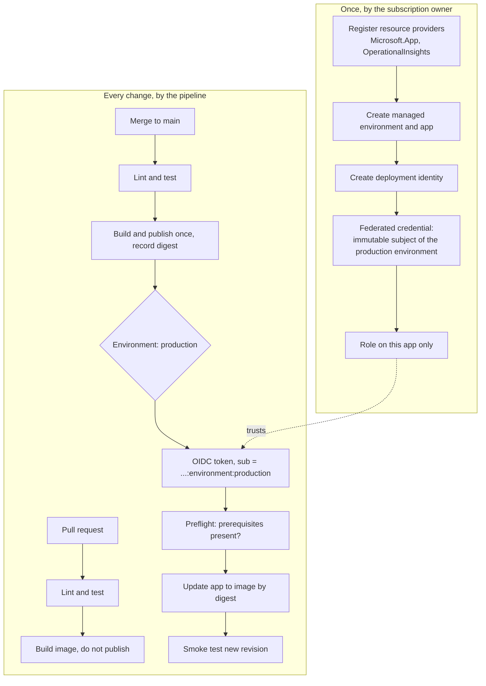

# Charity Website on Azure Container Apps: Platform Bootstrap and Workload Identity

> A vendor-neutral case architecture for the **small deployment that fails for reasons outside the application**: a container platform whose prerequisites are not in place, and a federated identity whose trust rule no longer matches the token. The application is a static website. The case is about what has to exist before the first automated deployment, who may create it, and how a pipeline proves who it is to a cloud without stored secrets.
> It is the first case in this repository realised on Microsoft Azure. Every view names the AWS and Google Cloud counterpart, because the problems are the same and only the names differ.

## Contents

- [Business](#business)
- [Architecture](#architecture)
  - [A1 Risks and scope](#a1-risks-and-scope)
  - [A2 Platform bootstrap versus deployment](#a2-platform-bootstrap-versus-deployment)
  - [A3 Anatomy of the "Registering" failure](#a3-anatomy-of-the-registering-failure)
  - [A4 Workload identity federation](#a4-workload-identity-federation)
  - [A5 The immutable subject change](#a5-the-immutable-subject-change)
  - [A6 Least privilege for the deployment identity](#a6-least-privilege-for-the-deployment-identity)
  - [A7 Pipeline shape: who may publish, who may deploy](#a7-pipeline-shape-who-may-publish-who-may-deploy)
  - [A8 Build once, deploy by digest, check the result](#a8-build-once-deploy-by-digest-check-the-result)
- [Cross-Cloud Mapping](#cross-cloud-mapping)
- [Key Decisions](#key-decisions)
- [Quality Attribute Scenarios and How to Measure Them](#quality-attribute-scenarios-and-how-to-measure-them)
- [Control Mapping](#control-mapping)
- [Failures](#failures)
- [Lessons Learned](#lessons-learned)
- [Further Reading](#further-reading)

Companion documents: [Reviewing a small cloud deployment against this case](review-checklist.md) and the hands-on [Workload Identity Federation Lab](../../labs/workload-identity-federation/README.md), which evaluates AWS, Azure and Google Cloud trust rules against token claim sets offline and contains a reference realisation of views A2 and A6 to A8.

---

## Business

**The operator** is a fictitious food-sharing charity with two part-time volunteers who maintain its website: opening hours of its pick-up points, how to volunteer, contact details. The site is static (HTML, CSS, JavaScript), has no database and no personal data beyond what visitors type into an external contact form. It runs on Azure because the charity already uses Microsoft 365 and has Azure credits.

**How it is done today.** The site runs on a virtual machine. A volunteer copies changed files onto it by hand. Nobody is sure which version is live, and a broken page is noticed by visitors.

**What the charity wants.** A change merged on GitHub is checked, packaged once and put live without anyone logging in to a server; no long-lived cloud password stored anywhere; a way back to the previous version; and something the next volunteer can understand.

**Constraints.** Two people, little time, no budget for paid support plans. Whatever is set up once must keep working without attention, and when it fails it must say why.

---

## Architecture

### A1 Risks and scope

| ID | Risk | Control | View |
|---|---|---|---|
| R1 | A deployment fails for a platform reason and nobody knows why | Prerequisites created once, checked by a preflight that names the cause | A2, A3 |
| R2 | Someone other than this repository's production job obtains cloud access | Federated trust on immutable identifiers and a single environment | A4, A5 |
| R3 | A working deployment breaks because the token format changed | Trust IDs as separate claims; know which format the repository sends | A5 |
| R4 | The pipeline identity can do far more than deploy this app | Role scoped to the app; platform rights stay with the owner | A6 |
| R5 | Unreviewed code reaches the live site | Pull requests build but neither publish nor deploy | A7 |
| R6 | The live site runs something other than what was tested, or is broken after a deployment | Deploy by digest; smoke test the new revision; keep the previous revision for rollback | A8 |

Out of scope: content management, the external contact form, availability beyond what the platform provides.

### A2 Platform bootstrap versus deployment

Two kinds of change reach the cloud, and they need different identities.

| | Platform bootstrap | Deployment |
|---|---|---|
| What | Register resource providers, create the managed environment and the app, create the deployment identity, its federated credential and its role | Point the app at a new image |
| How often | Once, and when the platform changes | Every merge to main |
| Who | The subscription owner, interactively or from infrastructure code applied by a privileged pipeline | The pipeline's deployment identity |
| Rights needed | Subscription level: `*/register/action`, role assignment | Write on one app |
| Failure handling | Wait, diagnose, escalate | Fail the run with a reason; never repair the platform |

The bootstrap is written down as a script or as infrastructure code (the lab's [bootstrap.sh](../../labs/workload-identity-federation/solution/azure/bootstrap.sh)), idempotent, and kept in the repository so the next volunteer can rerun it. Infrastructure-as-code tools usually do part of it implicitly: the Terraform `azurerm` provider registers a set of resource providers by default, which also means it needs the rights to do so.

### A3 Anatomy of the "Registering" failure

**What was observed.** The app had been created in the portal and served the site. The pipeline's login with OpenID Connect succeeded. The deployment step `az containerapp update` stopped with: *Subscription … is not registered for the Microsoft.App resource provider. Please run "az provider register -n Microsoft.App --wait"*. In the portal, the provider showed **Registering**, and repeated registration attempts did not change it.

**Where the error comes from.** The message is raised by the Azure CLI itself, before any request to change the app is sent. The containerapp command module checks the provider's registration state and continues only if it is exactly `Registered` (`_validate_subscription_registered` in the Azure CLI's `containerapp/_utils.py`, called at the start of `update`, `show` and most other containerapp commands). `Registering` therefore fails the check, although existing apps keep running.

**Why "just add the command to the pipeline" does not help.**

1. Registration had already been requested repeatedly by the owner; requesting it again from the pipeline changes nothing, and `--wait` only blocks the job.
2. Registering a provider is a subscription-level action. A deployment identity scoped to one app does not have the right, and giving it that right makes every merge a holder of subscription-wide power.
3. It is a one-time prerequisite. A deployment step that "repairs" the platform hides the real state and runs on every merge.

**What the owner can do.** Diagnose: the registration state, the registration operations in the activity log, and any policy that restricts locations (one plausible cause of a registration that never completes is a location the subscription may not use; this is a hypothesis to check, not an established cause). Escalate: a stuck registration needs the platform side; offers without a technical support plan, such as many student and credit-based subscriptions, cannot open a technical ticket, which is the real constraint. Meanwhile, the change to the app can be tested with a direct call to the resource manager API instead of the CLI command; if that is also refused, the refusal itself is the evidence.

**What the pipeline should do.** A preflight step reads the state and fails with a sentence a volunteer understands: "Microsoft.App is Registering. Provider registration is a one-time platform task (bootstrap), not a deployment step."

### A4 Workload identity federation

The pipeline does not hold a password. Each run asks GitHub for a short-lived OpenID Connect token, signed by GitHub, whose claims say which repository, branch, environment and event the job belongs to. The cloud exchanges it for its own short-lived credential **if the token matches a trust rule** the owner configured. The trust rule is therefore the whole access control.

The `sub` (subject) claim summarises the job:

| Job | Subject (name-based format) |
|---|---|
| Push to a branch | `repo:OWNER/REPO:ref:refs/heads/BRANCH` |
| Job with `environment: NAME` | `repo:OWNER/REPO:environment:NAME` |
| Pull request | `repo:OWNER/REPO:pull_request` |

Other claims include `repository`, `repository_id`, `repository_owner`, `repository_owner_id`, `ref`, `environment`, `event_name` and `job_workflow_ref`. Two things are easy to miss: a job with `environment:` sends the environment subject, not the branch subject; and names (`repository`, `repository_owner`) can change hands, while `repository_id` and `repository_owner_id` are never reused.

How each cloud matches, in brief (details and an executable model in the [lab](../../labs/workload-identity-federation/README.md)):

| | AWS IAM trust policy | Microsoft Entra federated credential | Google Cloud workload identity provider |
|---|---|---|---|
| Matching | Condition operators on `token.actions.githubusercontent.com:<claim>`; `StringEquals`, `StringLike` with `*` and `?` | Issuer, subject and audience must match exactly. Flexible credentials: an expression of `eq` and `matches` clauses | CEL attribute condition over `assertion.<claim>`, plus mappings |
| Claims beyond `sub` and `aud` | Since January 2026: `repository`, `repository_id`, `ref`, `environment`, `job_workflow_ref`, `actor`, `actor_id`, `workflow`, `enterprise_id` | Flexible credentials: other claims, such as `repository_id`, `repository_owner_id` | Any claim |
| Refused configurations | A trust policy for GitHub that does not evaluate `sub` | A flexible credential for GitHub that does not match `sub` and an ID claim | A GitHub provider without attribute condition |

### A5 The immutable subject change

GitHub announced in April 2026 that the default subject gains the immutable IDs: `repo:OWNER@OWNER_ID/REPO@REPO_ID:ref:refs/heads/main`. Repositories created after 15 July 2026, and repositories renamed or transferred after that date, use the new format; older repositories keep the name-based format until they opt in.

Consequences, all reproduced in the lab:

- **A new repository fails at once** with a credential written from a tutorial (`repo:OWNER/REPO:…`). This is the first failure in this case; the subject in the run log shows the cause.
- **An old repository fails later**, on the day it opts in or is renamed or transferred.
- **The quick fix is the dangerous one.** Wildcarding the IDs (`repo:OWNER@*/REPO@*:*`) accepts any repository that later carries those names, plus every branch, pull request and environment.
- **Name-based conditions outside `sub` are unaffected by the format and still unsafe.** A Google Cloud condition `assertion.repository == 'OWNER/REPO'` accepts a name takeover in either format.

The durable rule: **pin `repository_id` (and where available `repository_owner_id`) as separate conditions, and use `sub` only to say what may deploy** (the production environment), listing both formats while the repository migrates.

### A6 Least privilege for the deployment identity

- A user-assigned managed identity, federated with exactly one subject: the production environment of this repository, in the immutable format.
- One role assignment on the app's resource ID, written out as a string, so creating it does not depend on a containerapp command succeeding. If an update is refused with `LinkedAuthorizationFailed` on the managed environment, add the environment's join action through a custom role rather than widening the scope.
- The client ID, tenant ID and subscription ID are identifiers, not secrets. Storing them as environment variables of the GitHub environment ties them to the environment that is allowed to use them.
- No right to register providers, assign roles or create resources.

### A7 Pipeline shape: who may publish, who may deploy

- **Pull requests** run lint and tests and build the image, but do not log in to the registry, do not publish and cannot request a cloud token.
- **Merges to main** build and publish once. Only the deployment job requests an OIDC token (`id-token: write` in that job only), and it runs in the `production` environment, so its subject is the one the cloud trusts. Required reviewers on the environment add an approval step; whether they are available depends on the GitHub plan and repository visibility.
- **Separation of the two jobs** means the code that builds the image never holds cloud credentials.

A workflow that triggers on `pull_request` and has no condition on its publish and deploy jobs publishes unreviewed images; only a branch-bound trust rule stops the deployment, by accident.

### A8 Build once, deploy by digest, check the result

- The image is built once and referenced by its **digest** (`ghcr.io/owner/site@sha256:…`), not by `latest`. A mutable tag tells nobody what runs.
- Container Apps creates a new **revision** only when the app's template changes. Pushing a new `latest` does not redeploy anything; updating the app to a new digest does.
- After the update, the pipeline checks that the app's template names the deployed digest and that the new revision answers over HTTPS. If not, it fails, and the previous revision is still there to switch back to.

---

## Cross-Cloud Mapping

| Concern | Azure | AWS | Google Cloud |
|---|---|---|---|
| Platform prerequisite created once | Resource provider registration (`Microsoft.App`) | Service-linked roles; opt-in regions; the IAM OIDC identity provider | Enabling service APIs; the workload identity pool |
| Deployment identity | User-assigned managed identity or app registration | IAM role | Service account, or direct resource access for the federated principal |
| Trust rule | Federated identity credential | Role trust policy | Provider attribute condition plus IAM binding on a principal set |
| Least-privilege scope | Role assignment on one resource | Permissions policy on specific resource ARNs | IAM binding on one service or resource |
| Managed container target | Container Apps (revisions) | App Runner, ECS on Fargate | Cloud Run (revisions) |

---

## Key Decisions

| ID | Decision | Options considered | Choice and reason | Consequence to manage |
|---|---|---|---|---|
| D1 | Where platform prerequisites are created | Inside the deployment job vs. one-time bootstrap | **Bootstrap**, by the owner | The bootstrap must be documented and rerunnable |
| D2 | What the deployment does when a prerequisite is missing | Try to repair vs. fail with a reason | **Fail with a reason** | A missing prerequisite blocks deployments until the owner acts |
| D3 | What the trust rule pins | Names vs. immutable IDs | **IDs as separate claims**, `sub` for the environment | IDs must be looked up once and recorded |
| D4 | Subject granularity | Repository wildcard vs. branch vs. environment | **Production environment** | The workflow must use `environment: production` |
| D5 | Deployment identity scope | Subscription or resource group vs. one app | **One app** | Possible extra join permission on the environment |
| D6 | Artefact reference | `latest` vs. commit tag vs. digest | **Digest** | Promotion and rollback name digests |

---

## Quality Attribute Scenarios and How to Measure Them

| ID | Quality attribute | Scenario | Response measure | Measurement rules |
|---|---|---|---|---|
| QS1 | Diagnosability | A platform prerequisite is missing or stuck | The run fails in the preflight step with the cause in one sentence | Simulate by checking a provider that is not registered |
| QS2 | Access control | A token from a pull request, another repository or a renamed repository is presented | Refused | Lab matrix for the deployed trust configuration |
| QS3 | Robustness to the format change | The repository switches to immutable subjects | Deployments continue without a change to the trust rule | Lab tokens t1 and t2 against the configuration |
| QS4 | Least privilege | The deployment identity attempts a subscription-level action | Refused | Attempt provider registration with the identity in a test subscription |
| QS5 | Release integrity | A deployment completes | The running template names the digest that was built; the revision answers | Smoke test output |

---

## Control Mapping

| Control area | Control in this architecture | ISO/IEC 27001:2022 Annex A | SSDF | Evidence produced |
|---|---|---|---|---|
| Access to the cloud from the pipeline | Federated, short-lived credentials on immutable IDs and one environment (A4, A5) | 5.16, 5.17, 8.5 | PO.5.1 | Federated credential, trust rule tests |
| Least privilege | Role on one app; platform rights with the owner (A2, A6) | 5.15, 5.18, 8.2 | PO.5.1 | Role assignment export |
| Change management | Bootstrap separated from deployment; pull requests do not publish or deploy (A2, A7) | 8.32 | PS.1.1 | Workflow, environment settings |
| Release integrity | Build once, deploy by digest, smoke test (A8) | 8.32 | PS.2.1, PS.3.1 | Digest per deployment, smoke test log |

This table maps intent; a charity of this size is usually not in scope of NIS2 or DORA, and the mapping is for orientation only.

---

## Failures

- **A platform repair inside the deployment.** `az provider register` added to the workflow: it needs subscription-level rights in the pipeline, and it does not unstick a stuck registration.
- **"Registering" read as "almost done".** The CLI treats anything but `Registered` as not registered; a running app does not prove the prerequisite is complete.
- **A tutorial credential on a new repository.** The name-based subject never matches a repository created after 15 July 2026.
- **The format change fixed with wildcards.** `repo:OWNER@*/REPO@*:*` or `repo:OWNER/*:*` accepts more than the repository it was meant for.
- **Trust by name.** An owner or repository name in a condition admits whoever holds the name next.
- **A role assignment that depends on a failed lookup.** The scope is taken from a command that failed, so the assignment is created on an empty scope or not at all, and nobody notices until the deployment fails.
- **Pull requests that publish.** The workflow publishes images and attempts deployment on pull requests; only the trust rule's branch binding prevents a deployment.
- **`latest` as the release identifier.** The text says the platform always pulls the newest image; it does not, and the run cannot say what is live.
- **No check after the deployment.** "The command succeeded" is reported as "the site works".

---

## Lessons Learned

- **Separate what is created once from what changes every day, and give them different identities.**
- **When a deployment fails, find which component raised the error.** Here it was the client tool's own check, not the platform.
- **Trust immutable identifiers, and say exactly what may deploy.** Names change hands; IDs do not.
- **Fix a format change by pinning the stable part, never by widening the pattern.**
- **Deploy what you built, by digest, and check that it runs.**

---

## Further Reading

- [GitHub: OpenID Connect reference](https://docs.github.com/en/actions/reference/security/oidc) and [Immutable subject claims for GitHub Actions OIDC tokens (changelog, April 2026)](https://github.blog/changelog/2026-04-23-immutable-subject-claims-for-github-actions-oidc-tokens/)
- [Microsoft Entra: Migrate GitHub Actions federated credentials to immutable subjects](https://learn.microsoft.com/entra/workload-id/workload-identities-github-immutable-subjects)
- [Azure Resource Manager: Resolve errors for resource provider registration](https://learn.microsoft.com/azure/azure-resource-manager/templates/error-register-resource-provider)
- [GitHub: Configuring OpenID Connect in Amazon Web Services](https://docs.github.com/en/actions/how-tos/secure-your-work/security-harden-deployments/oidc-in-aws)
- [Google Cloud: Configure workload identity federation with deployment pipelines](https://docs.cloud.google.com/iam/docs/workload-identity-federation-with-deployment-pipelines)
- [Azure Container Apps documentation](https://learn.microsoft.com/azure/container-apps/)
- In this repository: [Workload Identity Federation Lab](../../labs/workload-identity-federation/README.md), [Insurance Claims Portal case](../insurance-claims-delivery/README.md) (environments, approvals, build once, promote by digest), [Release Promotion Lab](../../labs/release-promotion/README.md), [Security learning path](../../docs/10-security.md)
