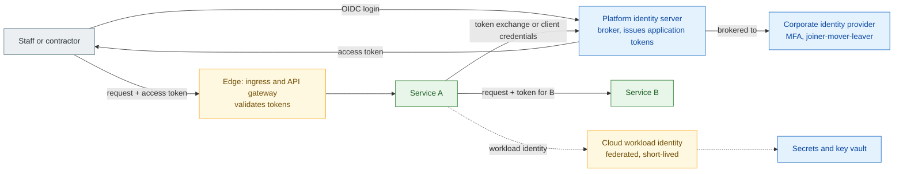
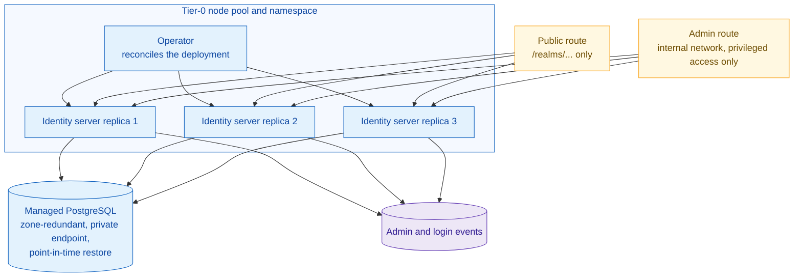
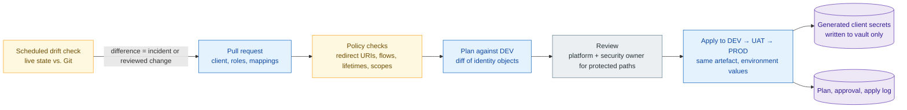
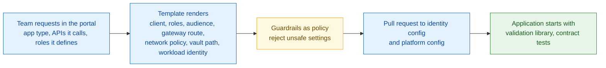

# Statutory Health Insurer: Identity Layer of an Internal Developer Platform

> A vendor-neutral case architecture for the **identity layer that a platform team offers to every application** on its internal developer platform: who issues which token to whom, where tokens are checked, how services call each other without a stored password, and how the identity server's own configuration is changed, reviewed and promoted like code.
> The applications are ordinary. The case is about the identity server as a shared platform service, its configuration and its blast radius, which is where platform designs are often strong on clusters and pipelines and weak on authentication and authorisation. Product names appear only as examples and in the realisation table.

## Contents

- [Business](#business)
- [What the Regulatory Frame Changes Compared with an ISO 27001 and GDPR Baseline](#what-the-regulatory-frame-changes-compared-with-an-iso-27001-and-gdpr-baseline)
- [Architecture](#architecture)
  - [I1 Populations and sources of truth](#i1-populations-and-sources-of-truth)
  - [I2 Identity planes](#i2-identity-planes)
  - [I3 The identity server as a tier-0 platform service](#i3-the-identity-server-as-a-tier-0-platform-service)
  - [I4 Token design](#i4-token-design)
  - [I5 Token validation at the edge and in every service](#i5-token-validation-at-the-edge-and-in-every-service)
  - [I6 Service-to-service calls](#i6-service-to-service-calls)
  - [I7 Identity configuration as code](#i7-identity-configuration-as-code)
  - [I8 Workload access to secrets and keys](#i8-workload-access-to-secrets-and-keys)
  - [I9 The golden path: onboarding an application](#i9-the-golden-path-onboarding-an-application)
  - [I10 Audit, detection and recovery](#i10-audit-detection-and-recovery)
- [Scaling](#scaling)
- [Resilience and Recovery of the Identity Layer](#resilience-and-recovery-of-the-identity-layer)
- [Key Decisions](#key-decisions)
- [Quality Attribute Scenarios and How to Measure Them](#quality-attribute-scenarios-and-how-to-measure-them)
- [Control Mapping](#control-mapping)
- [Failures](#failures)
- [Lessons Learned](#lessons-learned)
- [Non-normative Realisation Examples](#non-normative-realisation-examples)
- [Further Reading](#further-reading)

> **Teaching material, not legal advice.** The regulatory statements reflect the texts as of November 2026, as cited in each row; the B3S-GKV/PV statements were checked against the full text of version 1.4 (20 January 2025). Check the current official texts before relying on them in an audit, a contract or a procurement.

Companion documents: [Reviewing an identity layer against this case](review-checklist.md) and the hands-on [Identity Platform Lab](../../labs/identity-platform/README.md), which runs this architecture with open-source components: Keycloak with its operator, CloudNativePG and realms as code in Terraform, on a local kind cluster. For how pipelines authenticate to a cloud without secrets, see the [Charity Website case](../charity-site-azure-container-apps/README.md); for the gate that decides whether a change may be merged, the [Telehealth case](../telehealth-security-gates/README.md); for promotion from DEV to PROD with separation of duties, the [Insurance Claims Portal case](../insurance-claims-delivery/README.md).

---

## Business

**The operator** is a fictitious statutory health insurer (a *gesetzliche Krankenkasse*) in Germany with several million insured persons and about 9,000 staff. It is a public-law body. Insured persons use its app and website; staff in branches and back offices use internal applications for membership, contributions, benefits and case management. The core insurance system is run by an external IT service provider. New applications and APIs are built by internal agile teams and by contracted development partners.

**The platform.** A platform team of eight runs an internal developer platform on a managed Kubernetes service in a public cloud: cluster baseline, delivery pipelines, GitOps, observability and a self-service portal. The services were recently moved into a new cloud tenant with a security-first baseline. A security engineer sets security requirements and reviews designs; a DevOps engineer with security knowledge turns them into platform capabilities. This case is written from that DevOps engineer's seat.

**How identity works today.** Each team has solved authentication on its own. Two applications validate tokens from the corporate identity provider directly, one uses a shared technical user with a password in a pipeline variable, and a partner-built API trusts a header set by the ingress. An open-source identity server was installed on the cluster as a proof of concept: one replica, an embedded database, its configuration clicked together in the admin console, the admin console reachable from the internet.

**What the business wants.** One identity layer that every application on the platform uses in the same way; no long-lived passwords for services; changes to identity configuration that are reviewed and traceable like any other change; an identity layer that does not become the single point of failure for every service; and evidence for auditors and the supervisory authority that access to social and health data is controlled.

This business fixes the regulatory frame. Every row was checked against the legal text or the standard itself; the [next section](#what-the-regulatory-frame-changes-compared-with-an-iso-27001-and-gdpr-baseline) sets out what each one adds to an ISO 27001 and GDPR baseline.

| Regime | Why it applies | What it forces on the identity layer |
|---|---|---|
| § 393 SGB V (cloud use in health care) | Statutory health and care insurers and their processors may process social and health data by cloud computing only if the conditions of paragraphs 2 to 4 are met | Processing only in Germany, the EU, an equivalent state or an adequacy country, by a processing body with an establishment in Germany; a current **C5 Type 2 attestation** of the processing body against the C5 basic criteria; and the **corresponding customer criteria** from the attestation report implemented by the customer |
| C5-Gleichwertigkeitsverordnung (C5GleichwV) | Issued under § 393(4) SGB V, in force retroactively from 1 July 2024 | An ISO/IEC 27001 certificate (also on the basis of IT-Grundschutz) or a CSA CCM 4.0 attestation counts only together with a documented gap analysis against the C5 basic criteria, a 12-month measures plan and documented steps towards a C5 attestation |
| § 392 SGB V and the branch standard **B3S-GKV/PV** | Insurers must protect their IT according to the state of the art, and meet this duty "in particular" by applying the branch standard whose suitability the BSI confirms (§ 392(1), (3)); version 1.4 was confirmed on 9 April 2025. An insurer that operates a critical facility is exempt from § 392(1) because §§ 30, 31 and 39 BSIG already bind it (§ 392(5)), and uses the same branch standard to meet those duties. § 392(6) applies to every insurer: IT service providers must be bound to the branch standard by contract | ISO 27001 clauses 4 to 10 plus minimum Annex A controls per topic, deviations only documented and justified; systems for attack detection; awareness; contractual obligations for IT service providers; risk acceptance only as a justified exception, and measures not implemented approved by top management; technical tests such as penetration tests and emergency exercises **should** be held yearly |
| BSI Act (BSIG) as amended by the NIS2 Implementation Act, and BSI-KritisV | The administration and payment system of statutory health and care insurance is a critical facility from **500,000 insured persons** (BSI-KritisV Annex 9, No. 1.1.1); operators of critical facilities are essential entities (§ 28(1) No. 1 BSIG) | Risk-management measures including access control and **multi-factor or continuous authentication** (§ 30(2) Nos. 9 and 10 BSIG), stricter proportionality and mandatory **systems for attack detection** (§ 31 BSIG), incident reporting (§ 32 BSIG), evidence to the BSI every three years (§ 39 BSIG) |
| Social data protection: § 35 SGB I, §§ 67 ff. and § 80 SGB X, § 85(3b) SGB IV, § 197b SGB V | The insurer is a benefit provider bound by social secrecy; cloud and IT services are processing on its behalf | Social data accessible only to authorised persons, and staff's own social data shielded from people who decide on personnel matters; prior notification of the supervisory authority before awarding processing on behalf, and before procurements that fundamentally change the IT system concept; location limits; no outsourcing of essential tasks |
| GDPR | Health data are special categories (Art. 9) | Data protection by design (Art. 25), security of processing (Art. 32), data minimisation (Art. 5(1)(c)), DPIA (Art. 35) — including what is placed in tokens and logs |
| ISO/IEC 27001:2022 (required by the B3S) | Basis of the operator's ISMS | Annex A 5.15 to 5.18, 8.2, 8.3, 8.5 and 8.18 are minimum controls for identity and access in B3S-GKV/PV section 4.13 |

This case assumes the operator is above the KRITIS threshold. It reflects the legal texts as of November 2026; check the current versions before using it in an audit.

**Out of scope.** Digital identities of insured persons (the *GesundheitsID* under § 291(8) SGB V, issued through a sectoral identity provider approved by gematik) and the ePA app of the insurer (the *Frontend des Versicherten*, which needs gematik approval with security assessments); identity proofing; the corporate identity provider's own configuration; and the business authorisation model of each application beyond what the platform enforces.

---

## What the Regulatory Frame Changes Compared with an ISO 27001 and GDPR Baseline

A platform team that has built identity layers for banks or ordinary enterprises usually works to a baseline of **ISO/IEC 27001** (risk-based selection of Annex A controls, documented in a statement of applicability), the cloud guidance of **ISO/IEC 27017**, the processor guidance of **ISO/IEC 27018** and the **GDPR** (risk-appropriate measures under Art. 32, processor contracts under Art. 28, transfers under Chapter V). ISO/IEC 27018 itself points out that controllers can be subject to additional obligations that it does not cover. For a statutory health insurer those additional obligations are substantial. The table lists, topic by topic, where the frame of this case is **stricter or different**, and where the architecture responds.

Legend: **Δ stricter** = a baseline obligation is tightened; **Δ new** = an obligation the baseline does not have.

| # | Topic | Baseline (ISO 27001/27017/27018, GDPR) | Stricter or different in this frame | Source | Response in this architecture |
|---|---|---|---|---|---|
| 1 | Permission to use the cloud at all | Lawful with a processor contract (GDPR Art. 28) and risk-appropriate measures (Art. 32) | **Δ new.** Cloud processing of social and health data is permitted only if location, attestation and customer-criteria conditions are all met | § 393(1)–(3) SGB V | Every managed service the identity layer depends on is checked against the provider's attestation scope (I3) |
| 2 | Kind of evidence from the cloud provider | ISO 27001 certificate, possibly with 27017/27018: conformity of the provider's ISMS, sampled in audits | **Δ stricter.** A **C5 Type 2 attestation** since 1 July 2025: an auditor's report on whether each C5 basic criterion was designed, implemented **and operated effectively over a period**. Systems first placed on the market after 30 June 2025 may use Type 1 for 18 months. An ISO certificate counts only under the C5GleichwV conditions | § 393(3) No. 2, (4) SGB V; C5GleichwV § 1 | Ask for the C5 report and its system description, not the ISO certificate (I3). C5:2026 replaces C5:2020; its requirements apply to audit periods starting on or after 1 June 2027 and expand key management and transparency on locations, applicable law and official requests |
| 3 | Customer side of shared responsibility | Contractual and informal; ISO 27017 describes shared roles | **Δ new.** The customer **must implement** the corresponding customer criteria listed in the attestation report; it is a legal condition of lawful processing | § 393(3) No. 3 SGB V | A register of corresponding customer criteria, each with an owner and evidence, maintained like configuration (I7, I10) |
| 4 | Where data may be processed | Any location with a transfer mechanism (adequacy, standard contractual clauses, binding corporate rules) | **Δ stricter.** Only Germany, EU, EEA and Switzerland (equivalent under § 35(7) SGB I) or adequacy countries; **standard contractual clauses are not enough**. The processing body needs an establishment in Germany. The physical place of processing counts (BAS guide, section 2.10); backups and remote support access are processing too | § 393(2) SGB V; § 80(2) SGB X; § 35(7) SGB I; BAS guide 2.10 | Region pinning for identity server, database, **backups, logs and the security event pipeline**; no follow-the-sun support access outside the permitted area (I3, I10) |
| 5 | Telling the authority in advance | Only prior consultation after a DPIA with high residual risk (GDPR Art. 36) | **Δ new.** The supervisory authority must be notified **before** awarding processing on behalf (processor, its measures, data types, data subjects, task, subcontractors), and before procurements that fundamentally change the IT system concept | § 80(1) SGB X; § 85(3b) SGB IV | A new managed service in the identity layer (for example a SaaS log platform) has a regulatory lead time; the platform's change process includes the notification step (I7) |
| 6 | Using private processors | Allowed with an Art. 28 contract | **Δ stricter.** A non-public processor only if otherwise operations would be disrupted or the work is substantially cheaper; essential tasks for the care of insured persons may not be outsourced | § 80(3) SGB X; § 197b SGB V | The choice between a self-hosted identity server and an identity service run by a provider is documented with this test (decision D1) |
| 7 | Who may see social data | Need-to-know, chosen by risk (Annex A 5.15, 5.18) | **Δ stricter.** Social secrecy: social data accessible only to authorised persons. **Staff's own social data must not be accessible to people who make or influence personnel decisions** — the insurer's employees are often insured with it | § 35(1) SGB I | Group and role mapping from the source of truth (I1); a "staff member" attribute the services use to apply the rule in object-level authorisation (I5) |
| 8 | Which controls are mandatory | Chosen by risk; Annex A controls can be excluded with a justification | **Δ stricter.** ISO 27001 alone is stated to be insufficient; clauses 4 to 10 apply in full and the B3S names **minimum Annex A controls** per topic. Deviations remain possible but must be documented and justified against that list, not against a free choice. Risk treatment means avoid or reduce; acceptance only as a justified exception, and a measure not implemented needs documented approval by top management; insurance does not count as treatment. Yearly technical tests such as penetration tests, with changing focus, and yearly emergency exercises with service providers are **should** requirements | § 392(3) SGB V; B3S-GKV/PV v1.4 sections 3.2, 4.1, 4.3.4, 4.4, 4.10 | The identity layer is in the ISMS scope; "accepting" an exposed admin console or a missing restore test is not available as an option (I3, I10) |
| 9 | Multi-factor authentication | Secure authentication (Annex A 8.5); MFA by risk | **Δ stricter.** MFA or continuous authentication is a **named minimum measure** for essential and important entities; the C5 basic criteria require MFA for privileged users and for access to production at the provider; the BAS guide treats two-factor authentication as the minimum for individual, non-public data | § 30(2) No. 10 BSIG; C5:2020 IDM-01, IDM-09; BAS guide on electronic communication, section 4.2.3.2 | MFA at the workforce identity provider for every brokered login and for every administrator (I2) |
| 10 | Privileged access | Restrict and manage privileged rights (Annex A 8.2) | **Δ stricter.** Separate administrator accounts, reviewed privileged and emergency access (B3S); at the provider, privileged rights personalised, time-limited, logged and monitored, and revoked within 48 hours of a role change (C5 basic criteria) | B3S-GKV/PV v1.4 section 4.13; C5:2020 IDM-04, IDM-06 | Admin route internal only, just-in-time elevation, sealed break-glass, the 48-hour rule adopted as an internal target (I3, I10) |
| 11 | Logging and detection | Logging and monitoring by risk (Annex A 8.15, 8.16) | **Δ new.** **Systems for attack detection** — continuous, automated collection and analysis of operational data — are mandatory for operators of critical facilities (§ 31(2) BSIG), and § 392(4) No. 2 SGB V obliges the insurers to work towards the branch standard containing them, which version 1.4 does. The B3S part on attack detection sets individually numbered requirements for planning, detection and response, including a logging policy, central storage, correlation, synchronised time, network intrusion detection at boundaries and isolation of affected components | § 392(4) No. 2 SGB V; § 31(2) BSIG; B3S-GKV/PV v1.4 section 4.16 | Identity events are a mandatory input to attack detection, under a log contract and with synchronised clocks (I10) |
| 12 | Reporting incidents | Personal data breaches to the data protection authority within 72 hours (GDPR Art. 33) | **Δ new.** Significant incidents to the BSI: early warning within 24 hours, notification within 72 hours, final report within one month; a contact point reachable at all times | § 32 BSIG (NIS2 Art. 23); B3S-GKV/PV v1.4 section 4.9 | Signing key compromise and identity server compromise playbooks include the BSI reporting step (I10) |
| 13 | Evidence to the regulator | Certification is voluntary | **Δ new.** Implementation of the measures proved to the BSI every three years by audits, inspections or certifications | § 39 BSIG; B3S-GKV/PV v1.4 chapter 5 | Evidence is produced by the pipeline and the identity layer as a by-product (I7, I10) |
| 14 | Obligations of IT service providers | Processor contract (GDPR Art. 28) | **Δ stricter.** IT service providers must be **contractually bound to the branch standard**; the B3S lists attack detection, SLA-based availability, no risk acceptance or transfer while risks can still be reduced, immediate incident notice, continuity plans, inspection rights and the same duties for subcontractors | § 392(6) SGB V; B3S-GKV/PV v1.4 sections 1.2, 4.12 | Contracts for the managed database, the log platform and any identity service contain these clauses (I3) |
| 15 | Control of encryption keys | Provider-managed keys acceptable by risk | **Δ stricter.** C5 basic criterion: private keys used for encryption are known **exclusively to the cloud customer**, exceptions only by a regulated, contractually agreed procedure; the BAS guide recommends encrypted storage with keys held only by the controller | C5:2020 CRY-03; BAS guide, section 7.5 | Customer-managed keys for the identity database, the vault and backups, held in a key vault or HSM under the insurer's control (I8) |
| 16 | Exit | Data return or deletion at contract end (GDPR Art. 28(3)(g)) | **Δ stricter.** Return of data and functionality and complete deletion at the provider must be ensured; the exit strategy **should** be agreed at contract signing (B3S); the BAS guide adds change of provider or return to own infrastructure | B3S-GKV/PV v1.4 section 4.17; BAS guide, section 7.5 | Identity configuration as code and a tested database export make the identity layer movable (I7, I10) |
| 17 | Identities of insured persons | Ordinary customer identity, risk-based | **Δ new.** The insurer must offer insured persons a digital identity for the health care system on request; since 1 January 2026 it serves for authentication like the electronic health card. It is provided through a **sectoral identity provider approved by gematik**; contact with insured persons follows the GKV-Spitzenverband guideline on protecting social data, with graded procedures | § 291(8) SGB V; § 217f(4b) SGB V | Out of scope here, and deliberately a **separate trust boundary**: the platform identity server does not act as the insured persons' identity provider for the telematics infrastructure (D8) |

**Two things are easy to miss.** First, § 393(5) SGB V treats the insurer's own technical and organisational measures as appropriate if they meet the B3S-GKV/PV: the branch standard is how the insurer satisfies the "state of the art" condition, while the C5 attestation covers the provider. Second, § 393(6) SGB V still refers to "§ 8a of the BSI Act", a provision that the NIS2 Implementation Act replaced with §§ 30, 31 and 39 BSIG, which § 392(5) SGB V already cites. Read such references with the renumbering in mind. The B3S-GKV/PV v1.4 itself predates the renumbering: it still cites § 8a and § 8b BSIG and places the administration and payment system in BSI-KritisV Annex 6 No. 1.27, which is now Annex 9 No. 1.1.1, and it refers to C5:2020.

---

## Architecture

The identity layer is described in ten views. Each view says what it constrains, so that a design, a proof of concept or a running platform can be reviewed view by view.

Colour key: **blue** = platform component, **amber** = control or trust decision, **purple** = evidence, **green** = application runtime, **grey** = person or external party.

### I1 Populations and sources of truth

Four populations need identities. Each has **one** source of truth; the platform's identity server never becomes a second one.

| Population | Example | Source of truth | How it reaches an application |
|---|---|---|---|
| Staff | Case worker opening a benefits file | Corporate identity provider (HR-driven joiner, mover, leaver) | Brokered login through the platform identity server |
| Contractor staff | Developer of a development partner, support engineer | Corporate identity provider (guest or external account with end date) | Same as staff, with narrower roles and an expiry |
| Services | Benefits API calling the documents API | Platform: service registration in identity configuration (I7) | Client credentials or token exchange (I6) |
| Workloads and pipelines | Pod reading a database password; deployment job | Cloud workload identity | Federation to the cloud, no stored secret (I8, Charity case) |

**Rules:**

- **No local human users** in the platform identity server except sealed break-glass accounts (I10). A local user is an account that the leaver process does not remove.
- **Roles that grant access to social data come from the source of truth**, for example group membership in the corporate identity provider, mapped in reviewed configuration. They are not assigned by hand in the identity server's admin console.
- **Every identity has an owner and an end.** Contractor accounts expire; service registrations have an owning team; unused clients are found and removed (I10).
- **Δ Social secrecy for staff (delta 7).** Many staff are insured with the operator. The source of truth supplies a staff attribute and the organisational unit; services use it to keep staff members' own social data away from people who decide on personnel matters (§ 35(1) SGB I).

### I2 Identity planes

Three planes, three issuers:

1. **Workforce plane.** The corporate identity provider authenticates people with a second, phishing-resistant factor (**Δ delta 9**: MFA is a named minimum measure in § 30(2) No. 10 BSIG, not a risk-based option). It knows who someone is and which groups they belong to.
2. **Application plane.** The platform identity server issues tokens for applications on the platform. It brokers the login to the corporate identity provider, maps groups to application roles, and issues access tokens with an audience per API. Applications trust **only** this issuer.
3. **Workload plane.** The cloud's workload identity proves which pod or pipeline is calling the cloud's own services, such as the key vault and the managed database. No application token is used for that, and no cloud credential is used for application calls.

**Insured persons are not on this diagram.** Their digital identity for the health care system comes from a gematik-approved sectoral identity provider (delta 17); the platform identity server is not that provider.

**Why a platform identity server at all**, when the corporate identity provider can issue tokens itself: one issuer and one token format for all applications regardless of who built them; audience, scope and lifetime policy enforced in one place; service registrations that application teams can request through the platform without administrator rights in the corporate directory; and partners' applications that never need to be registered in the corporate tenant. The cost is one more tier-0 system to run (I3) and one more place where a configuration error affects everyone (I7). Decision D1 records this.

### I3 The identity server as a tier-0 platform service

If the identity server is down, no user can log in to any application and no service can obtain a new token. If it is compromised, an attacker can issue tokens for every API. It is therefore treated as **tier 0**: the most protected tier of the platform, on a par with the cluster control plane and the GitOps controller.

**Rules a reviewer can test:**

- **At least three replicas across zones**, with a pod disruption budget and anti-affinity, behind a health-checked service. Sessions and caches are shared between replicas; a rolling restart must not log users out.
- **External managed database**, never an embedded or in-cluster test database. Zone redundancy, point-in-time restore and a tested restore procedure (QS6). The database credential comes from the vault through workload identity (I8).
- **Two routes.** Only the public endpoints that applications and browsers need (`/realms/...`, discovery and key endpoints) are exposed at the edge. The admin console and admin API are reachable only from the internal network and only for privileged roles.
- **Dedicated tier-0 node pool and namespace** with network policies: inbound only from the edge and from platform namespaces that need token endpoints; outbound only to the database, the corporate identity provider, the vault and the log pipeline.
- **The operator and the identity server are pinned to versions** and upgraded through the same reviewed path as every other change. The identity server is a frequently patched internet-facing product; a security release has a target time to production (QS7).
- **Δ Everything the identity layer uses is inside the cloud provider's C5 Type 2 attestation scope** (deltas 1 and 2). Check service by service in the report's system description; do not assume a service is covered because the provider is.
- **Δ Region and location (delta 4).** Identity server, database, backups, the log pipeline and the attack detection platform run in permitted locations, and the processing body has an establishment in Germany. Support access from outside the permitted area is excluded by contract and by technical controls.
- **Δ Customer-managed keys (delta 15).** The identity database, its backups and the vault are encrypted with keys under the insurer's control.

### I4 Token design

The token is the contract between the identity layer and every application. Its design decides how much damage a stolen token can do and how much personal data travels with every request.

| Property | Rule | Why |
|---|---|---|
| Format | Signed JWT access tokens following the JWT profile for access tokens (RFC 9068) | Every service can validate locally with the published keys |
| Audience | One audience per API; a client requests the API it needs (resource indicators, RFC 8707, or client scope per API) | A token for the documents API is rejected by the benefits API |
| Lifetime | Access token 5 minutes; refresh token rotated on each use and bound to the session; session idle and maximum times set per application class | A stolen access token expires quickly; a replayed refresh token is detected |
| Roles and scopes | Only the roles for the token's audience; coarse-grained roles in the token, fine-grained decisions in the service | Small tokens, least privilege, no "all roles of the user" |
| Personal data | Subject identifier and the minimum claims the API needs. **No insurance numbers, health information or full names** in access tokens | Tokens are logged, cached and copied more often than anyone intends (GDPR Art. 5(1)(c), 25) |
| Signing | Asymmetric algorithm on an allowlist; keys rotated on a schedule with overlap, published with key IDs | Verifiers never need a shared secret; rotation does not break validation (QS4) |
| Flows | Authorization code with PKCE for browsers and apps; client credentials or token exchange for services; **no implicit flow, no password grant** | Follows the OAuth 2.0 Security Best Current Practice (RFC 9700) |

### I5 Token validation at the edge and in every service

The edge validates every token, and so does every service. A service that trusts "the gateway has checked it" accepts any request that reaches it by another path: a misrouted internal call, a debug port, a compromised neighbour pod.

| Check | Edge | Service | Negative test that must fail |
|---|---|---|---|
| Signature with a key from the issuer's published key set | ✓ | ✓ | Token signed with a different key |
| Algorithm from the allowlist; `none` and symmetric algorithms rejected | ✓ | ✓ | Token with `alg: none`; token signed with HMAC using the public key |
| Issuer equals the platform issuer exactly | ✓ | ✓ | Valid token from a test realm or another issuer |
| Audience contains this API | route-level | ✓ | Valid token for another API |
| Expiry and not-before, with clock skew at most 60 seconds | ✓ | ✓ | Expired token; token valid only in the future |
| Required scope or role for the operation | coarse | ✓ | Valid token without the role |
| Object-level authorisation (this user may see this case) | — | ✓ | Valid token, same role, someone else's object |

**Rules:**

- **Validation code is a platform library or a sidecar, not hand-written per team.** The golden path (I9) supplies it; the negative tests above run in every service's pipeline as contract tests.
- **Key sets are cached with a refresh on unknown key ID**, so that key rotation does not cause an outage and an unknown key is not trusted blindly.
- **Headers set by the edge are not identity.** A service never trusts a user name or role passed in a plain header.
- **Object-level authorisation stays in the service.** The identity layer says who is calling and with which roles; only the service knows whether this case belongs to this branch. This is the highest-priority risk and is tested by authorisation tests, as in the [Telehealth case](../telehealth-security-gates/README.md#t1-risk-to-control-mapping).

### I6 Service-to-service calls

| Situation | Mechanism | Token says | Use when |
|---|---|---|---|
| Service acts **on behalf of a user** (benefits API fetches that user's documents) | Token exchange (RFC 8693): the incoming user token is exchanged for a token with the downstream audience | User as subject, calling service as actor, downstream audience | The downstream service must apply the user's permissions |
| Service acts **as itself** (nightly job reconciles records) | Client credentials | Service as subject, downstream audience, service roles | No user is involved |
| Service calls a **cloud service** (vault, managed database) | Cloud workload identity (I8) | Cloud credential, not an application token | Never use an application token here |

**Rules:**

- **Never forward the user's token unchanged** to another API. Its audience is wrong, and forwarding turns every service into a confused deputy that can call anything the user could.
- **Client secrets are a last resort.** Prefer clients that authenticate with a signed assertion or with a federated workload credential where the identity server supports it. Where a client secret is unavoidable, it is generated by the configuration pipeline, written only to the vault and rotated (I7, I8). It is never in Git, in a pipeline variable or in an image.
- **Exchange is restricted by policy.** Which client may exchange tokens for which audience is part of the reviewed configuration; a client cannot exchange into any audience it likes.

### I7 Identity configuration as code

Realms, clients, roles, group-to-role mappings, client scopes, token lifetimes, identity provider links and authentication flows are **configuration**. They decide who can access social data. They are changed like infrastructure: in Git, reviewed, tested, promoted and checked for drift.

**Rules:**

- **Use a tool that reconciles changes, not one that only imports.** An identity server operator's realm import typically creates a realm once and does not update or delete it afterwards; a later change to the import file silently does nothing. Ongoing configuration needs a declarative tool that plans and applies differences, such as an infrastructure-as-code provider for the identity server or a dedicated configuration CLI.
- **One realm per trust boundary, not per team.** Teams get clients and roles inside a realm through the golden path (I9). A new realm is a platform decision.
- **Same configuration, different values per environment.** Redirect URIs and secrets differ between DEV, UAT and PROD; structure, roles and policies do not. Promotion follows the [Insurance Claims Portal case](../insurance-claims-delivery/README.md): the configuration change that runs in PROD is the one that was tested in UAT.
- **Protected paths.** Changes to authentication flows, identity provider links, token lifetimes, realm-wide roles and the policy itself require approval by the security owner in addition to the platform reviewer, and the policy is taken from the target branch, not from the pull request ([Telehealth case, gate integrity](../telehealth-security-gates/README.md#t7-gate-integrity)).
- **Δ Customer criteria and notifications are part of the change process (deltas 3 and 5).** A change that adds a managed service checks the provider's corresponding customer criteria, adds them to the register with an owner, and triggers the notification to the supervisory authority before the contract is awarded.
- **The admin console is read-only in practice.** Changes made by hand are detected by the drift check and either reverted or turned into a reviewed change. Emergency changes by hand are allowed only through break-glass and reviewed afterwards.

### I8 Workload access to secrets and keys

| Secret or key | Who needs it | How it is obtained | Never |
|---|---|---|---|
| Identity server database credential | Identity server pods | Workload identity → vault, synchronised into the pod at start; or passwordless database authentication with the workload identity | In a values file, a pipeline variable or an image |
| Identity server signing keys | Identity server | Generated and stored by the identity server, encrypted at rest; key rotation scheduled (I4). Where supported, keys held in a managed HSM | Exported to developers' machines |
| Client secrets of confidential clients | The service that owns the client | Written by the configuration pipeline to the service's vault path; read through the service's workload identity | Shown in pull requests or logs |
| Application secrets (third-party API keys) | The service | Workload identity → vault | Shared between services |
| Pipeline access to the cloud | Deployment jobs | OIDC federation from the CI platform, subject bound to environment ([Charity case](../charity-site-azure-container-apps/README.md#a4-workload-identity-federation)) | Stored service principal password |

**Δ Key control (delta 15).** Encryption keys for the identity database, backups and the vault are customer-managed; the provider must not be able to decrypt without the insurer's key, and exceptions follow a documented procedure.

**Rules:** one workload identity per service and environment; vault access per path, not per vault; no human has standing read access to production secrets; and every secret has a rotation method that has been run at least once (QS5).

### I9 The golden path: onboarding an application

An application team should get a correct identity setup **by asking the platform**, not by reading the identity server's manual.

**Guardrails enforced as policy, not as documentation:**

- Redirect URIs are exact, HTTPS and on an approved domain; no wildcards.
- Public clients (browser, mobile) use authorization code with PKCE and have no secret; implicit flow and password grant are disabled.
- Access token lifetime within the platform's limit; refresh token rotation on.
- A client may request only audiences it was granted; no client with access to all APIs.
- Every client has an owning team and a review date.
- Every service template includes the validation library or sidecar and the negative tests from I5.

**Division of work.** The security engineer owns the policy and approves exceptions; the platform team owns the templates, the pipeline and the identity server's operation; application teams own their roles and their object-level authorisation. Exceptions to a guardrail are recorded with owner, approver and expiry, as in the [Telehealth case](../telehealth-security-gates/README.md#t5-severity-policy-and-risk-acceptance).

### I10 Audit, detection and recovery

**Δ Attack detection is mandatory, not a choice (delta 11).** The identity layer's events are a required input to the insurer's systems for attack detection (§ 31(2) BSIG for operators of critical facilities; B3S-GKV/PV section 4.16, which § 392(4) No. 2 SGB V asks the branch to include); clocks are synchronised, events are stored centrally and correlated, and the platform's network boundary is covered by intrusion detection (B3S-GKV/PV section 4.16).

**Events to keep:** admin events (who changed which client, role, flow or provider link, with before and after), login events (success, failure, MFA result, brokered provider), token exchange events, and configuration pipeline runs. They go to the central log pipeline under a log contract that **excludes tokens, authorisation codes, client secrets and personal data beyond the pseudonymous subject**.

**Detections as code, tested with a normal and an attack log:**

| Detection | Signal |
|---|---|
| Configuration changed outside the pipeline | Admin event from a user who is not the pipeline identity, outside a break-glass session |
| Privilege added | Realm-wide or admin role granted; new client scope with broad audience |
| Unsafe client | New or changed client with wildcard redirect URI, implicit flow or disabled PKCE (policy should have prevented it) |
| Credential attack | Many failed logins across many subjects from one source, or many sources against one subject |
| Token misuse | Token exchange into an audience not in policy; refresh token reuse |
| Unused access | Clients without token requests for 90 days; contractor accounts past their end date |

**Δ Reporting (delta 12).** A compromised signing key or administrator account is a candidate significant incident: the playbook contains the BSI early warning within 24 hours and the contact point that is reachable at all times.

**Break-glass.** Two sealed local administrator accounts with strong, separately stored credentials, alarmed on use, tested quarterly. Every break-glass change is reconciled into Git afterwards.

**Recovery.** The identity server's state is the database plus its key material. Recovery means restoring the database to a point in time, restoring or re-establishing signing keys (with the consequence that tokens signed by lost keys become invalid), and re-applying configuration from Git. Recovery is rehearsed, timed and recorded (QS6).

---

## Scaling

- **More applications.** Onboarding cost must stay constant: one portal request, one generated pull request. If onboarding needs a meeting with the security engineer, the golden path is missing a template or a guardrail.
- **More traffic.** Token validation is local in each service and does not call the identity server. Load on the identity server comes from logins, refreshes and token exchanges. Short access tokens increase refresh traffic; measure it before shortening lifetimes further.
- **More realms.** Each realm multiplies configuration, monitoring and review. Add a realm only for a new trust boundary (for example, a separate population with different legal grounds), not for a new team.
- **More environments and regions.** One identity server per environment; production in at least three zones. A second region is a resilience decision with its own data-protection review, not a default.

---

## Resilience and Recovery of the Identity Layer

| Scenario | Effect | Planned path | How to test |
|---|---|---|---|
| One identity server replica fails | None visible; sessions continue | Pod disruption budget, three replicas across zones | Delete a pod during a load test |
| Database failover | Short login interruption; existing access tokens keep working | Zone-redundant managed database; connection retry | Forced failover in UAT |
| Corporate identity provider unavailable | New staff logins fail; existing sessions and service-to-service tokens continue | Documented degradation; break-glass for platform operators only | Disable the provider link in DEV |
| Signing key compromised | Attacker can mint tokens | Emergency key rotation; revoke old key; force re-login | Rotation drill in UAT, measure time to complete |
| Bad configuration change (for example, wrong redirect URI or removed role) | Login or access fails for one or many applications | Revert in Git, re-apply; drift check confirms state | Deliberate faulty change in DEV, measure time to restore |
| Identity server upgrade fails | Replicas do not start | Pinned versions, rehearsed upgrade in UAT, database backup before upgrade, roll back operator and image | Upgrade drill per minor version |
| Database lost | Total outage of the identity layer | Point-in-time restore, then re-apply configuration from Git | Restore drill twice a year (QS6) |
| Cloud provider loses its C5 attestation or a service drops out of scope | Processing of social data in that service is no longer permitted (§ 393 SGB V) | Exit plan agreed at contract signing; configuration as code and database export allow moving | Annual review of the attestation report; exit rehearsal for the identity database |

---

## Key Decisions

| ID | Decision | Options considered | Choice and reason | Consequence to manage |
|---|---|---|---|---|
| D1 | Who issues application tokens | Corporate identity provider directly vs. platform identity server brokering to it (self-hosted or as a provider service) | **Platform identity server as broker**: one issuer and token policy for all apps; partners not in the corporate tenant. A provider-run identity service would additionally need the § 80(3) SGB X justification, a C5 attestation and a notification | One more tier-0 system; must be run as such (I3) |
| D2 | Where tokens are validated | Edge only vs. edge and every service | **Edge and every service** | Validation library and contract tests in the golden path |
| D3 | How identity configuration changes | Admin console vs. operator import vs. declarative tool with plan and drift check | **Declarative tool with plan, review, promotion and drift check** | Learning curve; break-glass path for emergencies |
| D4 | Service-to-service on behalf of users | Forward user token vs. token exchange | **Token exchange** with policy per audience | Exchange policy is configuration that must be reviewed |
| D5 | Service authentication to the identity server | Client secret vs. signed assertion vs. federated workload credential | **Federated or assertion-based where supported**, client secret only from the vault with rotation | Depends on the identity server's capabilities; check per version |
| D6 | Personal data in tokens | Rich claims for convenience vs. minimal claims | **Minimal claims**; services fetch attributes they need from the system of record | More calls from services; data protection by design |
| D7 | Database for the identity server | In-cluster vs. managed | **Managed, zone-redundant, inside C5 scope** | Cost; dependency on the provider's attestation scope |
| D8 | Number of realms | Per team vs. per trust boundary | **Per trust boundary**; insured persons' identities for the telematics infrastructure stay outside the platform identity server | Teams share a realm; isolation by client, roles and audience |
| D9 | Encryption keys of the identity layer | Provider-managed vs. customer-managed | **Customer-managed** (C5 CRY-03, BAS guide 7.5) | Key lifecycle, rotation and recovery become the insurer's duty |

---

## Quality Attribute Scenarios and How to Measure Them

| ID | Quality attribute | Scenario | Response measure | Measurement rules |
|---|---|---|---|---|
| QS1 | Security | A token for API A, an expired token or a token with `alg: none` is sent to API B | Rejected by edge and by service in 100 % of cases | Negative contract tests in every service pipeline; one end-to-end run per release |
| QS2 | Traceability | Any change to a client, role, flow or provider link in PROD | Linked to a reviewed pull request, or detected as drift within 24 h | Compare admin events with pipeline runs daily |
| QS3 | Availability | One zone fails | Logins continue; error rate below agreed level | Zone failure drill in UAT, load test results |
| QS4 | Operability | Scheduled signing key rotation | No failed validation attributable to rotation | Validation error rate during and after rotation |
| QS5 | Secret hygiene | Inventory of service credentials | 0 long-lived secrets outside the vault; every vault secret with a rotation method run at least once | Secret scan of repositories and pipeline variables; vault inventory |
| QS6 | Recoverability | Identity database lost | Restored and configuration re-applied within the agreed recovery time | Timed restore drill twice a year, recorded |
| QS7 | Patch latency | Security release of the identity server | In production within the agreed time (for example, 7 days for critical) | Release date vs. production deployment date |
| QS9 | Regulatory conformity | A managed service is added to the identity layer | In C5 Type 2 scope, permitted location, customer criteria registered with owner, notification sent before award | Change records, register, notification copies |
| QS8 | Onboarding | A team onboards a new API with the golden path | Working, policy-compliant identity setup without a manual exception, within one working day | Portal request to first successful authenticated call |

---

## Control Mapping

| Control area | Control in this architecture | BSIG § 30(2) (NIS2 Art. 21(2)) | Health insurance law | B3S-GKV/PV v1.4 | ISO/IEC 27001:2022 Annex A | Evidence produced |
|---|---|---|---|---|---|---|
| Identity management | One source of truth per population, no local users, expiry for contractors (I1) | No. 9 (i) | § 35(1) SGB I | 4.13 | 5.16, 5.18 | Account inventory, leaver reconciliation |
| Authentication | Brokered login with MFA; secure flows only (I2, I4) | No. 10 (j) | — | 4.13 | 5.17, 8.5 | Flow configuration, login events |
| Access control | Audience per API, minimal roles, validation in every service, object-level checks incl. staff rule (I4, I5) | No. 9 (i) | § 35(1) SGB I | 4.13 | 5.15, 8.3 | Contract test reports |
| Privileged access | Admin route internal, separate admin accounts, break-glass sealed and alarmed (I3, I10) | No. 9 (i) | — | 4.13 | 8.2, 8.18 | Break-glass logs, network configuration |
| Configuration and change | Identity configuration as code with review, promotion, drift check; notification step (I7) | No. 5 (e) | § 80(1) SGB X, § 85(3b) SGB IV | 4.14 | 8.9, 8.32 | Pull requests, plans, apply logs, drift reports, notifications |
| Cryptography and keys | Asymmetric signing with rotation, customer-managed keys, secrets only in the vault (I4, I8) | No. 8 (h) | — | Tab. 8 | 8.24 | Key rotation records, key ownership records, vault inventory |
| Data minimisation | No insurance numbers or health data in tokens or logs (I4, I10) | — | GDPR Art. 5(1)(c), 25 | — | 8.11, 8.15 | Token samples, log contract checks |
| Attack detection | Identity events in the systems for attack detection, detections as code (I10) | No. 2 (b); § 31(2) BSIG | § 392(4) No. 2 SGB V | 4.16 | 8.15, 8.16 | Rule tests, alert records |
| Incident reporting | Playbooks with BSI reporting, 24/7 contact point (I10) | No. 2 (b); § 32 BSIG | — | 4.9 | 5.24–5.28 | Playbooks, exercise records |
| Cloud use and suppliers | C5 Type 2 scope check, location, customer criteria register, supplier clauses, exit plan (I3, I7) | No. 4 (d) | § 393 SGB V, § 80 SGB X, § 392(6) SGB V | 1.2, 4.12, 4.17 | 5.19–5.23 | Attestation coverage list, customer criteria register, contracts |

The NIS2 letters in brackets correspond to the numbered measures in § 30(2) BSIG. This table maps intent, not legal interpretation; check the official texts before using it in an audit.

---

## Failures

These failure modes recur in identity layers on internal platforms and in proofs of concept for them. Most pass a demonstration.

- **The import that never updates.** Realm configuration is kept in Git and applied through an operator's import resource. The first deployment works; every later change to the file is silently ignored, and the live realm drifts from Git while everyone believes it is managed as code.
- **Admin console on the internet.** The identity server is exposed through one route, including its admin interface, protected only by a password.
- **Proof-of-concept topology in production.** One replica, an embedded database, no backup, no restore test. The first node maintenance logs out every user; the first disk failure deletes every client.
- **Tokens without audience.** Every API accepts every token from the issuer. A token stolen from the least important application opens the most important one.
- **"The gateway checked it."** Services do not validate tokens and trust headers set by the edge. An internal path around the gateway bypasses all authentication.
- **The user's token forwarded downstream.** Services pass the incoming token on; every service can do everything the user can do anywhere.
- **Wildcard redirect URIs and implicit flow** left over from development, allowing authorization codes or tokens to be sent to attacker-controlled pages.
- **Client secrets in pipeline variables** that never rotate, shared by three services and known to everyone who ever had admin rights on the CI system.
- **Local users and hand-assigned roles** in the identity server, which the corporate leaver process never sees.
- **Health data in tokens.** Insurance numbers and full names in access tokens, which end up in gateway logs, browser storage and support tickets.
- **Key rotation as an outage.** Services cache the key set without refresh on unknown key ID; the first rotation breaks every API.
- **ISO certificate instead of C5 report.** The provider's ISO 27001 certificate is filed as proof for § 393 SGB V; nobody has read a C5 report, checked which services it covers or implemented its corresponding customer criteria.
- **Logs abroad.** Identity server and database are region-pinned, but the SaaS log platform and the provider's support process sit outside the permitted area.
- **Notification forgotten.** A new managed service is contracted without notifying the supervisory authority first.
- **Patching later.** The identity server stays on a version with known vulnerabilities because nobody owns its upgrades and the upgrade path was never rehearsed.

---

## Lessons Learned

- **Run the identity server as tier 0.** It is a shared dependency of every application and the most valuable target on the platform.
- **One source of truth per population.** Brokering, not copying, keeps the leaver process effective.
- **A token is valid for one audience, for minutes, with minimal content.** Every extra claim and every extra minute is risk.
- **Validate everywhere.** The edge filters; the service decides.
- **Identity configuration is code that grants access to social data.** It deserves the same review, promotion and drift detection as infrastructure, and a tool that reconciles rather than only imports.
- **In a statutory health insurer, the regulatory frame changes the architecture, not only the paperwork:** where logs live, who holds the keys, which evidence a provider must show, and which changes need notice in advance.
- **Make the safe path the easy path.** Guardrails as policy in the golden path scale; review meetings do not.

---

## Non-normative Realisation Examples

Illustrative, not a recommendation; check current capabilities, versions, permitted regions, and each managed service's inclusion in the provider's **C5 Type 2** attestation before relying on them (deltas 1, 2 and 4).

| Logical component | Microsoft Azure | AWS | Google Cloud |
|---|---|---|---|
| Managed Kubernetes | AKS | EKS | GKE |
| Corporate identity provider | Microsoft Entra ID | AWS IAM Identity Center with an external directory, or Entra ID | Cloud Identity, or Entra ID |
| Workload identity | Microsoft Entra Workload ID (federated credentials, managed identities) | EKS Pod Identity or IAM roles for service accounts | GKE Workload Identity Federation |
| Secrets and keys | Azure Key Vault, Azure Managed HSM | AWS Secrets Manager, AWS KMS, CloudHSM | Secret Manager, Cloud KMS, Cloud HSM |
| Managed PostgreSQL | Azure Database for PostgreSQL flexible server | Amazon RDS or Aurora PostgreSQL | Cloud SQL or AlloyDB for PostgreSQL |
| Edge and API gateway | Application Gateway for Containers, Azure API Management | AWS Load Balancer Controller with ALB, Amazon API Gateway | GKE Gateway, Apigee |
| Policy enforcement | Azure Policy for AKS (Gatekeeper) | OPA Gatekeeper or Kyverno | Policy Controller |

| Logical component | Open-source examples |
|---|---|
| Platform identity server | Keycloak (with the Keycloak Operator), ZITADEL, Ory Hydra with Kratos, authentik |
| Identity configuration as code | Terraform or OpenTofu provider for Keycloak, keycloak-config-cli |
| Secret synchronisation into pods | External Secrets Operator, Secrets Store CSI Driver |
| Token validation at the edge | Envoy JWT authentication filter, oauth2-proxy, gateway-native JWT validation |
| Policy as code for identity configuration | OPA/Conftest on the plan output, Checkov custom policies |
| GitOps controller | Argo CD, Flux |

**Keycloak note.** The Keycloak Operator's `KeycloakRealmImport` resource creates a realm if it does not exist; it does not overwrite an existing realm and does not apply later changes. Use it, if at all, for the initial bootstrap, and manage ongoing configuration with a reconciling tool (view I7).

---

## Further Reading

Legal texts and regulator guidance:

- [§ 393 SGB V, cloud use in health care](https://www.gesetze-im-internet.de/sgb_5/__393.html) and [C5-Gleichwertigkeitsverordnung](https://www.gesetze-im-internet.de/c5gleichwv/BJNR05B0A0025.html)
- [§ 392 SGB V, IT security of statutory health insurers](https://www.gesetze-im-internet.de/sgb_5/__392.html)
- [§ 80 SGB X, processing of social data on behalf](https://www.gesetze-im-internet.de/sgb_10/__80.html), [§ 35 SGB I, social secrecy](https://www.gesetze-im-internet.de/sgb_1/__35.html), [§ 85 SGB IV](https://www.gesetze-im-internet.de/sgb_4/__85.html), [§ 197b SGB V](https://www.gesetze-im-internet.de/sgb_5/__197b.html), [§ 291 SGB V](https://www.gesetze-im-internet.de/sgb_5/__291.html)
- [BSI-KritisV, Annex 9 (social insurance)](https://www.gesetze-im-internet.de/bsi-kritisv/anhang_9.html); BSI Act §§ 28, 30, 31, 32, 39 as amended by the NIS2 Implementation Act
- [B3S-GKV/PV version 1.4](https://www.gkv-datenaustausch.de/media/dokumente/sicherheitsstandard_b3s/B3S_GKV-PV_V.1.4_final.pdf) and the [publication page with the BSI suitability notice](https://www.gkv-datenaustausch.de/sicherheitsstandard_b3s/sicherheitsstandard_b3s.jsp)
- [Bundesamt für Soziale Sicherung, guide on electronic communication and digitalisation in social insurance (version 6.2.1)](https://www.bundesamtsozialesicherung.de/fileadmin/redaktion/Krankenversicherung/PDK2/PDK/20260511_Leitfaden_Elektronische_Kommunikation_Sozialversicherung.pdf)
- [BSI, Cloud Computing Compliance Criteria Catalogue (C5)](https://www.bsi.bund.de/EN/Themen/Unternehmen-und-Organisationen/Informationen-und-Empfehlungen/Empfehlungen-nach-Angriffszielen/Cloud-Computing/Kriterienkatalog-C5/kriterienkatalog-c5_node.html)
- [Directive (EU) 2022/2555 (NIS2)](https://eur-lex.europa.eu/eli/dir/2022/2555/oj)
- [ISO/IEC 27018:2025](https://www.iso.org/standard/88150.html)

Protocols and products:

- [RFC 9700, Best Current Practice for OAuth 2.0 Security](https://www.rfc-editor.org/rfc/rfc9700)
- [RFC 9068, JWT Profile for OAuth 2.0 Access Tokens](https://www.rfc-editor.org/rfc/rfc9068)
- [RFC 8693, OAuth 2.0 Token Exchange](https://www.rfc-editor.org/rfc/rfc8693)
- [RFC 8707, Resource Indicators for OAuth 2.0](https://www.rfc-editor.org/rfc/rfc8707)
- [RFC 8725, JSON Web Token Best Current Practices](https://www.rfc-editor.org/rfc/rfc8725)
- [OpenID Connect Core 1.0](https://openid.net/specs/openid-connect-core-1_0.html)
- [NIST SP 800-207, Zero Trust Architecture](https://csrc.nist.gov/pubs/sp/800/207/final)
- [Keycloak Operator: automating a realm import](https://www.keycloak.org/operator/realm-import)

In this repository: [Platform engineering learning path](../../docs/12-platform-engineering.md), [Security learning path](../../docs/10-security.md), [Workload Platform Foundation reference architecture](../../architecture/reference-architectures/workload-platform-foundation.md), [Charity Website case: workload identity](../charity-site-azure-container-apps/README.md), [Telehealth case: security gates](../telehealth-security-gates/README.md), [Insurance Claims Portal case: release promotion](../insurance-claims-delivery/README.md)
