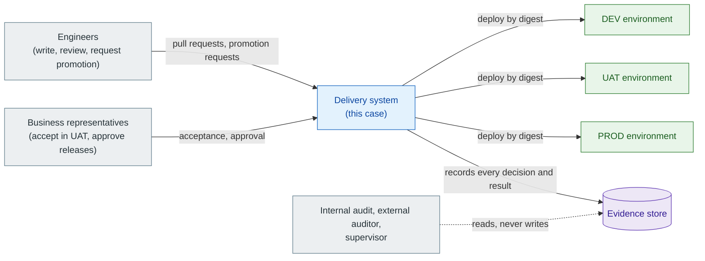
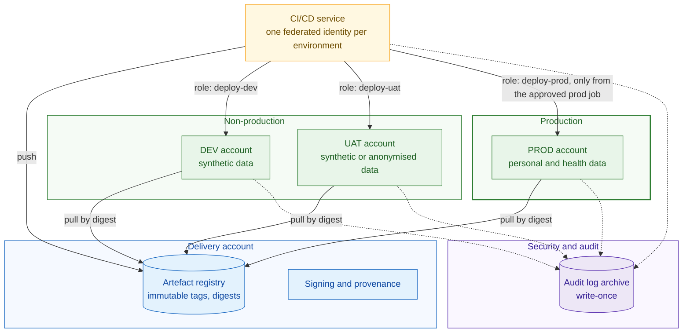
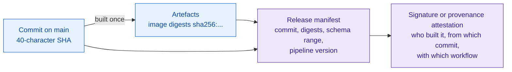
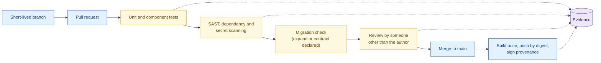
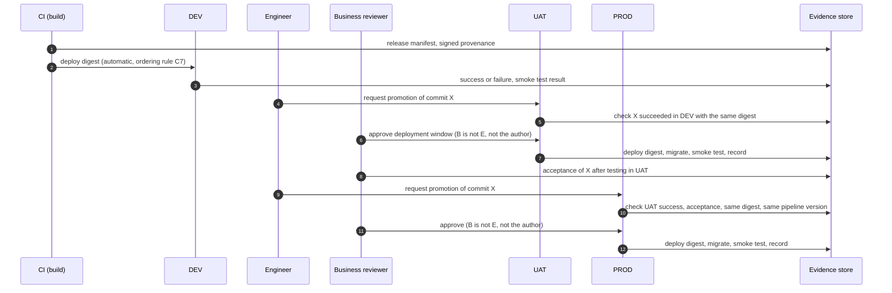
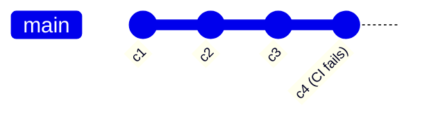
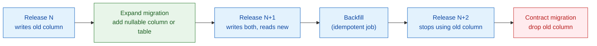
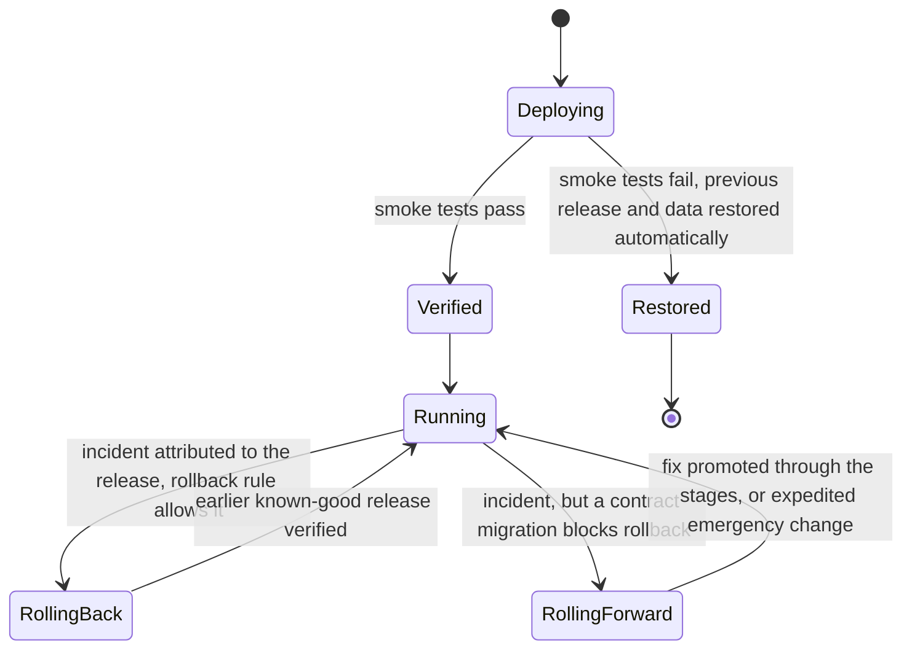

# Insurance Claims Portal: Traceable Release Promotion

> A vendor-neutral case architecture for the **delivery system** of a small insurer's claims portal: how a change travels from a commit to production through DEV, UAT and PROD so that every running release can be traced to its commit, its tests and the people who decided to ship it.
> The application is ordinary. The case is about the pipeline, the environments and the evidence, which is where most designs and proofs of concept for "DevOps adoption" are weakest. Provider services appear only in the non-normative realisation table.

## Contents

- [Business](#business)
- [Architecture](#architecture)
  - [C1 System context](#c1-system-context)
  - [C2 Environment and account topology](#c2-environment-and-account-topology)
  - [C3 Release identity](#c3-release-identity)
  - [C4 Integration pipeline and gates](#c4-integration-pipeline-and-gates)
  - [C5 Promotion and evidence chain](#c5-promotion-and-evidence-chain)
  - [C6 Roles and separation of duties](#c6-roles-and-separation-of-duties)
  - [C7 Release ordering](#c7-release-ordering)
  - [C8 Database change: expand, migrate, contract](#c8-database-change-expand-migrate-contract)
  - [C9 Failed deployments, rollback and roll-forward](#c9-failed-deployments-rollback-and-roll-forward)
  - [C10 Measuring delivery performance](#c10-measuring-delivery-performance)
- [Scaling](#scaling)
- [Resilience and Recovery of the Delivery System](#resilience-and-recovery-of-the-delivery-system)
- [Key Decisions](#key-decisions)
- [Quality Attribute Scenarios and How to Measure Them](#quality-attribute-scenarios-and-how-to-measure-them)
- [Control Mapping](#control-mapping)
- [Failures](#failures)
- [Lessons Learned](#lessons-learned)
- [Non-normative Realisation Examples](#non-normative-realisation-examples)
- [Further Reading](#further-reading)

Companion documents: [Reviewing a delivery pipeline against this case](review-checklist.md) and the hands-on [Release Promotion Lab](../../labs/release-promotion/README.md), which implements the rules of views C3 to C10 on a laptop.

---

## Business

**The operator** is a fictitious property and casualty insurer, authorised under Solvency II in an EU member state. Its claims portal lets policyholders report a loss, upload photos and documents, and follow the claim to settlement. Claims handlers work on the same data through an internal interface. Six engineers build and run the portal; a claims operations manager and a product owner represent the business.

**How releases work today.** Engineers develop on long-lived branches and merge shortly before a monthly release. One engineer builds the release on a laptop, copies it to a test server and emails the tester. Fixes found during testing are rebuilt and copied again, so testers are not always sure which build they are testing. After sign-off, the release is rebuilt for production and handed to an administrator with configuration notes. Problems in production are found by policyholders and handlers.

**What the business wants.** Weekly releases instead of monthly; no release in production that the business has not accepted; the ability to show an auditor, for any day in the last year, which release ran and why it was allowed to.

This business fixes the regulatory frame:

| Regime | Why it applies | What it forces on the delivery system |
|---|---|---|
| DORA, Regulation (EU) 2022/2554 | Insurance undertakings under Solvency II are financial entities in scope (Art. 2) | ICT change management (Art. 9(4)(e)) with the content set out in RTS (EU) 2024/1774 Art. 17: recorded, tested, approved and verified changes; **independence between the functions that approve changes and those that request and implement them**; fall-back procedures; emergency changes reviewed afterwards |
| RTS (EU) 2024/1774 | Specifies DORA's ICT risk management tools and procedures | Separation of production from development and test environments, and protection of production data used outside production (Art. 16); change management content (Art. 17) |
| GDPR | Claims contain personal data; injury claims contain health data (Art. 9) | Data protection by design (Art. 25) and security of processing (Art. 32): no production personal data in DEV or UAT unless anonymised; least-privilege access to production |
| ISO/IEC 27001:2022 (voluntary, requested by corporate clients) | Certification of the operator's ISMS | Annex A controls 5.3 segregation of duties, 8.25 secure development life cycle, 8.31 separation of environments, 8.32 change management, 8.33 test information |

Very small insurers below the Solvency II size thresholds fall outside DORA. This case assumes an insurer subject to the full framework.

**Out of scope.** The claims process itself, fraud detection, document storage design, and the portal's runtime architecture beyond what the delivery system touches (database schema, configuration, deployment units).

---

## Architecture

The delivery system is described in ten views. Each view says what it constrains, so that a pipeline or a proof of concept can be reviewed view by view.

Colour key: **blue** = delivery system, **green** = runtime environment, **amber** = control or gate, **purple** = evidence, **grey** = person or external party.

### C1 System context

Two properties matter more than any tool: the delivery system is the **only** path into an environment, and every action it takes leaves a record that the actor cannot edit.

### C2 Environment and account topology

An **account** is the provider's unit of isolation and billing (an AWS account, an Azure subscription, a Google Cloud project).

**Constraints:**

- **One account per environment.** Separate stacks in one account share one blast radius: a mis-scoped role, a quota or an account-level setting reaches PROD from DEV. Isolation that depends on everyone writing every policy correctly is not isolation.
- **Federated, short-lived credentials only.** The CI/CD service obtains a token per job. Each environment's role trusts only jobs bound to that environment (for example a subject claim `repo:<org>/<repo>:environment:prod`). No stored keys.
- **Images are pulled across accounts by digest** from one registry, so every environment runs bytes from the same source.
- **No production personal data below PROD.** DEV uses generated data; UAT uses generated or properly anonymised data. A copy of the production database in UAT puts UAT in scope for everything PROD is in scope for.

### C3 Release identity

A release has exactly one identity, fixed at build time, and every later step refers to it.

**Rules:**

- **The digest is the identity of what runs; the commit is the identity of what was reviewed.** A tag is a label that can move. Resolve a tag once at build time and carry the digest from then on.
- **Build once.** UAT and PROD deploy the digest that succeeded in the previous stage. A rebuild, even of the same commit, is a new artefact that has not been tested.
- **Provenance is signed by the build, not asserted by the deployer.** A checksum stored next to the artefact, in the same store, by the same pipeline, proves consistency, not integrity: whoever can replace the artefact can replace the checksum. A signature by a build identity that deployers cannot use closes that gap (SLSA Build Level 2 and above).
- **The manifest records the deployment logic version.** The scripts and migrations that deploy a release travel with the release, so that the release is promoted by the logic it was verified with.

### C4 Integration pipeline and gates

**Rules that keep the gates honest:**

- **One threshold policy for all scanners.** If one scanner blocks on any finding and another only on critical and high, the effective policy is whichever is weaker for the finding at hand. State one severity threshold and the exception process.
- **Every gate has a negative test**: a deliberately failing input committed to the repository, run on a schedule. A gate that has never failed cannot be told apart from one that does not work.
- **Review is enforced by the platform** (branch ruleset, no bypass), not by convention.
- **Pull request runs never publish.** Only a commit on `main` becomes a release.

### C5 Promotion and evidence chain

**What each stage requires before it deploys:**

| Target | Requires | Refuses |
|---|---|---|
| DEV | Successful build of a commit on `main`; valid provenance | Releases DEV already runs or has moved past (skip, not fail) |
| UAT | Success of the same commit **and digest** in DEV; approval by a business reviewer | Anything else, including a newer commit that skipped DEV |
| PROD | Success of the same commit and digest in UAT; recorded business acceptance in UAT; approval; unchanged pipeline version since UAT | A release older than the one running, unless it is a declared rollback (C9) |

**The evidence store** holds one record per deployment attempt, including refusals and skips: target, commit, digest, actor, approvers, pipeline version, result, smoke-test output, time. Records are written by the delivery system, are append-only, and are either kept by the platform outside the reach of the pipeline that writes them (deployment API, audit log) or chained by hash so that an edited record is detectable.

### C6 Roles and separation of duties

| Action | Engineer (author) | Engineer (other) | Business reviewer | Platform owner | Delivery system |
|---|---|---|---|---|---|
| Merge a change | Requests | Reviews and approves | | | Enforces review |
| Deploy to DEV | | | | | Automatic |
| Request UAT or PROD promotion | Yes | Yes | | | Records requester |
| Approve UAT or PROD | **No** | **No** if they requested it | Yes | | Refuses self-approval |
| Accept release in UAT | No | No | Yes | | Records acceptance |
| Change environment protection rules | No | No | No | Yes, with audit | Logs the change |
| Emergency change | Implements | Reviews afterwards | Approves afterwards | | Marks as emergency |

**Rules:**

- **Approval is a decision by someone else, recorded by the platform.** A checkbox in a form, ticked by the person starting the deployment ("I confirm UAT passed"), is a self-attestation. It records nothing that anyone else decided and does not meet the independence requirement of RTS (EU) 2024/1774 Art. 17.
- **Two conflicts, not one.** Platforms typically prevent the person who started a run from approving it. The author of the change is a second conflict that usually needs its own check.
- **Small teams use compensating controls.** Where six engineers cannot staff independent functions, the business reviewer is the independent function for releases, and a periodic review of the change register covers the rest. Document which control compensates for what.
- **Changing the rules is itself a change.** Protection rules, required reviewers and role trust policies are changed by the platform owner through the same reviewed process, and the change is logged.

### C7 Release ordering

Concurrent integration runs on `main` can finish in a different order from their commits. Manual re-runs of old runs make this worse.

| Event | Naive rule "deploy if equal to head of main" | Ancestry rule "deploy unless what runs already contains it" |
|---|---|---|
| CI for c3 finishes first, DEV runs c1 | Deploy c3 only if c3 is still head | Deploy c3 |
| CI for c2 finishes after c3 | Skip (correct) | Skip, because c3 contains c2 (correct) |
| c4 merged, its CI fails, then CI for c3 is re-run | Skip c3, because head is c4: **DEV goes stale** | Deploy c3 if DEV runs something older (correct) |
| Someone asks UAT for c1 while UAT runs c3 | Depends on head | Refuse: UAT would move backwards |

**Rules:**

- Order by **commit ancestry against what the environment runs**, read from the evidence store, not against the head of `main` at some moment.
- DEV **skips** stale releases (and records the skip); UAT and PROD **refuse** them, because there a backwards move is never an accident worth hiding.
- One deployment per environment at a time (a concurrency group or lock). Queue, do not cancel a running deployment.
- A deliberate move backwards is a **rollback** (C9) with its own rules, never a side effect of a re-run.

### C8 Database change: expand, migrate, contract

The application and its schema change at different speeds, and a rollback can only move the application.

**Rules:**

- Every migration declares its kind. An **expand** keeps the previous release working; a **contract** does not.
- A release may be rolled back to an earlier release only if every migration applied since that earlier release is an expand. After a contract, the way back is a new release (roll forward).
- Contract migrations ship in their own release, at least one release after the code stopped depending on what they remove, so that the release before the contract is still a valid rollback target.
- Migrations travel inside the release (C3) and run in every environment in the same order. DEV and UAT therefore rehearse exactly the PROD migration.
- Long-running migrations (large backfills, index builds) run as separate, resumable jobs, not inside the deployment step, so that a deployment timeout does not leave a half-applied change.

### C9 Failed deployments, rollback and roll-forward

**Rules:**

- **The switch is gated by the smoke test.** Traffic moves to the new release only after the release-specific checks pass (health, expected release identifier, a read-write round trip through the database). On failure, the previous release keeps serving.
- **A rollback target must be a release that ran successfully in the same environment**, and the C8 rule must allow it. Rollbacks need a recorded reason but not a new business approval: the target was approved before, and recovery speed matters.
- **Emergency changes** (a hotfix that cannot wait for UAT) are possible but marked as such, and reviewed and approved after implementation (RTS (EU) 2024/1774 Art. 17).
- **Practise.** A rollback drill in UAT each quarter, timed, with the evidence kept. A rollback path that has never been used is a hypothesis.

### C10 Measuring delivery performance

Delivery performance is measured from the evidence store, not estimated. The five DORA software delivery metrics are used with written measurement rules:

| Metric | Measurement rule in this case | Source records |
|---|---|---|
| Change lead time | Per commit: time of the first successful PROD deployment that contains it, minus the commit time. Report the median and the 90th percentile | Commit history, PROD deployment records |
| Deployment frequency | Successful forward PROD deployments per week | PROD deployment records |
| Change fail rate | Forward PROD deployments that failed their checks or were followed by a rollback or emergency fix attributed to them, divided by all forward PROD deployment attempts | PROD deployment records, incident records |
| Failed deployment recovery time | From the failed deployment (or the detection of the failure it caused) to the next successful PROD deployment that restores service | PROD deployment and incident records |
| Deployment rework rate | Unplanned PROD deployments (rollbacks, emergency fixes) divided by all PROD deployments | PROD deployment records with a planned or unplanned flag |

**Rules:**

- **Baseline before change.** Measure the current process for at least a few release cycles before the new pipeline goes live, or reconstruct it from tickets and release notes. A comparison against invented baseline numbers proves nothing.
- **A baseline must be consistent with the process it describes.** With monthly releases and work merged shortly before release, a median lead time of a few days is impossible: most commits wait weeks.
- **Each metric needs a way to fail.** Lead time measured from merge instead of commit hides review queues; change fail rate that ignores rollbacks hides most failures.

---

## Scaling

The delivery system scales with the number of changes and engineers, not with customer traffic.

- **Pipeline concurrency.** Integration runs in parallel for fast feedback; deployments to one environment are serialised (C7). Throughput is then limited by the slowest stage that is serialised, usually UAT. Keep UAT deployments short and move long tests to a parallel stage that does not hold the environment.
- **Batch size.** Weekly releases with daily merges mean each release carries about five days of commits. Smaller batches shorten lead time and make a failing release easier to attribute; the limit is the business's capacity to accept releases in UAT. Release trains (fixed weekly slot) and continuous promotion (any accepted release, any working day) are both valid; choose deliberately.
- **Approval capacity.** If two business reviewers approve everything, their availability becomes the bottleneck. Name deputies in the environment rules, and agree a response time.
- **More teams, more services.** With several deployable services, keep one release identity per service, and add a compatibility check between services (consumer-driven contract tests) as a gate before UAT.

---

## Resilience and Recovery of the Delivery System

The delivery system is itself an ICT system that the business depends on. If it is down, fixes cannot ship.

| Scenario | Impact | Mechanism | How to test |
|---|---|---|---|
| CI/CD service outage | No releases, no fixes | Documented emergency procedure: deploy a known digest with a break-glass role, two-person rule, reviewed afterwards | Annual exercise in UAT |
| Registry unavailable | Deployments and scale-out fail | Environments keep running images already pulled; replicate the registry or keep a pull-through cache per environment | Block the registry in UAT and deploy |
| Signing identity compromised | Forged releases could pass the provenance check | Short-lived keyless signing tied to the workflow identity; revocation procedure; deployers verify signer workflow, not only signature validity | Tabletop exercise |
| Evidence store tampered with | Audit trail unreliable | Records held by the platform outside the pipeline's write access, or hash-chained and periodically anchored in the audit log archive | Edit a record in a copy and run the verifier |
| Bad pipeline change | Every release affected | Pipeline definitions are reviewed code; a pipeline change is promoted like a release (C5: PROD requires the pipeline version UAT used) | Change the pipeline and promote a release through it |

---

## Key Decisions

| ID | Decision | Options considered | Choice and reason | Consequence to manage |
|---|---|---|---|---|
| D1 | Unit of promotion | Rebuild per environment vs. promote one artefact | **Promote one artefact by digest**: only then is what PROD runs what UAT tested | Configuration must be injected at deploy time, not baked in |
| D2 | Environment isolation | Separate stacks in one account vs. one account per environment | **One account per environment** | More accounts to manage; set up before the first workload |
| D3 | Approval mechanism | Form confirmation by the deployer vs. platform-enforced reviewers | **Platform-enforced reviewers, self-review prevented, author checked** | Reviewers' availability becomes a dependency |
| D4 | Release ordering | Concurrency off vs. "equals head" vs. ancestry | **Ancestry against the running release**, with one deployment per environment at a time | Requires reliable records of what runs |
| D5 | Artefact integrity | Checksums vs. signed provenance | **Signed provenance verified at every deployment** | Verification adds a step and a dependency on the signing service |
| D6 | Schema change | Free migrations vs. expand and contract | **Expand and contract, kinds declared, rollback rule enforced** | Some changes take two or three releases |
| D7 | Delivery metrics | Survey estimates vs. records | **Computed from records** with written rules | Needs a planned or unplanned flag and incident linkage |
| D8 | Pipeline platform | Self-hosted CI vs. hosted CI integrated with the code host | **Hosted, integrated with the code host**: the team cannot run another server | Platform outages need an emergency procedure |

---

## Quality Attribute Scenarios and How to Measure Them

| ID | Quality attribute | Scenario | Response measure | Measurement rules |
|---|---|---|---|---|
| QA1 | Traceability | An auditor picks any PROD deployment in the last 12 months | Commit, digest, tests, approvers and acceptance retrieved in under 15 minutes | Sample at least 10 deployments at random; any one missing link fails the scenario |
| QA2 | Integrity of change | Someone replaces the image behind a tag after UAT | PROD deployment refused | Run as a scheduled negative test against UAT, not argued from design |
| QA3 | Separation of duties | The deployer or the author tries to approve their own PROD release | Refused by the platform | Tested for both conflicts separately |
| QA4 | Ordering | Two CI runs finish out of order; an old run is re-run | No environment moves backwards | Reproduced with two merges in quick succession plus a manual re-run |
| QA5 | Recoverability | A release breaks a core flow in PROD | Previous release serving again within 30 minutes, if no contract migration intervenes | Time from the failed deployment's record to the successful rollback record; measured in a quarterly drill |
| QA6 | Environment isolation | A DEV job attempts to use PROD credentials | Denied | Attempt with the DEV role against PROD in a test |
| QA7 | Data protection | Any data store in DEV or UAT | No production personal data | Automated scan for production identifiers (policy and claim number formats) in non-production stores |
| QA8 | Delivery performance | Any quarter | Metrics of C10 reported with their counts | Same rules every quarter; changes to a rule are reported with both old and new values |

---

## Control Mapping

| Control area | Control in this architecture | DORA and RTS (EU) 2024/1774 | ISO/IEC 27001:2022 Annex A | Evidence produced |
|---|---|---|---|---|
| Change recording and approval | Pull request review; platform-enforced business approval for UAT and PROD; acceptance record | DORA Art. 9(4)(e); RTS Art. 17 | 8.32 | Deployment and approval records per release |
| Independence of approval | Self-review prevented; author check; compensating periodic review | RTS Art. 17 | 5.3 | Approver identities per deployment; review minutes |
| Testing before production | Gates in C4; DEV and UAT success required with the same digest | RTS Art. 17 | 8.25, 8.29 | Gate results, negative-test runs |
| Fall-back | Smoke-test-gated switch; rollback rules C8, C9; drills | RTS Art. 17 | 8.32 | Rollback drill records with timings |
| Emergency changes | Marked, implemented with safeguards, approved afterwards | RTS Art. 17 | 8.32 | Emergency change register |
| Environment separation | One account per environment; per-environment federated roles | RTS Art. 16 | 8.31 | Account structure, role trust policies |
| Test data | Synthetic or anonymised data outside PROD | RTS Art. 16; GDPR Art. 25, 32 | 8.33 | Data generation scripts; scan results (QA7) |
| Integrity of software | Signed provenance; deploy by digest; immutable registry | DORA Art. 9 | 8.25 | Attestations; verification logs |
| Logging | Append-only deployment records; audit log archive | DORA Art. 9, 10 | 8.15 | Evidence store; integrity checks |

Requirement wording should be checked against the official texts before use in an audit; this table maps intent, not legal interpretation.

---

## Failures

These failure modes recur in delivery pipelines and in proofs of concept for them. Each passes a demonstration and fails a careful review.

- **"Isolated environments" in one account.** Three stacks with different names, one blast radius. The claim of isolation rests on every policy being written correctly.
- **Self-attested approval.** A form input such as "I confirm acceptance testing passed", ticked by the engineer who starts the PROD deployment. The report then claims that business approval is enforced.
- **Ordering by "head of main".** A guard that deploys only the head of `main` looks correct until the head's build fails; from then on every good release is skipped and DEV silently stops following `main`.
- **Integrity by checksum in the same store.** The pipeline computes a checksum, stores it next to the artefact, and later compares the two. Anyone who can change one can change both.
- **Promotion logic that changes between stages.** The PROD deployment runs the workflow definition from today's `main`, not the one that deployed the same release to UAT. The bytes are the same; the procedure is not.
- **Rollback promised, never designed.** The report names "challenging rollbacks" as a problem, then shows no rollback path, and applies migrations in every environment without stating whether they are reversible.
- **Metrics invented on both sides.** A before-and-after table in which both columns are hypothetical, and the baseline contradicts the process described in the same report.
- **Inconsistent gate thresholds.** One scanner blocks on any finding, another only on high severity, with no stated policy. The effective threshold is accidental.
- **A demo application unrelated to the case.** The business case describes one domain and the deployed application exercises another. The pipeline may be fine, but the acceptance tests then test nothing the business would accept.

---

## Lessons Learned

- **A release is a set of bytes with a history.** Identify it by digest, sign its history, and never rebuild it on the way to production.
- **An approval is only as good as the identity of the approver.** If the platform cannot tell who decided, nobody did.
- **Order is a property of history, not of time.** Ask whether what runs already contains the change.
- **Rollback is designed in the schema, not in the pipeline.** Expand and contract decide whether going back is possible.
- **Evidence must be written by the system and readable by others.** If the record of a control depends on screenshots, the control is not automated.
- **Measure from records, with rules that could have produced a bad number.**

---

## Non-normative Realisation Examples

Illustrative, not a recommendation; check current capabilities before relying on them. The [lab's reference workflows](../../labs/release-promotion/solution/github-actions/README.md) show one realisation in detail.

| Logical component | GitHub | GitLab | Azure DevOps |
|---|---|---|---|
| Branch protection and review | Rulesets, required reviews | Protected branches, approval rules | Branch policies |
| Hosted CI/CD | GitHub Actions | GitLab CI/CD | Azure Pipelines |
| Environment approvals, self-review prevented | Environments with required reviewers and "Prevent self-review" | Protected environments with deployment approvals | Environments with approvals and checks |
| Deployment records | Deployments API | Deployments and environments | Environment deployment history |
| Provenance signing | Artifact attestations (Sigstore) | Sigstore keyless signing in CI | Notation or Sigstore in pipelines |
| Federated cloud identity | OIDC with environment subject claims | OIDC ID tokens | Workload identity federation |

| Logical component | AWS | Microsoft Azure | Google Cloud |
|---|---|---|---|
| Account per environment | AWS Organizations accounts | Subscriptions under management groups | Projects under folders |
| Registry with immutable tags | Amazon ECR, tag immutability | Azure Container Registry, locked tags | Artifact Registry, immutable tags |
| Container runtime | Amazon ECS on Fargate | Azure Container Apps | Cloud Run |
| Admission check on signatures | Signature verification at deploy time | Azure Policy with Ratify | Binary Authorization |

---

## Further Reading

- [Regulation (EU) 2022/2554 – Digital Operational Resilience Act](https://eur-lex.europa.eu/eli/reg/2022/2554/oj)
- [Commission Delegated Regulation (EU) 2024/1774 – RTS on ICT risk management framework](https://eur-lex.europa.eu/eli/reg_del/2024/1774/oj)
- [DORA – Software delivery performance metrics](https://dora.dev/guides/dora-metrics/)
- [SLSA v1.0 – Build levels](https://slsa.dev/spec/v1.0/levels)
- [NIST SP 800-218 – Secure Software Development Framework](https://csrc.nist.gov/pubs/sp/800/218/final)
- [GitHub Docs – Managing environments for deployment](https://docs.github.com/en/actions/how-tos/deploy/configure-and-manage-deployments/manage-environments)
- [GitHub Docs – Using artifact attestations to establish provenance for builds](https://docs.github.com/en/actions/security-for-github-actions/using-artifact-attestations/using-artifact-attestations-to-establish-provenance-for-builds)
- [Laukkanen, Itkonen and Lassenius (2017) – Problems, causes and solutions when adopting continuous delivery](https://doi.org/10.1016/j.infsof.2016.10.001)
- [Shahin, Ali Babar and Zhu (2017) – Continuous integration, delivery and deployment: a systematic review](https://doi.org/10.1109/ACCESS.2017.2685629)
- In this repository: [Regulated Card Payments case, A10](../regulated-card-payments/README.md#a10-delivery-pipeline-and-evidence-chain), [Immutable Infrastructure pattern](../../patterns/immutable-infrastructure.md), [Release Promotion Lab](../../labs/release-promotion/README.md)
