# Regulated Card Payments Case Study

> A vendor-neutral case architecture for a small EU payment institution that accepts card-funded transfers and pays out to bank accounts, under **PCI DSS v4.0.1**, **DORA** and **PSD2 strong customer authentication**.
> The figures are detailed enough to review a design or a proof of concept against them. They are a case architecture, not a canonical blueprint: provider services appear only in the non-normative realisation table.

## Contents

- [Business](#business)
- [Architecture](#architecture)
  - [A1 System context](#a1-system-context)
  - [A2 Compliance scope: what is in the CDE](#a2-compliance-scope-what-is-in-the-cde)
  - [A3 Account and environment topology](#a3-account-and-environment-topology)
  - [A4 Logical architecture](#a4-logical-architecture)
  - [A5 Network segmentation and permitted flows](#a5-network-segmentation-and-permitted-flows)
  - [A6 Key hierarchy and tokenisation](#a6-key-hierarchy-and-tokenisation)
  - [A7 Identity and access](#a7-identity-and-access)
  - [A8 Payment flow: happy path](#a8-payment-flow-happy-path)
  - [A9 Payment flow: payout outcome unknown](#a9-payment-flow-payout-outcome-unknown)
  - [A10 Delivery pipeline and evidence chain](#a10-delivery-pipeline-and-evidence-chain)
  - [A11 Detection, audit and incident reporting](#a11-detection-audit-and-incident-reporting)
- [Scaling](#scaling)
- [Resilience and Recovery](#resilience-and-recovery)
- [Key Decisions](#key-decisions)
- [Quality Attribute Scenarios and How to Measure Them](#quality-attribute-scenarios-and-how-to-measure-them)
- [Control Mapping](#control-mapping)
- [Failures](#failures)
- [Lessons Learned](#lessons-learned)
- [Non-normative Realisation Examples](#non-normative-realisation-examples)
- [Further Reading](#further-reading)

Companion document: [Reviewing a PoC against this case](review-checklist.md).

---

## Business

**The operator** is a fictitious payment institution licensed in an EU member state under PSD2, with about a dozen staff. Customers and small merchants use its app to send money from a payment card to any IBAN in near real time:

1. The card is **authorised** through an acquiring partner, with 3-D Secure where the issuer requires it.
2. The beneficiary is **paid out** by SEPA Instant Credit Transfer through a partner bank.
3. The card authorisation is **captured** once the payout is confirmed, and released if the payout fails.

This business model fixes the regulatory frame:

| Regime | Why it applies | What it forces on the architecture |
|---|---|---|
| PCI DSS v4.0.1 | The operator stores, processes or transmits PANs and acts for others, so it is assessed as a **service provider** | A bounded cardholder data environment (CDE), keyed or encrypted PAN storage, six-monthly segmentation tests (Req. 11.4.6) and scope confirmation (Req. 12.5.2.1) |
| DORA, Regulation (EU) 2022/2554 | Payment institutions are financial entities in scope since 17 January 2025 | ICT risk framework (Art. 6), protection, detection and recovery (Art. 9–11), segregated backups (Art. 12), incident classification and reporting (Art. 17–19), third-party register (Art. 28) |
| PSD2 RTS on SCA, Delegated Regulation (EU) 2018/389 | Customers initiate electronic payments from their account | Two-factor authentication with **dynamic linking** of amount and payee (RTS Art. 5) |
| GDPR | Customer and beneficiary personal data | Data minimisation, EU data residency by design choice, retention limits |

A payment institution exempted under PSD2 may fall under DORA's simplified framework (Art. 16). This case assumes a fully authorised institution, so Articles 5 to 15 apply in full.

**Load profile.** Traffic clusters around salary days, month end and marketing campaigns. Peak-to-mean ratios of 10:1 are plausible. The business cannot buy peak capacity permanently, but it also cannot answer a payday customer with "try again later" for long.

**What is out of scope here.** Merchant onboarding and KYC flows, fraud model training, the customer front end, and the commercial terms with the acquirer and the bank.

---

## Architecture

The architecture is described in eleven views. Each view states what it constrains, so that a design or PoC can be checked against it view by view.

Colour key used across figures: **red** = CDE, **amber** = connected-to or security-impacting system (in PCI scope, not storing PAN), **green** = out of PCI scope, **grey** = external party.

### A1 System context

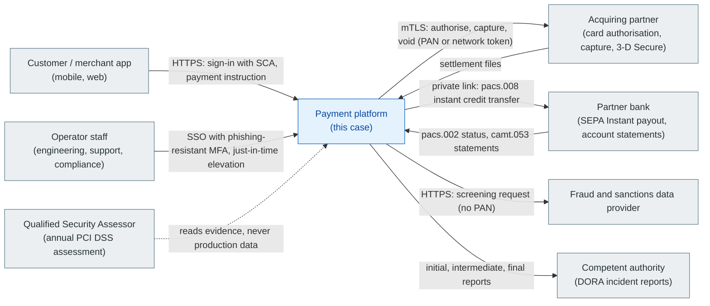

Two flows carry different regulated data and must never share a path: card data goes only to the acquirer, beneficiary account data goes only to the bank.

### A2 Compliance scope: what is in the CDE

The single most important architectural lever is how small the CDE is. Everything that receives, stores or forwards a PAN is CDE. Everything that can affect the security of the CDE, such as the identity provider, the CI/CD system and the logging pipeline, is in scope as **connected-to or security-impacting**, even though it never sees a PAN.

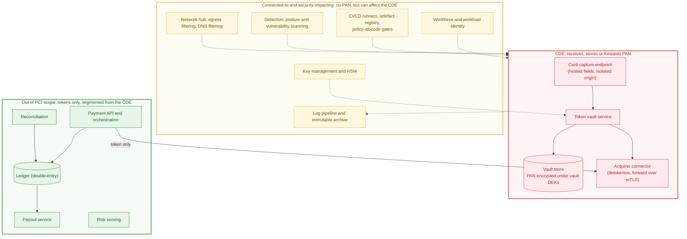

**Scope rules that make this boundary hold:**

- The card number goes from the customer's device straight to the card capture endpoint. The payment API only ever sees a token. If the API received the PAN even transiently, the API, its logs and its runtime would all join the CDE.
- Systems out of scope must be **segmented**: no network path into the CDE except to the vault's documented token interfaces, verified by segmentation penetration tests every six months (Req. 11.4.6).
- Out-of-scope stores may hold truncated PAN (at most the first six or eight and last four digits) for display. They must never hold a token that can be turned back into a PAN outside the vault, and never a hash of the PAN.
- Scope is re-confirmed every six months and after significant change (Req. 12.5.2.1). The data-flow diagram (Req. 1.2.4) is this figure, kept current by the same change process as the code.

### A3 Account and environment topology

Provider-neutral terms are used: an **account** is the provider's unit of isolation and billing (an AWS account, an Azure subscription, a Google Cloud project). Organisation-level **guardrails** are preventive policies that no one inside an account can override.

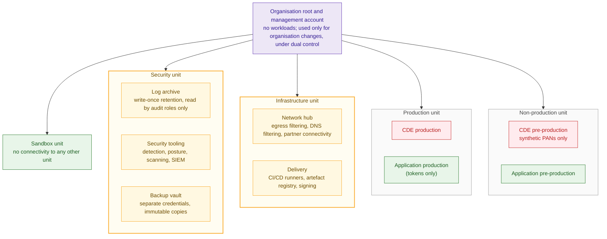

**Guardrails attached at organisation level** (each one is preventive, not just detective):

| Guardrail | Applies to | Purpose | Anchor |
|---|---|---|---|
| Deny resource creation outside the approved EU regions | All units except the organisation-wide audit trail | Data residency, smaller scope | GDPR, DORA Art. 28 |
| Deny stopping, deleting or reconfiguring the audit trail and log delivery | All units | Logs cannot be silenced by a compromised administrator | PCI DSS 10.3.2, 10.7.2 |
| Deny public object storage and public database endpoints | Production, non-production | No accidental exposure | PCI DSS 1.4.4 |
| Deny creating internet gateways or public addresses in CDE accounts | CDE units | The CDE has no direct internet path | PCI DSS 1.3.1, 1.3.2 |
| Deny long-lived user credentials (access keys, passwords for service users) | All units | Identities come from federation only | PCI DSS 8.6.2 |
| Deny changes to key policies except by the key administration role | CDE, security | Key use and key administration stay separated | PCI DSS 3.6.1, 3.7.6 |
| Deny deleting backups or shortening their retention | Backup vault | Ransomware and insider resilience | DORA Art. 12 |

**Why separate accounts instead of one account with roles.** The account boundary is the only isolation that survives a misconfigured identity policy. A single account forces every guardrail to be written as a deny statement inside the same blast radius that it protects. Small teams often skip this because creating an organisation feels heavy; it is cheaper to do it before the first workload than after the first assessment.

### A4 Logical architecture

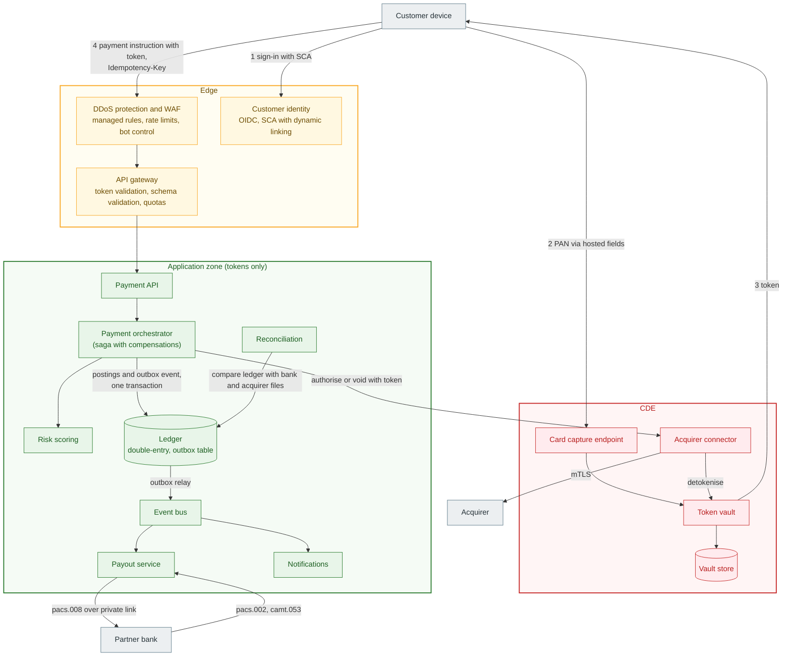

**Component responsibilities and the rules that make them reviewable:**

| Component | Responsibility | Non-negotiable rules |
|---|---|---|
| Card capture endpoint | Receives the PAN from hosted fields on an isolated origin | Only scripts on an approved inventory may run on the capture page; changes and tampering are detected (Req. 6.4.3, 11.6.1). Never stores card verification codes after authorisation (Req. 3.3.1.2) |
| Token vault | Issues random tokens, stores PAN encrypted, detokenises for the connector only | No interface returns a PAN to anything except the acquirer connector. Every detokenisation is logged with caller identity (Req. 10.2.1.1) |
| Acquirer connector | Turns a token into an acquirer call | Only egress from the CDE, to the acquirer's endpoints only, over mTLS (Req. 1.3.2, 4.2.1) |
| Payment API | Validates instructions, enforces idempotency | Rejects any field that looks like a PAN or security code. Idempotency keys are bound to a hash of the request body; a reused key with a different body is rejected, not replayed |
| Orchestrator | Runs the payment as a saga: authorise, post, pay out, capture or void | Every step is idempotent and every forward step has a defined compensation ([Saga pattern](../../patterns/saga.md)) |
| Ledger | Source of truth for balances | Double-entry with database constraints that make every transaction sum to zero; postings are append-only; corrections are new postings |
| Outbox relay and event bus | Publish state changes exactly once in effect | Event written in the same database transaction as the postings; consumers deduplicate by event ID ([Event-driven architecture](../../patterns/event-driven-architecture.md)) |
| Payout service | Submits instant credit transfers | Never retries blindly on timeout; queries status by end-to-end ID first (see A9) |
| Reconciliation | Compares the ledger with bank statements and acquirer settlement files daily and intraday | Every difference opens a case; unexplained differences block the next day's settlement sign-off |

### A5 Network segmentation and permitted flows

Segmentation is specified as an **allow-list of flows**. Anything not on the list is denied by two independent layers: a stateful filter at the workload and a filter at the subnet or zone boundary.

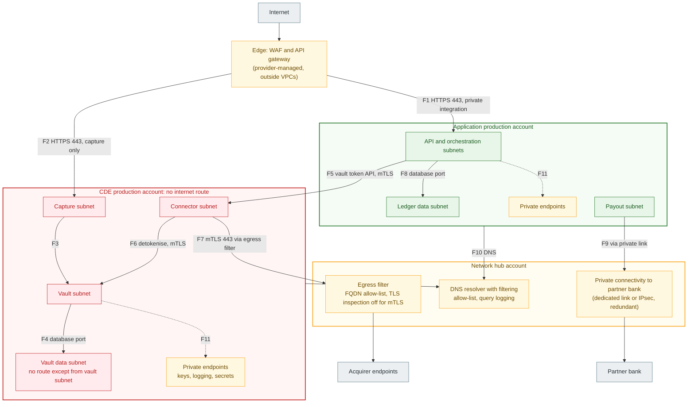

| Flow | From → to | Port and protocol | Why it exists | Evidence |
|---|---|---|---|---|
| F1 | Edge → API | 443 TLS, private integration | Customer payment instructions | Filter rules, WAF logs |
| F2 | Edge → capture | 443 TLS | PAN entry via hosted fields | Filter rules, capture page inventory |
| F3, F4 | Capture → vault → vault store | 443 mTLS, database port | Tokenise and store | Filter rules, flow logs |
| F5 | API → connector | 443 mTLS, token API only | Authorise, capture, void by token | Flow logs show no other CDE ingress |
| F6 | Connector → vault | 443 mTLS | Detokenise for the acquirer call | Vault audit log per call |
| F7 | Connector → acquirer | 443 mTLS through egress filter | The only CDE egress | Egress filter allow-list |
| F8 | API → ledger | Database port | Postings | Filter rules |
| F9 | Payout → bank | Private link | Instant credit transfers and statements | Link configuration, flow logs |
| F10 | All → DNS resolver | 53 | Name resolution against an allow-list | DNS query logs (covert-channel detection, Req. 11.5.1.1) |
| F11 | Workloads → provider private endpoints | 443 | Keys, logs, secrets without internet | Endpoint policies restricted to own organisation |

**Design notes that reviewers should check:**

- The bank link terminates in the **application** account, not in the CDE. Payout handles IBANs, not PANs; routing the bank into the CDE would widen the CDE for no benefit.
- Subnet-level filters are stateless in most clouds. Return traffic needs explicit ephemeral-port rules, which often end up broader than the diagram suggests. The flow table above is the specification; the rule set must be checked against it, not the other way round.
- Private endpoints carry their own policies. Restrict them to principals and resources of the operator's organisation, otherwise a compromised workload can still write to a storage bucket in someone else's account through the "private" path.
- DNS is an exfiltration channel even with no internet route. Resolve only allow-listed domains and keep query logs.

### A6 Key hierarchy and tokenisation

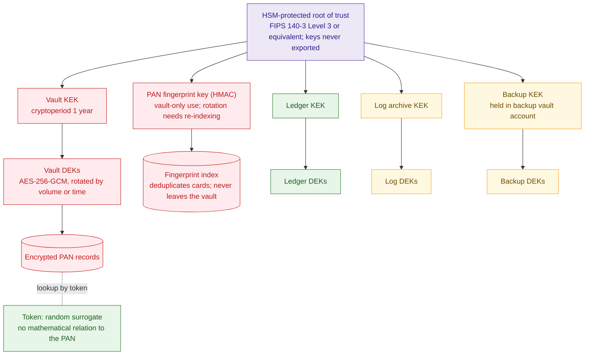

**Tokenisation design.** The token handed to the rest of the platform is **random**, stored next to the encrypted PAN in the vault. It is not a hash or MAC of the PAN. This matters because a 16-digit PAN shown as "first six, last four" leaves six unknown digits, and the Luhn check digit cuts the candidates to about 100,000. Anyone who can compute or verify a MAC of a candidate PAN can recover the full number in seconds. A random token removes that attack; the fingerprint HMAC used for deduplication stays inside the vault, with a key that only the vault service can use.

**Keyed hashes are still allowed** where a one-way form is needed (Req. 3.5.1.1 has required them to be keyed since 31 March 2025). The rule for reviewers: whoever can use the hash key, or a verify-MAC operation on it, holds the PAN in practice.

**Key management controls:**

| Control | Rule | Anchor |
|---|---|---|
| Separation of duties | Key administrators cannot use keys; key users cannot change key policies | PCI DSS 3.6.1, 7.2.2 |
| Dual control | Any manual key operation (import, export of a component, policy change on the root) needs two named people | PCI DSS 3.7.6 |
| Cryptoperiods | Defined per key in the documented cryptographic architecture; HMAC keys need a planned re-index because they cannot rotate transparently | PCI DSS 3.6.1.1, 3.7.4 |
| Encryption context | Every decrypt call is bound to an encryption context (record type, account) and logged | PCI DSS 10.2.1.1 |
| Deletion | Scheduled with a waiting period; deletion of the vault KEK destroys all PANs and is an incident in itself | PCI DSS 3.7.5 |

### A7 Identity and access

Three populations, three mechanisms. None of them uses a long-lived secret.

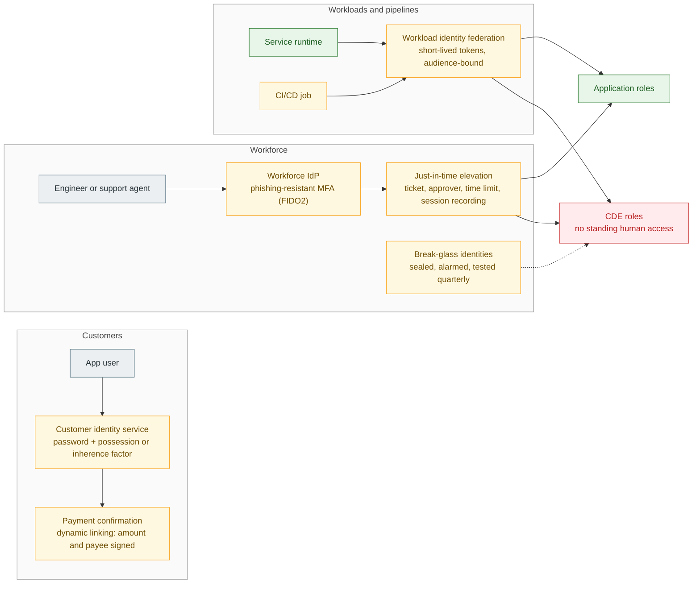

**Access rules a reviewer can test:**

- No human holds standing access to CDE data paths. Elevation requires a ticket and an approver other than the requester, expires automatically and is recorded (Req. 7.2.2, 8.4.2, 10.2.1.2).
- "Administrators cannot read cardholder data" must be proven against **every** read path, not just the obvious ones: direct queries, query languages layered over the store, exports, backups, restores into a new store, snapshots, replicas, and changes to the key policy. If any path stays open, the claim is false.
- The organisation's root or owner identity is never used for builds, tests or operations. Its use raises an alarm by design (Req. 8.2.2).
- Pipeline identities can deploy only into the account and stage they are bound to, and only from protected branches ([GitOps](../../patterns/gitops.md)).
- Service identities get least privilege per function; the vault's identity is the only one that can use the vault KEK and the fingerprint key (Req. 7.2.5).

### A8 Payment flow: happy path

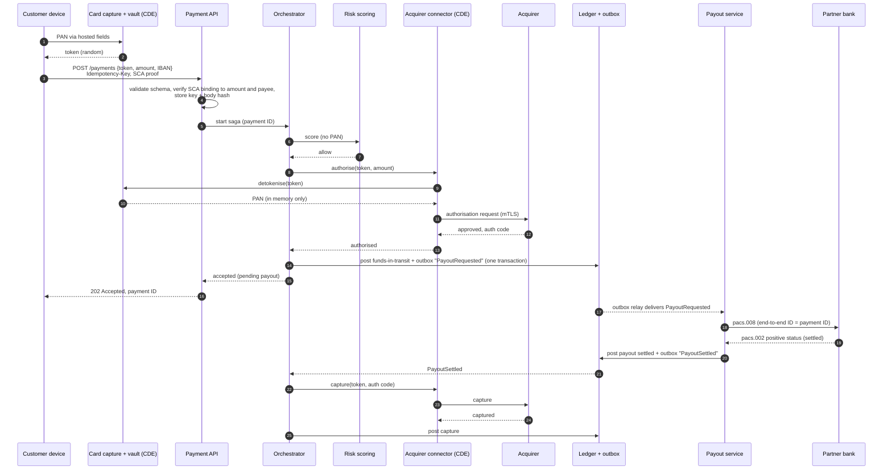

Points to check in a design or PoC: the API answers **202** after authorisation, not after payout, so the user never waits on the bank; the postings and the outbox event commit together; the end-to-end ID used with the bank is derived from the payment ID, so a later status query can find the transfer.

### A9 Payment flow: payout outcome unknown

The dangerous failure is not "the bank said no" but "the bank did not answer". A blind retry can pay the beneficiary twice; giving up can leave a card captured with no payout.

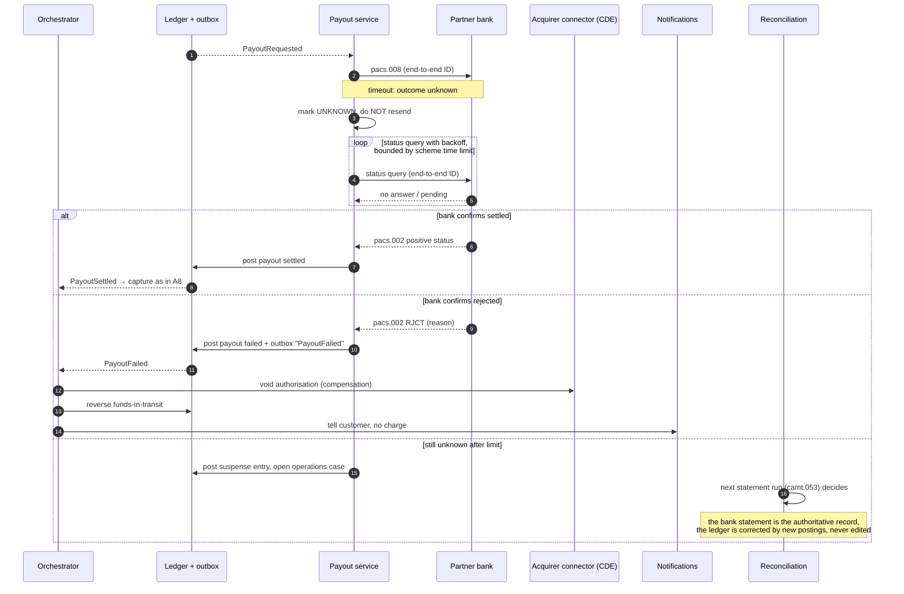

This flow is where most designs fail review. The [retry](../../patterns/retry.md), [idempotency](../../patterns/idempotency.md) and [circuit breaker](../../patterns/circuit-breaker.md) patterns apply, but only once the operation is known to be safe to repeat.

### A10 Delivery pipeline and evidence chain

In a regulated platform the pipeline is part of the control system. Its output is not only a deployment but a trail of evidence that an assessor can verify without trusting the people who ran it.

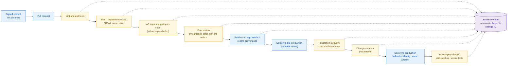

**Rules that keep the evidence honest:**

- A policy-as-code result counts as **pass** only if every rule actually evaluated. Most engines report "skipped" or "not applicable" when a selector matches nothing or a value cannot be resolved, and still return an overall pass. The gate must assert the expected number of evaluated resources per rule.
- Rules must select resources by type, not by an opt-in tag. A rule that applies only to resources tagged "in scope" lets an untagged resource escape the gate.
- Every gate has a **negative test**: a deliberately non-compliant input that must fail. Without it, a gate that never fails is indistinguishable from a gate that works.
- The production deployment uses the artefact built and signed in the pull request run, never a rebuild (Req. 6.5.1, 6.5.3; DORA Art. 9).
- Live PANs never enter pre-production (Req. 6.5.5); test data in pre-production is synthetic and generated.
- The repository history is evidence. Squashing all work into one commit removes the record that reviews and gates ran.

### A11 Detection, audit and incident reporting

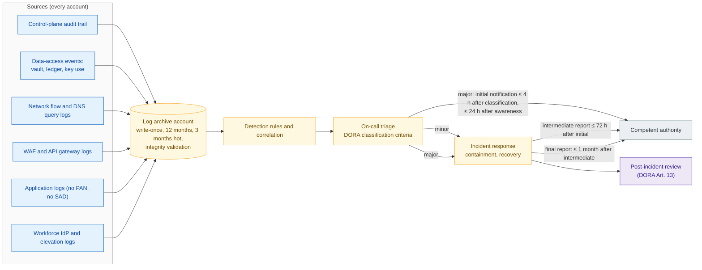

Reporting time limits follow DORA Art. 19 and Commission Delegated Regulation (EU) 2025/301. Logging requirements: all individual access to cardholder data and all administrative actions (Req. 10.2.1.1, 10.2.1.2), logs protected from modification and promptly copied to a central store (Req. 10.3.2, 10.3.3), automated review (Req. 10.4.1.1), 12-month retention with three months immediately available (Req. 10.5.1), and detection of failed security controls such as a stopped audit trail (Req. 10.7.2).

---

## Scaling

**Capacity is a concurrency budget, not a request rate.** Every request occupies a worker, container or function instance for its full duration, including initialisation. Little's law gives the in-flight concurrency the platform needs:

> required concurrency = arrival rate × time in system

At 200 payment requests per second and a 120 ms service time the platform needs about 24 concurrent executions on average. During a cold start lasting 900 ms, the same rate needs about 180 for the instances that are starting. A rate limit at the gateway does not cap concurrency: a burst that arrives while instances are initialising still exceeds the budget. Set three numbers deliberately and keep them consistent:

1. **Provisioned or minimum capacity** sized for the expected peak, scheduled ahead of known peaks such as payday.
2. **Hard concurrency ceiling** per component, below any provider quota, so overload produces a controlled rejection instead of a provider error.
3. **Gateway rate limit** derived from 1 and 2, returning 429 with a Retry-After header when exceeded.

**Provider quotas are part of the architecture.** New cloud accounts often start with low default concurrency or throughput quotas. A load test against such an account measures the quota, not the design. Record every quota the design depends on, request increases before load testing, and alarm on headroom.

**Scale the stateful parts on purpose.**

- The ledger is the bottleneck by design, because it enforces consistency. Partition by customer account so that unrelated payments do not contend; keep postings for one payment in one partition.
- The vault is on the critical path of every card authorisation. Size it for peak and keep it simple; no feature that is not tokenisation belongs in it.
- Payout throughput is bounded by the partner bank's limits. Queue in front of the payout service, and shed or defer at the API when the queue's age exceeds the scheme's time limit.

**Load shedding order** under overload: first reject unauthenticated traffic at the edge, then defer non-urgent work (notifications, analytics), then reject new payments with 429. Never shed reconciliation or status queries: they repair the state that overload damages.

---

## Resilience and Recovery

Recovery objectives are defined **per failure scenario**. A single RPO/RTO pair for "disaster" hides the scenarios that actually happen.

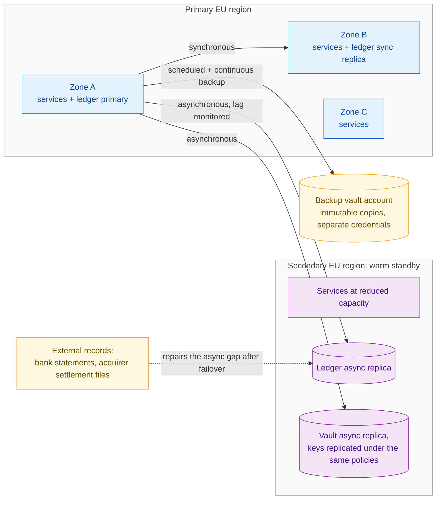

| Scenario | RPO target | RTO target | Mechanism | How to test |
|---|---|---|---|---|
| Instance or container failure | 0 | Seconds | Redundant instances, health checks | Kill instances under load |
| Zone loss | 0 | Minutes | Synchronous replica in another zone, automatic failover | Zone failure injection |
| Region loss | Replication lag at failure, typically seconds | ≤ 1 hour | Warm standby, manual promotion decision | Scheduled failover test at least yearly |
| Logical corruption (bad deploy, operator error) | Last good point before the event | ≤ 4 hours | Point-in-time restore into a new store, then cut over | Restore drill with cut-over |
| Account compromise or ransomware | Last immutable backup | ≤ 24 hours | Restore from the backup vault account into clean accounts | Annual clean-room restore |

**How the region-loss RPO can still end at zero lost money.** Asynchronous replication can lose the last seconds of postings. The bank and the acquirer have their own records of every transfer and authorisation. After a failover, reconciliation compares the promoted ledger with both and posts what is missing. That is why reconciliation is part of the recovery design, not only a finance process.

**Definitions that a test must use.**

- **RPO** is the age of the newest committed transaction that is not present after recovery. Measure it by comparing transaction IDs committed before the failure with those present after; the lag between choosing a restore point and starting a restore is not RPO.
- **RTO** runs from detection of the failure until customers can complete payments again. A restored table that is "active" but not yet used by the application has not recovered the service.
- **Backups are segregated** from the systems they protect: different account, different credentials, deletion denied to everyone including administrators of the production accounts (DORA Art. 12).

---

## Key Decisions

| ID | Decision | Options considered | Choice and reason | Consequence to manage |
|---|---|---|---|---|
| D1 | How to handle PANs | (a) Acquirer-hosted fields and acquirer tokens, PAN never touches the operator; (b) own token vault; (c) store a keyed hash only | **(b)**, because the operator routes across acquirers and needs card-on-file for refunds and chargebacks. Where (a) meets the business need it is the better choice: it removes most of the CDE | A vault is a product in its own right, with keys, audits and on-call |
| D2 | Token format | Random surrogate vs. hash or MAC of the PAN | **Random**: no brute-force path from token to PAN | Needs a lookup table in the vault and a fingerprint index for deduplication |
| D3 | Ledger store | Key-value store vs. relational store with constraints | **Relational**, because double-entry invariants are enforced by the database, not by application code | Plan partitioning early; avoid cross-partition transactions |
| D4 | Compute model | Functions vs. containers vs. virtual machines | **Containers** for vault and ledger paths (predictable capacity and latency); functions acceptable for asynchronous, bursty work | Patching of images is the operator's job; automate rebuilds |
| D5 | Account topology | One account with roles vs. multi-account organisation | **Multi-account** with organisation guardrails | Higher initial effort; cheap only if done first |
| D6 | Recovery strategy | Backup-restore vs. pilot light vs. warm standby vs. active-active | **Warm standby** across two EU regions; active-active rejected because the ledger needs a single writer | Async gap repaired by reconciliation; yearly failover tests |
| D7 | Payout consistency | Synchronous payout in the request vs. saga | **Saga** with explicit compensations and an "unknown" state | More states to test; see A9 |
| D8 | Egress control | Per-account egress vs. central egress filter | **Central filter** in the network hub, FQDN allow-list | Single point to make highly available |

---

## Quality Attribute Scenarios and How to Measure Them

Each scenario names the stimulus, the expected response and, critically, **how the measurement is defined**. Most disagreements in design reviews come from metrics that are measured in a way that cannot fail.

| ID | Quality attribute | Scenario | Response measure | Measurement rules |
|---|---|---|---|---|
| QA1 | Performance | Steady load at the declared normal rate | p95 end-to-end latency ≤ 500 ms **and** error rate ≤ 0.1 % | Percentiles over **all** responses, including errors; clients outside the provider region; warm-up excluded but reported |
| QA2 | Scalability | Payday surge to 3× normal rate for 15 minutes | Accepted throughput ≥ declared peak capacity; 0 server errors; excess rejected with 429 and Retry-After | Report accepted, rejected and failed requests separately; a lower error count achieved by accepting fewer payments is not an improvement |
| QA3 | Confidentiality | Any data store, log or backup outside the CDE | 0 PANs found | Automated PAN discovery scan across stores and logs outside the CDE, not only the main table |
| QA4 | Accountability | Any access to cardholder data | 100 % attributable to a named person or workload identity | Full reconciliation of access events against identities; if sampled, state the sampling method and confidence, and do not report "100 %" |
| QA5 | Recoverability | Logical corruption of the ledger | RPO and RTO as in the scenario table | RPO and RTO as defined above; cut-over included in RTO |
| QA6 | Integrity of change | Any production change | 100 % traceable to a reviewed pull request with passing gates | No gate result counts if any rule was skipped; reviewer ≠ author |
| QA7 | Least privilege | An administrator attempts to read cardholder data | Denied on every read path | Tested path by path (query, query language, export, backup, restore, replica, key policy change) |
| QA8 | Detectability | Audit logging is stopped in any account | Alert to on-call within 15 minutes | Fault injection in pre-production, quarterly |

---

## Control Mapping

Each row links a control in the architecture to its regulatory anchor and to the **evidence** an assessor would ask for. Requirement numbers refer to PCI DSS v4.0.1 and to Regulation (EU) 2022/2554 (DORA).

| Control area | Control in this architecture | PCI DSS v4.0.1 | DORA | Evidence produced |
|---|---|---|---|---|
| Scope | CDE limited to capture, vault, connector; scope reviewed every six months | 12.5.2, 12.5.2.1, 1.2.4 | Art. 8 | Data-flow diagram (A2), scope statement with date |
| Segmentation | Allow-listed flows F1–F11, two filter layers, no CDE internet route | 1.2.1, 1.3.1, 1.3.2, 1.4.4 | Art. 9 | Rule sets diffed against the flow table; segmentation pen-test report every six months (11.4.6) |
| Public-facing protection | WAF with managed rules and rate limits; capture-page script inventory and tamper detection | 6.4.2, 6.4.3, 11.6.1 | Art. 9 | WAF configuration, script inventory, alert history |
| Stored data | Random tokens; PAN encrypted under vault DEKs; no security codes after authorisation | 3.3.1, 3.3.1.2, 3.5.1, 3.5.1.1 | Art. 9 | Discovery scan results, vault design document |
| Keys | HSM-protected hierarchy, separation of duties, dual control, cryptoperiods | 3.6.1, 3.6.1.1, 3.7.4, 3.7.6 | Art. 9 | Cryptographic architecture document, key ceremony records |
| Transmission | TLS for customers; mTLS to acquirer; private link to bank | 4.2.1 | Art. 9 | TLS configuration scans, certificate inventory |
| Secure development | Gates in A10; component inventory; patching | 6.2.4, 6.3.2, 6.3.3, 6.5.1, 6.5.3, 6.5.5 | Art. 9 | Pipeline run records, SBOMs, change tickets |
| Access | No standing CDE access; JIT; MFA; federated workloads | 7.2.1, 7.2.2, 7.2.5, 8.4.1, 8.4.2, 8.6.2 | Art. 9 | Access reviews, elevation logs, role definitions |
| Logging and monitoring | Central immutable archive; automated review; control-failure alerts | 10.2.1.1, 10.2.1.2, 10.3.2, 10.3.3, 10.4.1.1, 10.5.1, 10.7.2 | Art. 10 | Log configuration, retention settings, alert tests |
| Detection | Intrusion detection, DNS covert-channel detection, vulnerability scanning | 11.3.1, 11.3.2, 11.5.1, 11.5.1.1 | Art. 10 | Scan reports, detection rule inventory |
| Recovery | Per-scenario RPO/RTO; segregated immutable backups; tested restores | 12.10.1 | Art. 11, 12 | Drill reports with measured RPO/RTO as defined above |
| Incidents | Classification, response, reporting timers | 12.10.1 | Art. 17, 18, 19 | Runbooks, exercise records, report templates |
| Testing | Pen tests, segmentation tests, scenario tests | 11.4.1, 11.4.5, 11.4.6 | Art. 24, 25 | Test plans and reports |
| Third parties | Acquirer, bank, cloud provider, fraud data provider under contract and monitored | 12.8.1–12.8.5 | Art. 28, 30 | Register of information, responsibility matrices |

---

## Failures

These failure modes recur in designs and proofs of concept for this kind of platform. Each one passes a casual review and fails a careful one.

- **A deny that blocks the provider itself.** A key policy that denies decryption to everyone except named services also blocks the provider's own service principals, which validate the key when a table or bucket is created. Deployment rolls back. The fix is to scope the deny to human and workload principals explicitly, and to test key policies in pre-production before the first deployment that depends on them.
- **Throttling mistaken for capacity.** Lowering the gateway rate limit turns provider errors into 429 responses, but it also lowers accepted throughput. The error count falls and the business serves fewer customers. Only more concurrency, or shorter service time, adds capacity.
- **Latency measured on the survivors.** Percentiles computed over successful responses only look good precisely when many requests fail.
- **Restore is not recovery.** A restored copy of a table proves that backups work. Until the application uses it, the service has not recovered, and the RTO has not been measured.
- **Gates that pass by skipping.** Policy-as-code engines report an overall pass when a rule matched nothing or could not evaluate a value. A gate with no negative test can be broken for months without anyone noticing.
- **"Administrators cannot read card data" with one read path closed.** Denying direct reads while leaving query languages, exports, restores or key-policy changes open makes the control decorative.
- **A one-way token that is not one-way in practice.** A keyed hash of a PAN, shown alongside the first six and last four digits, can be reversed by anyone who can compute the hash for candidate numbers.
- **Tests run with the highest privilege.** Running load tests and drills as the account owner proves nothing about least privilege and pollutes the audit trail with owner activity.
- **"100 %" from a sample.** A sample can support a confidence statement. It cannot support a claim of completeness.
- **Quotas measured instead of design.** Load tests on a new account hit default quotas first. The result describes the account, not the architecture.

---

## Lessons Learned

- **Scope is the architecture.** Every component kept out of the CDE removes controls, evidence and assessment cost. Ask first whether the PAN needs to touch the platform at all.
- **Define every metric before measuring it.** RPO, RTO, percentiles and coverage are only meaningful with a written measurement rule that could have produced a failing result.
- **Evidence is a product of the pipeline.** If the record of a control depends on someone remembering to take a screenshot, the control is not automated.
- **The external record is part of the recovery design.** In payments, the bank and the acquirer hold an independent copy of the truth; reconciliation turns it into a recovery mechanism.
- **Unknown is a state.** Designs that model only success and failure double-pay or lose money on the first timeout.
- **Review claims path by path.** Strong claims ("cannot read", "never stored", "100 % attributed") are true only if every path that could falsify them has been tested.

---

## Non-normative Realisation Examples

The table shows how the logical components could be realised on three providers. It is illustrative, not a recommendation; check current service capabilities, regional availability and each service's inclusion in the provider's PCI DSS attestation before relying on it.

| Logical component | AWS | Microsoft Azure | Google Cloud |
|---|---|---|---|
| Organisation guardrails | AWS Organizations, service control policies | Management groups, Azure Policy | Resource hierarchy, Organization Policy |
| Edge protection | AWS Shield, AWS WAF | Azure DDoS Protection, Azure WAF (Front Door or Application Gateway) | Cloud Armor |
| API gateway | Amazon API Gateway | Azure API Management | Apigee or API Gateway |
| Customer identity | Amazon Cognito | Microsoft Entra External ID | Identity Platform |
| Container runtime | Amazon ECS or EKS | Azure Container Apps or AKS | Cloud Run or GKE |
| Key management and HSM | AWS KMS, AWS CloudHSM | Azure Key Vault, Azure Managed HSM | Cloud KMS, Cloud HSM |
| Relational ledger store | Amazon Aurora | Azure SQL Database or Azure Database for PostgreSQL | Cloud SQL, AlloyDB or Spanner |
| Event bus | Amazon EventBridge, SQS | Azure Service Bus, Event Grid | Pub/Sub |
| Private endpoints | VPC endpoints, AWS PrivateLink | Azure Private Link | Private Service Connect |
| DNS filtering | Route 53 Resolver DNS Firewall | Azure Firewall DNS proxy with FQDN filtering | Cloud DNS response policies, Secure Web Proxy |
| Immutable log and backup storage | S3 Object Lock, AWS Backup vault lock | Immutable Blob Storage, Azure Backup immutable vaults | Cloud Storage bucket lock, Backup and DR vaults |
| Threat detection and posture | Amazon GuardDuty, AWS Security Hub | Microsoft Defender for Cloud | Security Command Center |
| Policy-as-code in CI | CloudFormation Guard, Checkov, OPA | Azure Policy as code, Checkov, OPA | Policy Controller, Checkov, OPA |

---

## Further Reading

- [PCI Security Standards Council – Document Library (PCI DSS v4.0.1, Tokenization Product Security Guidelines, Cloud Computing Guidelines)](https://www.pcisecuritystandards.org/document_library/)
- [PCI SSC FAQ – Segmentation testing frequency for service providers](https://www.pcisecuritystandards.org/faq/articles/Frequently_Asked_Question/how-often-must-service-providers-test-penetration-testing-segmentation-controls-under-pci-dss)
- [Regulation (EU) 2022/2554 – Digital Operational Resilience Act](https://eur-lex.europa.eu/eli/reg/2022/2554/oj)
- [Commission Delegated Regulation (EU) 2024/1774 – RTS on ICT risk management framework](https://eur-lex.europa.eu/eli/reg_del/2024/1774/oj)
- [Commission Delegated Regulation (EU) 2025/301 – Content and time limits of major incident reports](https://eur-lex.europa.eu/eli/reg_del/2025/301/oj)
- [Commission Delegated Regulation (EU) 2018/389 – RTS on strong customer authentication](https://eur-lex.europa.eu/eli/reg_del/2018/389/oj)
- [NIST SP 800-57 Part 1 Rev. 5 – Recommendation for Key Management](https://csrc.nist.gov/pubs/sp/800/57/pt1/r5/final)
- [European Payments Council – SEPA Instant Credit Transfer rulebook](https://www.europeanpaymentscouncil.eu/what-we-do/sepa-instant-credit-transfer)

Related in this repository: [Digital Banking case study](../digital-banking/README.md), [Security](../../docs/10-security.md), [Reliability](../../docs/11-reliability.md), [DevOps](../../docs/08-devops.md), [Saga](../../patterns/saga.md), [Idempotency](../../patterns/idempotency.md).
