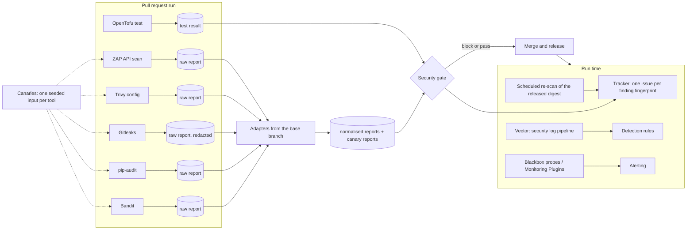

# Retail Bank Account-Summary API: Assessing the DevSecOps Tool Set

> A vendor-neutral case architecture for **choosing and configuring the tools of a DevSecOps pipeline** in a financial entity under DORA: which tool covers which risk, how to assess a tool by measured behaviour rather than by its feature list, how each tool must be invoked so that its result can be trusted as evidence, and how the tool set maps to SSDF tasks and DORA obligations.
> The [Telehealth case](../telehealth-security-gates/README.md) is about the gate that decides. This case is about what feeds it: Bandit, pip-audit, Gitleaks, Trivy, an OpenTofu test, ZAP, and at run time a log pipeline, availability probes and a tracker. Tool names are the subject here, but the assessment method is the reusable part; check current tool behaviour before relying on any row.

## Contents

- [Business](#business)
- [Architecture](#architecture)
  - [B1 Risk-to-tool mapping](#b1-risk-to-tool-mapping)
  - [B2 Assessment criteria](#b2-assessment-criteria)
  - [B3 Measured behaviour](#b3-measured-behaviour)
  - [B4 Candidates per control and the choice](#b4-candidates-per-control-and-the-choice)
  - [B5 From tool report to gate evidence](#b5-from-tool-report-to-gate-evidence)
  - [B6 Invocation that makes a result trustworthy](#b6-invocation-that-makes-a-result-trustworthy)
  - [B7 The supply chain of the tools themselves](#b7-the-supply-chain-of-the-tools-themselves)
  - [B8 Continuous assurance at run time](#b8-continuous-assurance-at-run-time)
  - [B9 The evidence pack](#b9-the-evidence-pack)
- [Scaling](#scaling)
- [Key Decisions](#key-decisions)
- [Quality Attribute Scenarios and How to Measure Them](#quality-attribute-scenarios-and-how-to-measure-them)
- [Control Mapping](#control-mapping)
- [Failures](#failures)
- [Lessons Learned](#lessons-learned)
- [Further Reading](#further-reading)

Companion documents: [Reviewing a tool set against this case](review-checklist.md) and the hands-on [DevSecOps Toolchain Lab](../../labs/devsecops-toolchain/README.md), which reproduces view B3 with recorded and live tool output and implements B5 and B6.

---

## Business

**The operator** is a fictitious direct bank in an EU member state with about 600 staff and no branches. Its mobile app shows customers their accounts, balances and recent transactions through an **account-summary API**. The API reads from the core banking system, caches statements in object storage, and calls a payment service provider for card details. A platform team of six runs the delivery pipeline on a hosted CI service; an application security engineer and the ICT risk function review it.

**Why the tool choice is a regulatory question.** As a financial entity, the bank falls under DORA (Regulation (EU) 2022/2554). Its ICT risk management framework must include documented ICT change management (Art. 9(4)(e)), and its digital operational resilience testing programme must include, where appropriate, vulnerability assessments and scans, open source analyses and source code reviews where feasible (Art. 24 and 25(1)). The regulatory technical standards on the ICT risk management framework (Commission Delegated Regulation (EU) 2024/1774) require security testing during acquisition, development and maintenance of ICT systems (Art. 16) and controlled change management (Art. 17). The hosted CI service is an ICT third-party service and appears in the register of information (DORA Art. 28(3)). An auditor will ask not "which scanners do you run" but "how do you know they work, and what did they find on the release that is in production".

**How it is done today.** A previous team assembled the tools from blog posts. They run on every pull request, all green most of the time. Nobody has checked what "green" means for each tool: whether it scanned anything, whether it would have found a known problem, whether a red result means a finding or a crash.

**What the business wants.** A tool set chosen against stated criteria; each tool invoked so that its result is complete, reproducible and attributable to a version; evidence per release that the bank can show to its supervisor; and a run-time counterpart that keeps checking the release after it has shipped.

**Scale.** Around 30 pull requests a week on this service; about 25 services on the same pipeline template. One application security engineer cannot read 25 services' raw scanner output: the tool set must produce normalised findings that a gate can decide on and a tracker can route.

---

## Architecture

### B1 Risk-to-tool mapping

Start from risks, not from tools. The account-summary API's top risks and the tool that can, and cannot, address each:

| ID | Risk | Primary control | Tool in this case | What the tool cannot see |
|---|---|---|---|---|
| R1 | A customer reads another customer's accounts | Authorisation tests in the test suite | None of the scanners | Every scanner here. Object-level authorisation is business logic; neither SAST nor DAST knows who owns account 1001 |
| R2 | Injection through a query parameter or a shell call | SAST, DAST | Bandit; ZAP active scan | Bandit sees only Python and only patterns; ZAP sees only routes it was given |
| R3 | A dependency with a known vulnerability | Dependency audit, re-scanned daily | pip-audit; Trivy for the image | Vulnerabilities not yet in an advisory database; packages installed outside the requirements file |
| R4 | A payment provider key or access token in the repository | Secret scanning of the full history | Gitleaks | Secrets that match no rule; low-entropy test values (by design) |
| R5 | Statement cache bucket readable from the internet | IaC scan and IaC tests | Trivy config; OpenTofu test | Settings changed outside the code (drift); the provider's account-level defaults |
| R6 | Missing security headers or weak TLS on the API | DAST in the pipeline, probes at run time | ZAP; Blackbox exporter or Monitoring Plugins | Behaviour behind authentication unless the scan is authenticated |
| R7 | Credential stuffing against the login of the app back end | Detection rules on a pseudonymised security log | Vector plus detection rules (see the [Security Gates Lab](../../labs/security-gates/README.md)) | Attacks below the rule thresholds |
| R8 | A compromised or silently changed scanner | Pinned versions, verified checksums, protected adapters | The pipeline itself (B7) | A compromised release published with a matching checksum |

R1 is the most important row and no tool in this case addresses it. A tool set assessment that does not say so overstates what the pipeline proves.

### B2 Assessment criteria

Each tool is assessed on the same nine criteria. Criteria A3 to A5 are the ones that feature lists do not answer and that decide whether a result can be evidence.

| ID | Criterion | Question | How to assess |
|---|---|---|---|
| A1 | Risk coverage | Which risk in B1 does it address, for which languages and formats, and what is out of reach? | Map to B1; run it on the canary for that risk |
| A2 | Automation | Headless, non-interactive, deterministic for the same input and version, usable offline? | Run twice on the same commit; run without network |
| A3 | Evidence | Machine-readable report that states the tool version, the scope scanned and any errors? | Read the report of a run with a missing and a broken input |
| A4 | Failure semantics | Do exit codes distinguish clean, findings and tool failure? Is a report written on failure? | Probe: missing path, unparsable file, unreachable database |
| A5 | Severity model | Does it rate findings? On which scale? Is the rating stable across versions? | Read the canary report; compare with the advisory source |
| A6 | Suppression | How can a finding be hidden (inline, file, flag)? Can the pipeline disable or protect that? | Add an inline suppression to the canary and rerun |
| A7 | Tool supply chain | Can the version be pinned and the artefact verified? Does it download rules or databases at run time? | Install from a pinned, checksum-verified artefact; block the network |
| A8 | Data protection | Can the report contain secrets or personal data? Can that be prevented? | Inspect the report of the secret canary and of a DAST run |
| A9 | Cost and licence | Licence, hosting, maintenance effort, triage effort per week | Licence file; one month of finding volume |

### B3 Measured behaviour

Rows marked **measured** were observed with the versions shown, on 2026-11-08, and are reproducible from the lab's [recorded output](../../labs/devsecops-toolchain/recorded/README.md) and [probes](../../labs/devsecops-toolchain/recorded/probes.txt). Rows marked **documented** come from the tool's documentation and were not run for this case.

| Tool, version | Exit code on findings | Exit code on tool failure, and report | Version in report | Scope in report | Severity | Basis |
|---|---|---|---|---|---|---|
| Bandit 1.9.4 | 1 | **0** on a missing path or an unparsable file; the problem appears only in `errors[]` | No | Yes: `metrics` has one key per file | LOW, MEDIUM, HIGH plus confidence; B105 (hard-coded password string) is LOW, B602 (`shell=True`) is HIGH | measured |
| pip-audit 2.10.1 | 1 | 1 on a missing requirements file; **no report** | No | Yes: `dependencies[]` with name and version | **None**; the same advisory may appear twice for one package | measured |
| Gitleaks 8.30.1 | 1 with `--exit-code 1` | 1 on a missing path; **no report** | No | **No**: the report lists findings only | **None** | measured |
| Trivy 0.76.2, `config` | 1 with `--exit-code 1`, also for a single LOW finding | 1 on a missing path or two targets; **no report**. Checks bundle unreachable: an error is logged and the embedded checks are used | Yes: `Trivy.Version` | Yes: `Results[].Target` | LOW to CRITICAL per check | measured |
| Trivy 0.76.2, vulnerability scan | 1 with `--exit-code 1` | 1 when the vulnerability database cannot be downloaded; **no report** | Yes | Yes | From the database | measured (failure path only) |
| ZAP 2.17.0 packaged scans | 1 if any alert is configured FAIL; 2 if only WARN | 3 for other failures | Yes: `@version` | **No**: only routes with alerts appear | `riskcode` 0 to 3; `riskdesc` is display text | documented |
| OpenTofu `tofu test` | Non-zero when an assertion fails | Non-zero when providers cannot be installed; the measured run failed at provider installation | n/a | The `run` blocks | n/a | partly measured |

Three consequences for the pipeline:

1. **The exit code is not a verdict.** Bandit reports success after an error; Trivy reports the same exit code for "one LOW finding", "no database" and "wrong arguments". The pipeline records exit codes, but only the report decides (B5).
2. **What the tool does not record, the pipeline must.** Bandit, pip-audit and Gitleaks do not write their version into the report; Gitleaks and ZAP do not write their scope. The pipeline passes both explicitly, from the pinned installation and the scan configuration.
3. **A tool without severities needs a stated rule.** For pip-audit, the bank looks up the advisory's severity in its advisory source, and treats an advisory it cannot rate as HIGH. For Gitleaks, every finding blocks.

The measurement also exposed one stale assumption: the pins in the requirements file had no known advisories when they were chosen, and on the recording date pip-audit reported five distinct advisories for them (two packages, the same advisory listed twice in places). A pipeline that scans only on change would not notice (B8).

### B4 Candidates per control and the choice

The table compares candidates on the criteria where they differ. Claims about candidates that were not chosen are from their documentation; apply the B3 probes before relying on them.

| Control | Candidates | Where they differ | Choice for this service | Reason |
|---|---|---|---|---|
| SAST | Bandit; Semgrep Community Edition; CodeQL | Bandit: Python only, AST patterns, fast, Apache-2.0. Semgrep: many languages, rule registry, rules under their own licence. CodeQL: semantic data-flow analysis, slower, licence restrictions for private repositories | **Bandit**, with CodeQL as a scheduled deep scan if licensed | The service is Python only; Bandit's report states its scope and errors; data-flow analysis is valuable but too slow for every pull request |
| Dependency audit | pip-audit; OSV-Scanner; Grype | pip-audit: Python only, PyPI and OSV advisories, no severity. OSV-Scanner: many ecosystems, OSV data, severity where the advisory has a CVSS vector. Grype: images and file systems, severity from its database | **pip-audit** for the requirements, **Trivy** for the image | pip-audit resolves exactly the pinned requirements; the missing severity is handled by the severity map (B3) |
| Secrets | Gitleaks; TruffleHog | Gitleaks: regex and entropy rules, MIT. TruffleHog: also verifies candidate secrets against the provider's API, AGPL-3.0 | **Gitleaks**, full history, `--redact` | Verification calls a third party with a candidate secret, which needs its own risk decision; AGPL needs a licence review |
| Image and IaC | Trivy; Grype for images; Checkov or KICS for IaC | Trivy covers images, file systems and IaC in one binary with one report format. Checkov and KICS have larger IaC rule sets and policy-as-code | **Trivy** for both, plus **OpenTofu tests** for the properties the bank must never lose | One pinned binary for two controls; the bank's own invariants (no public bucket, KMS rotation, versioning) are better written as tests than hoped for in a generic rule set |
| DAST | ZAP; Nuclei | ZAP: proxy-based scanner with passive and active rules and an OpenAPI import. Nuclei: template-driven checks for known issues | **ZAP API scan** with the OpenAPI definition | The scope is the API definition, so coverage can be stated; Nuclei suits scheduled checks for known exposures |
| Security log pipeline | Vector; Fluent Bit | Vector: transforms in its own language, unit tests for transforms, disk buffers, MPL-2.0. Fluent Bit: small C agent, Lua filters, Apache-2.0 | **Vector** | Transform unit tests make the log contract testable in CI, the same way as detection rules |
| Availability and TLS probes | Monitoring Plugins (Nagios or Icinga); Prometheus Blackbox exporter | Monitoring Plugins: one process per check, exit codes 0 OK, 1 WARNING, 2 CRITICAL, 3 UNKNOWN. Blackbox exporter: probes as metrics, certificate expiry as a metric | **Blackbox exporter**, because the bank runs Prometheus | Either works; in both, the "could not check" state (UNKNOWN, a missing series) must alert like a failure |
| Finding tracker | GitHub Issues; Jira | Issues: in the code platform, labels and project fields, light workflow. Jira: enforced workflows and fields, separate access model | **Jira**, because the ICT risk function already tracks remediation there | The tracker must carry the finding fingerprint, severity, owner, due date and exception reference; either can if configured |
| CI platform | GitHub Actions; GitLab CI; Jenkins | Hosted platforms provide required checks bound to a source, OIDC tokens and attestations; Jenkins gives full control and full patching and plugin supply-chain responsibility | **GitHub Actions** (existing) | Assessed as an ICT third-party service: required-check binding, SHA-pinned actions, runner isolation, audit log, exit strategy |

### B5 From tool report to gate evidence

Each tool's report is converted by an **adapter** into the normalised report the gate reads (control, tool, version, scope, findings with id, severity, target and fingerprint). The adapters are part of the gate: they live in a protected path and run from the base branch, like the gate itself ([Telehealth case, T7](../telehealth-security-gates/README.md#t7-gate-integrity)).

An adapter fails closed. It writes **no** report, and the control job fails, when:

- the raw report is missing or not parseable (a crashed scanner, an unreachable database);
- the tool reports errors or skipped inputs (Bandit `errors[]`, pip-audit `skip_reason`);
- the report would publish a secret (a Gitleaks report without redaction);
- the version stated by the report conflicts with the version the pipeline installed, or neither states one;
- a severity code is outside the tool's documented range (ZAP `riskcode` other than 0 to 3).

The gate then sees a missing report and a failed job and blocks (rules G1 and G2 of the [Security Gates Lab](../../labs/security-gates/README.md)). An adapter must never turn missing evidence into an empty list of findings. The adapter also records the SHA-256 of the raw report, so the normalised finding can be traced to the tool's own output.

### B6 Invocation that makes a result trustworthy

The same tool gives evidence or noise depending on its flags. The configuration used in this case, as implemented in the lab's [reference CI step](../../labs/devsecops-toolchain/solution/ci/run-control.sh):

| Tool | Invocation | Why these flags |
|---|---|---|
| Bandit | `bandit -r target/app -f json -o sast.json -q --ignore-nosec` | `--ignore-nosec`: an inline `# nosec` drops the finding without owner or expiry (measured); exceptions go through the gate's register. No `-l` severity filter |
| pip-audit | `pip-audit -r requirements.txt --no-deps --disable-pip --strict -f json -o sca.json` | Audits exactly the pinned list without installing it; `--strict` fails the audit when any dependency cannot be collected. Fully hashed requirements are better still (the tool warns about this) |
| Gitleaks | `gitleaks git . --redact --exit-code 1 --report-format json --report-path secrets.json` with a full clone | The history, not only the working tree: a secret removed in a later commit is still leaked. `--redact`: the report is a CI artefact |
| Trivy | `trivy config target/infra --format json --exit-code 1` | No `--severity` filter: with it, the LOW finding on the target vanished from the report (measured). One target per call |
| OpenTofu | `tofu test` with `mock_provider "aws"` and `command = plan` | Asserts the bank's invariants (no public access, KMS rotation, versioning) without cloud credentials |
| ZAP | `zap-api-scan.py -t openapi.json -f openapi -J dast.json -I` against a disposable deployment | The OpenAPI import defines the scope that the report cannot prove; `-I` so that warnings do not change the exit code; the gate applies the threshold. Exit 3 is a failed scan |

Two rules apply to every tool. **Thresholds live in the gate policy**, with their rationale, never on the scanner's command line. **Every control has a canary**: a seeded input the tool must find, run with the same version and flags (the lab's canaries are shell injection, `jinja2==2.10`, a disabled public access block, a page without CSP, and a pair of generated tokens).

### B7 The supply chain of the tools themselves

A scanner runs with the pipeline's permissions and sees the source code. It is a supplier in the DORA sense and a component in the SSDF sense (PO.3).

- **Pin and verify.** Python tools are installed at exact versions into an isolated environment; binaries are downloaded at exact versions and checked against a SHA-256 kept **in the repository**, not against the checksum file published next to the binary, which an attacker who can replace the binary can usually replace too. Container images are pinned by digest.
- **Know what is downloaded at run time.** Trivy downloads its vulnerability database and its checks bundle; pip-audit queries an advisory service; ZAP add-ons and scan rules change with the image. A download failure must fail the control, not silently use stale data. Trivy's fallback to embedded checks (measured) is acceptable for IaC only if the bank records the bundle version used; for vulnerability scanning, a missing database is a failed control.
- **Version changes are reviewed changes.** A new scanner version can add or re-rate findings. The version is pinned in the policy (the gate checks it, rule G3), so an upgrade is a pull request to a protected path, with a comparison run attached.
- **Record the tools in the register.** The hosted CI service, the advisory services and any SaaS scanner are ICT third-party services; record them and their exit strategy.

### B8 Continuous assurance at run time

A release that passed the gate can become vulnerable without a code change. Three run-time controls close the loop:

- **Scheduled re-scan of the released digest.** Daily dependency and image scans of what runs in production, not of the main branch. A new finding opens a tracker issue keyed by its fingerprint; the due date follows the severity.
- **Probes that fail loudly.** Blackbox probes for availability, TLS validity and certificate expiry. An absent probe series or an UNKNOWN plugin result alerts like a failure; "could not check" is not "fine".
- **A tested security log.** Vector receives the API's security events, enforces the log contract (no raw client addresses, no tokens, keyed pseudonyms) and forwards them to detection. The transforms have unit tests in CI, so a change to the log pipeline that breaks the contract or the pseudonymisation fails before deployment.

### B9 The evidence pack

For each release, the bank keeps (retention per its record-keeping policy):

| Evidence | Produced by | Shows |
|---|---|---|
| Raw tool reports and their SHA-256 | Control jobs | What the tool said, unaltered |
| Normalised reports and canary reports | Adapters | What the gate decided on, and that each tool still detects its canary |
| Tool versions, checksums verified, scan scope | Control jobs | Which tool, from which artefact, looked at what |
| Gate decision with rule codes | Gate | Why the change passed or was blocked |
| Exceptions in force, with owner, approver and expiry | Exception register | Which risks were accepted, by whom, until when |
| Tracker issues per fingerprint | Tracker | That findings were routed, owned and closed |
| Re-scan results for the deployed digest | Scheduled job | That the release is still checked after shipping |

---

## Scaling

- **One adapter per tool, shared by all services.** Twenty-five services must not have twenty-five interpretations of Trivy's report. Adapters and policy live in a central, protected repository and are versioned.
- **Deduplicate by fingerprint.** The same advisory in the same package across services is one remediation item per service, not one per run.
- **Spend scanner time where it pays.** Fast tools on every pull request; data-flow SAST, authenticated DAST and full image scans on a schedule and before release.
- **Measure triage load.** If findings per week exceed what the security engineer can triage, tune rules and thresholds with rationale; do not add scanners.

---

## Key Decisions

| ID | Decision | Options considered | Choice and reason | Consequence to manage |
|---|---|---|---|---|
| D1 | Basis of tool selection | Feature lists and popularity vs. measured behaviour against criteria | **Measured behaviour (B2, B3)** | Probes must be rerun on every tool upgrade |
| D2 | What decides | Tool exit codes vs. normalised reports | **Reports, through fail-closed adapters** | Adapters are code to test and protect |
| D3 | Severity for tools without one | Default LOW vs. block all vs. advisory lookup with HIGH fallback | **Lookup with HIGH fallback** (pip-audit); **block all** (Gitleaks) | The severity map needs an owner and updates |
| D4 | Where thresholds live | Scanner flags vs. gate policy | **Gate policy**, scanners unfiltered | Larger reports to store and triage |
| D5 | Inline suppressions | Allow vs. disable vs. protect | **Disable** where the tool allows it (`--ignore-nosec`), **protect** ignore files as code-owned paths | Developers need a fast exception path |
| D6 | Tool installation | Latest from the network vs. pinned and verified | **Pinned and verified** against checksums in the repository | Upgrades are deliberate and reviewed |
| D7 | Secret verification against providers | Verify (TruffleHog) vs. pattern only (Gitleaks) | **Pattern only**, rotate on every finding | More false positives; no candidate secret leaves the pipeline |
| D8 | Bank invariants for infrastructure | Rely on the scanner's generic rules vs. own tests | **Own tests** (OpenTofu) plus the generic scan | Tests need maintenance with the module |

---

## Quality Attribute Scenarios and How to Measure Them

| ID | Quality attribute | Scenario | Response measure | Measurement rules |
|---|---|---|---|---|
| QS1 | Evidence integrity | A scanner crashes, or cannot download its database | Control job fails; gate blocks; no empty report exists | Lab checks plus one fault-injection run per tool per quarter |
| QS2 | Effectiveness | Any control on any run | Canary detected in 100 % of runs | Canary results from gate decisions |
| QS3 | Reproducibility | The same commit is scanned twice on the same day | Identical normalised findings | Compare fingerprints of two runs |
| QS4 | Data protection | The secret canary is found | No unredacted secret in any artefact | Pattern scan of stored artefacts |
| QS5 | Vulnerability handling | An advisory is published for a package in the released digest | Detected within 24 h; fixed or excepted within the due date for its severity | Re-scan timestamps and tracker records |
| QS6 | Tool supply chain | A tool artefact differs from the pinned checksum | Installation fails; control fails | Replace the checksum in a test branch |
| QS7 | Run-time assurance | A probe cannot reach the API or reads an expiring certificate | Alert within 5 minutes; "could not check" alerts too | Alert rule tests; game day |

---

## Control Mapping

Each tool is mapped to the SSDF tasks (NIST SP 800-218 v1.1) and DORA provisions it helps to evidence. "Helps to evidence" is deliberate: a tool is never the whole control.

| Tool or practice | SSDF tasks | DORA (Reg. 2022/2554) and RTS 2024/1774 | Evidence it produces |
|---|---|---|---|
| Tool set choice and configuration (B2, B6, B7) | PO.3.1, PO.3.2, PO.3.3 | Art. 6(2) and 9(4)(e); RTS Art. 16 | Assessment matrix, pinned versions, checksums |
| Gate policy, thresholds and severity map | PO.4.1, PO.4.2 | Art. 9(4)(e); RTS Art. 17 | Policy file and its reviewed history |
| Bandit | PW.7.2 | Art. 25(1) (source code reviews where feasible); RTS Art. 16 | SAST report and canary report per run |
| pip-audit, Trivy image scan, scheduled re-scan | PW.4.4, RV.1.1, RV.1.2 | Art. 25(1) (vulnerability scans, open source analyses); Art. 9(2) | Dependency reports, re-scan results |
| Gitleaks | PS.1.1, PW.7.2 | Art. 9(4)(c) and (d) (protection of keys and credentials) | Redacted secret reports, rotation records |
| Trivy config, OpenTofu tests | PW.9.1, PW.7.2 | Art. 9(2); RTS Art. 16 | IaC reports, test results |
| ZAP | PW.8.2 | Art. 25(1) (vulnerability assessments and scans) | DAST report with stated scope |
| Adapters, trusted gate, code-owner review | PS.1.1, PO.3.2 | Art. 9(4)(e); RTS Art. 17 (separation of duties in change management) | Gate decisions, review records |
| Tracker and exception register | RV.2.1, RV.2.2 | Art. 9(4)(f) (patches and updates); Art. 25 | Issues per fingerprint, exceptions with expiry |
| Vector log pipeline with tested contract, detection rules | — (SSDF covers development, not operation) | Art. 10 (detection) | Transform tests, contract checks, alerts |
| Blackbox probes or Monitoring Plugins | — | Art. 10; Art. 11 (response and recovery) | Probe results, alert history |
| Hosted CI service, advisory services | PO.3.2 | Art. 28 (third-party risk, register of information) | Register entries, exit strategy |

This table maps intent, not legal interpretation. Check the official texts, the guidance of the competent authority, and whether the bank applies the simplified framework of DORA Art. 16 before using it in an audit.

---

## Failures

These failures recur in tool-centred DevSecOps work, including well-built proofs of concept. Each passes a demonstration.

- **A green job that scanned nothing.** Bandit pointed at a path that does not exist exits 0. So does Bandit on a file it cannot parse.
- **A red job that means nothing.** Trivy exits 1 on a single LOW finding and on a missing database. A team that "fixes" the red job by adding `|| true` has removed the only signal that the database failed.
- **Severities invented by the adapter.** pip-audit has none; an adapter that defaults to LOW lets every advisory through a HIGH threshold.
- **The threshold on the command line.** `--severity HIGH,CRITICAL` on the scanner hides lower findings from reviewers and from trend analysis, and puts the threshold outside the reviewed policy.
- **Inline suppression in the same change.** `# nosec`, `#trivy:ignore`, `.gitleaksignore` or a ZAP rule set to IGNORE, added in the pull request that introduces the finding.
- **The secret leaked twice.** A Gitleaks report without `--redact`, uploaded as a build artefact, readable by everyone with access to the pipeline.
- **"Latest" tools.** Unpinned installs and `latest` images: two runs of the same commit disagree and nobody can say which tool produced last month's evidence.
- **A DAST scan without a stated scope.** The report lists only routes with alerts, so a scan that never reached the account endpoints looks clean.
- **SSDF as a badge list.** "Aligned with SSDF" in a slide, without the task IDs a tool supports, the evidence it leaves, or the tasks no tool covers.
- **The top risk left to a scanner.** Object-level authorisation (R1) assigned to DAST, which cannot know who owns an account.

---

## Lessons Learned

- **Assess tools by probing them.** Missing input, broken input, unreachable database, inline suppression, canary: five runs say more than a feature matrix.
- **Read reports, not exit codes, and fail closed when the report is missing.**
- **Make the pipeline state what the tool does not:** version, scope, severity rule.
- **Keep thresholds and exceptions in the reviewed policy, not in scanner flags or source comments.**
- **Treat the tools as suppliers:** pinned, verified, upgraded by reviewed change, registered.
- **Say which risks no tool covers.** Then cover them with tests.

---

## Further Reading

- [Regulation (EU) 2022/2554 (DORA)](https://eur-lex.europa.eu/eli/reg/2022/2554/oj)
- [Commission Delegated Regulation (EU) 2024/1774 (RTS on the ICT risk management framework)](https://eur-lex.europa.eu/eli/reg_del/2024/1774/oj)
- [NIST SP 800-218, Secure Software Development Framework v1.1](https://csrc.nist.gov/pubs/sp/800/218/final)
- [NIST SP 800-204D, Software supply chain security in DevSecOps CI/CD pipelines](https://csrc.nist.gov/pubs/sp/800/204/d/final)
- Tool documentation: [Bandit](https://bandit.readthedocs.io/), [pip-audit](https://github.com/pypa/pip-audit), [Gitleaks](https://github.com/gitleaks/gitleaks), [Trivy](https://trivy.dev/), [ZAP packaged scans](https://www.zaproxy.org/docs/docker/), [OpenTofu test](https://opentofu.org/docs/cli/commands/test/), [Vector](https://vector.dev/docs/), [Monitoring Plugins guidelines](https://www.monitoring-plugins.org/doc/guidelines.html), [Blackbox exporter](https://github.com/prometheus/blackbox_exporter)
- In this repository: [DevSecOps Toolchain Lab](../../labs/devsecops-toolchain/README.md), [Telehealth case](../telehealth-security-gates/README.md), [Security Gates Lab](../../labs/security-gates/README.md), [Insurance Claims Portal case](../insurance-claims-delivery/README.md), [Security learning path](../../docs/10-security.md)
