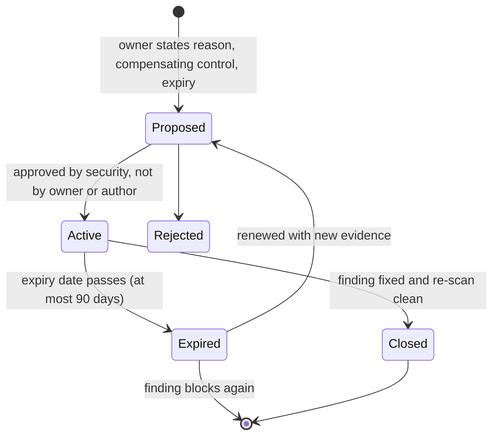
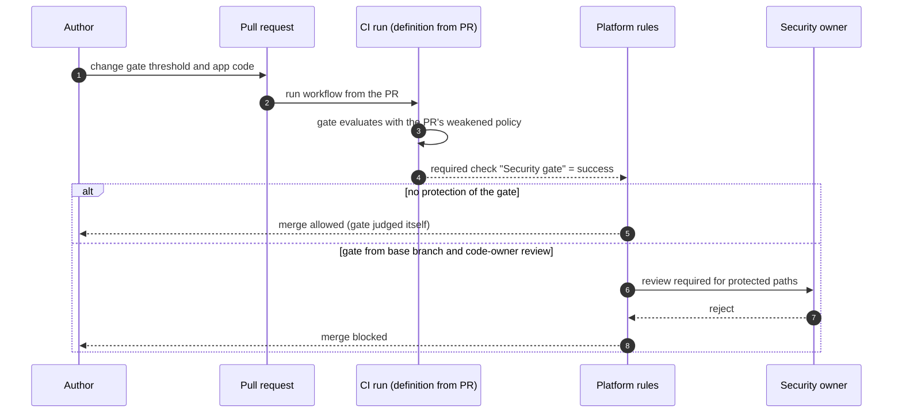

# Telehealth Appointment Platform: Risk-Based Security Gates

> A vendor-neutral case architecture for the **security decision inside a delivery pipeline**: which security controls run on every change, how their results become a merge decision that fails closed, how the team proves each control still detects what it should, and how the gate is protected from the change it judges.
> The application is small. The case is about the gate, its evidence and its integrity, which is where DevSecOps proofs of concept are most often strong on tooling and weak on governance. Provider and tool names appear only as examples.

## Contents

- [Business](#business)
- [Architecture](#architecture)
  - [T1 Risk-to-control mapping](#t1-risk-to-control-mapping)
  - [T2 Gate architecture](#t2-gate-architecture)
  - [T3 Fail-closed semantics](#t3-fail-closed-semantics)
  - [T4 Evidence that counts](#t4-evidence-that-counts)
  - [T5 Severity policy and risk acceptance](#t5-severity-policy-and-risk-acceptance)
  - [T6 Negative controls](#t6-negative-controls)
  - [T7 Gate integrity](#t7-gate-integrity)
  - [T8 Continuous re-scanning of what runs](#t8-continuous-re-scanning-of-what-runs)
  - [T9 Detection as code and the log contract](#t9-detection-as-code-and-the-log-contract)
  - [T10 Measuring the security pipeline](#t10-measuring-the-security-pipeline)
- [Scaling](#scaling)
- [Resilience of the Security Pipeline](#resilience-of-the-security-pipeline)
- [Key Decisions](#key-decisions)
- [Quality Attribute Scenarios and How to Measure Them](#quality-attribute-scenarios-and-how-to-measure-them)
- [Control Mapping](#control-mapping)
- [Failures](#failures)
- [Lessons Learned](#lessons-learned)
- [Non-normative Realisation Examples](#non-normative-realisation-examples)
- [Further Reading](#further-reading)

Companion documents: [Reviewing a security gate against this case](review-checklist.md) and the hands-on [Security Gates Lab](../../labs/security-gates/README.md), which implements views T3 to T7 and T9 on a laptop. For what happens to an artefact after it passes the gate, see the [Insurance Claims Portal case](../insurance-claims-delivery/README.md).

---

## Business

**The operator** is a fictitious telehealth provider in an EU member state with about 180 staff. Patients book video consultations with clinicians, receive appointment reminders and upload documents before a consultation. The appointment API is the system of record for who sees which clinician, when and why. Eight engineers build and run it; one security engineer and the data protection officer support them part time.

**How changes are checked today.** Functional tests decide whether a pull request can be merged. Some security scanners run, but their results are advisory: a red scanner job does not stop a merge, findings are triaged when someone has time, and nobody can say whether the scanners would actually notice a known-vulnerable package or a leaked key. Logs contain client IP addresses and, in one debug path, request headers.

**What the business wants.** Every change checked automatically against the risks that matter for patient data; a merge that is blocked unless every required control demonstrably worked; no security decision that a single engineer can override alone; and evidence for the annual audit that these controls work, not only that they exist.

This business fixes the regulatory frame:

| Regime | Why it applies | What it forces on the security pipeline |
|---|---|---|
| NIS2, Directive (EU) 2022/2555 | Healthcare providers are in the health sector of Annex I; a medium-sized provider is an important entity | Art. 21(2)(e): security in acquisition, development and maintenance, including vulnerability handling. Art. 21(2)(f): policies and procedures to **assess the effectiveness** of the risk-management measures |
| GDPR | Appointment data reveal health information (Art. 9) | Data protection by design (Art. 25) and security of processing (Art. 32), including for logs and test data |
| ISO/IEC 27001:2022 (voluntary, requested by insurers that contract the provider) | Certified ISMS | Annex A 5.3 segregation of duties, 8.4 access to source code, 8.8 technical vulnerabilities, 8.15 logging, 8.16 monitoring, 8.25 secure development life cycle, 8.28 secure coding, 8.29 security testing, 8.32 change management |
| NIST SP 800-218 (SSDF), used as practice reference | Common vocabulary for secure development | PO.4 criteria for security checks; PS.1 protect code from tampering; PW.7 and PW.8 code review and testing; RV.1 and RV.2 ongoing identification and remediation |

National transposition of NIS2 differs in detail; this case uses the directive's wording.

**Out of scope.** Clinical safety, the video platform itself, identity proofing of patients, and the release promotion that follows the merge (covered by the Insurance Claims Portal case).

---

## Architecture

The security pipeline is described in ten views. Each view says what it constrains, so that a pipeline, a proof of concept or a report can be reviewed view by view.

Colour key: **blue** = pipeline component, **amber** = control or gate, **purple** = evidence, **green** = runtime, **grey** = person.

### T1 Risk-to-control mapping

Controls are chosen from risks, not from tool lists. Each risk names the control that addresses it, the evidence the control must produce, and the negative control that proves it can detect the risk.

| Risk (priority) | Control on every change | Evidence | Negative control |
|---|---|---|---|
| Patient A reads patient B's appointments (very high) | Authorisation contract tests: 401, 403 and cross-patient access cases for every route | Test report listing each route and case | A fixture route without an ownership check must fail the tests |
| A change weakens or bypasses the security gate (very high) | Protected gate definition (T7), fail-closed evaluation (T3) | Gate decision with reasons; review record for protected paths | A change to the policy without security approval must be blocked |
| Known-vulnerable dependency or base image (high) | Dependency audit and image scan against complete inventories | Reports with scanned inventory and tool version | Seeded vulnerable package and image must be found |
| Leaked credential in code or history (high) | Secret scanning of history and working tree | Report | Seeded fake key must be found |
| Public or unencrypted storage, over-broad roles (high) | Infrastructure-as-code scan and model tests | Report, test results | Seeded public bucket must be found |
| Exploitable misconfiguration on the running service (medium) | Authenticated dynamic scan of the documented API | Report listing the routes reached | Seeded fixture route with a known misconfiguration must be found |
| Credential stuffing or password spraying goes unnoticed (medium) | Detection rules as code over the security event log | Rule test results | Seeded attack log must raise the expected alert |
| Personal data in logs (medium) | Log contract check | Contract test results | A seeded log line with a raw address must break the contract |

The highest-priority risk is covered by tests, not by a scanner: generic dynamic scanners rarely detect missing object-level authorisation. A design that maps every risk to a scanner should be questioned.

### T2 Gate architecture

```mermaid
flowchart LR
    classDef step fill:#e3f2fd,stroke:#1565c0,color:#0d47a1
    classDef gate fill:#fff8e1,stroke:#f9a825,color:#6d4c00
    classDef ev fill:#ede7f6,stroke:#5e35b1,color:#311b92
    classDef person fill:#eceff1,stroke:#607d8b,color:#263238

    PR["Pull request"]:::step
    subgraph JOBS["Control jobs (parallel, pinned tools)"]
        C1["Tests"]:::step
        C2["SAST"]:::step
        C3["Dependencies"]:::step
        C4["Secrets"]:::step
        C5["Image"]:::step
        C6["IaC"]:::step
        C7["DAST"]:::step
        C8["Detection rules"]:::step
    end
    REP[("Reports and canary reports")]:::ev
    TRUST["Gate code, policy, exceptions<br/>from the base branch"]:::gate
    GATE["Security gate<br/>fail closed"]:::gate
    DEC[("Decision with reasons")]:::ev
    PLAT["Platform rules<br/>required check, code-owner review"]:::gate
    SEC["Security owners"]:::person

    PR --> JOBS
    JOBS --> REP
    REP --> GATE
    TRUST --> GATE
    GATE --> DEC
    DEC --> PLAT
    SEC -- "approve protected-path changes" --> PLAT
    PLAT -- "merge allowed or blocked" --> PR
    style JOBS fill:#f5f9ff,stroke:#1565c0,color:#0d47a1
```

**Rules:**

- **Scanners report; the gate decides.** A scanner's exit code is an input at most. The decision is made in one place, from reports, against one policy.
- **One gate, one required check.** The platform requires the gate's result, not a list of individual scanner jobs that changes whenever a job is renamed.
- **The gate's inputs it trusts come from the target branch**, not from the change under evaluation (T7).

### T3 Fail-closed semantics

| Input state | Decision | Why |
|---|---|---|
| Every required job `success`, every report complete, every canary detected, no unexcepted finding at threshold | Pass | The only passing state |
| A job `failure` | Block | The control found something or broke |
| A job `skipped` | Block | Usually skipped because an earlier job failed; the control did not run |
| A job `cancelled`, `timed_out` or not concluded | Block | No result is not a good result |
| A required job missing from the run | Block | Typically a workflow change removed it |
| An unknown status value | Block | Future platform states must not pass by default |
| The gate itself errors | Block | An exception in the gate is never a pass |

**Rules:** enumerate the passing state, block everything else; test the gate against every input state, including missing and unknown ones; and keep the gate small enough to review line by line.

### T4 Evidence that counts

A report counts as evidence only if it is:

- **present and parseable**: a missing report is not a clean report;
- **from the pinned tool and version**: so the decision can be reproduced and explained;
- **complete against its inventory**: every installed package, every image package, every IaC file, every documented route; a scanner that silently skipped half the inventory reports fewer findings, not fewer risks;
- **kept**: stored with the run for the audit period, also when the job failed.

Pinning the tool does not pin its vulnerability database. A re-run of the same commit can produce new findings later. That is desired, and is why T8 exists.

### T5 Severity policy and risk acceptance

**One policy, written down.** Each control has one threshold and a one-sentence rationale in terms of risk. Different thresholds per control are fine when the rationale differs (a confirmed finding on the running service may justify a lower threshold than a dependency advisory); undocumented differences are not.

**Risk acceptance, not suppression.** Inline suppressions (`nosec`, ignore files, lowered thresholds in a branch) have no owner, no approver and no expiry. They are not allowed. A finding that cannot be fixed now is handled by an exception record:

- The exception names the finding by fingerprint (rule, location, package), so it cannot silently cover a different finding.
- CRITICAL findings cannot be accepted by the delivery team.
- Exceptions live in a protected path (T7); adding one is a reviewed change.

### T6 Negative controls

A green scanner job shows that the tool ran. It does not show that it would have found anything. Each control therefore runs, in the same job and with the same configuration, against a **seeded insecure fixture** (a canary) whose expected finding is known:

| Control | Canary | Expected result |
|---|---|---|
| SAST | Fixture file with a hard-coded password | Rule for hard-coded credentials fires |
| Dependencies | Fixture environment with a known-vulnerable package version | The advisory is reported |
| Secrets | Fixture file with a fake key in a known format | The key is reported |
| Image | Fixture image with a known-vulnerable base | The CVE is reported |
| IaC | Fixture with a public bucket | The rule fires at HIGH |
| DAST | Fixture route with wildcard CORS and credentials | The alert is raised |
| Detection | Fixture log with a burst of failed logins from one client | The burst rule alerts once |

**Rules:** the gate blocks if a canary does not produce its expected finding; canaries are isolated from the release artefact; and canary results are reported separately, never mixed with the application's findings. This is the most direct way to meet NIS2 Art. 21(2)(f), the assessment of effectiveness.

### T7 Gate integrity

On most CI platforms, the pipeline definition and every script it calls are read from the change being tested. A required status check is matched by name. A pull request can therefore replace the gate job with one that always succeeds, delete a control job, lower a threshold or add an exception, and the required check still turns green.

| Layer | Mechanism | Closes | Leaves open |
|---|---|---|---|
| 1 | The gate job loads gate code, policy and exceptions from the target branch | PR editing the gate, policy or exceptions to pass itself | PR editing the pipeline definition so that layer 1 is not used |
| 2 | Code owners for the pipeline definition, gate, policy and exceptions; platform requires their review; at least one approval; stale approvals dismissed; no bypass | Any merge of a protected-path change without an independent security owner | Administrators changing the rules (audit, two-person rule) |
| 3 | Organisation-level required workflow from a central repository | The PR's copy of the pipeline definition being the one that runs | Changes in the central repository (reviewed there) |

**Rules:** at least layers 1 and 2. If the team cannot provide an independent reviewer, state it as an open risk; do not rate the gate-bypass risk as mitigated by a required status check alone.

### T8 Continuous re-scanning of what runs

Pull-request scanning protects new changes. It does not notice a vulnerability disclosed tomorrow in a package merged last month.

- Re-scan `main` and the **deployed artefacts by digest** on a schedule (daily), with the same pinned tools and policy.
- Keep a software bill of materials (SBOM) per released artefact, so new advisories can be matched without rebuilding.
- New findings on running artefacts open tracked work with a due date by severity, owned by the team, and are visible in the same metrics as gate decisions (T10).

### T9 Detection as code and the log contract

Detection rules are code: versioned, reviewed, and tested in CI against a normal log (no alert) and an attack log (expected alert).

**The log contract** lists the fields a security event may contain: time, event type, route template, status, latency and a **client pseudonym**. The pseudonym is a keyed hash (for example HMAC-SHA-256 with a key held by the security team) of the source address. Tokens, headers, account and patient identifiers and raw addresses are not allowed.

Why a pseudonym rather than nothing: without any client identifier a rule can only count failures across all clients. It then alerts when several patients mistype their password at the same time and misses a slow attack spread over many addresses. With a pseudonym, the rules can count per client (burst) and across clients (spray) without storing the address, and the security team can still re-identify a client under a documented procedure.

| Rule | Condition | Severity |
|---|---|---|
| Burst from one client | ≥ 5 authentication failures from one pseudonym within 10 s | Medium |
| Spray | ≥ 20 failures from ≥ 5 pseudonyms within 60 s | Medium |
| Contract breach | A field outside the contract, or a malformed line | High |

Thresholds are starting values, to be tuned on measured normal traffic; the tuning is itself a reviewed change.

### T10 Measuring the security pipeline

| Metric | Measurement rule | Why it matters |
|---|---|---|
| Gate decisions by rule | Count of blocks per rule code per month | Shows which controls actually stop changes |
| Canary pass rate | Share of runs in which every canary detected its seeded finding | Effectiveness of controls (NIS2 Art. 21(2)(f)) |
| Time to remediate by severity | From first detection (PR or re-scan) to the fix being merged or deployed | Vulnerability handling performance |
| Open and expired exceptions | Count and age, by severity | Accepted risk that is growing or forgotten |
| Detection false-positive rate | Alerts on the normal log per rule, and alerts confirmed as benign in operation | Whether alerts will be trusted |
| Inventory coverage | Scanned items divided by inventory items, per control | Silent partial scans |
| Gate duration | Median and 90th percentile time from push to decision | Cost of the controls in feedback time |

A single pipeline run proves integration. It does not establish a detection rate, a remediation time or a cost. Report what was measured and what was not.

---

## Scaling

- **Parallel controls, one decision.** Controls run in parallel; the gate waits for all of them. Total time is the slowest control plus the gate. Dynamic scanning is usually the slowest; scope it to the documented API and run deep scans on a schedule.
- **More services.** Keep one policy per organisation with per-service overrides that carry their own rationale. A central required workflow (T7 layer 3) avoids each repository drifting.
- **Triage capacity.** Findings grow with the number of services faster than the security team. Thresholds, deduplication by fingerprint and ownership routing matter more than additional scanners.

---

## Resilience of the Security Pipeline

| Scenario | Default behaviour | Planned path | How to test |
|---|---|---|---|
| Vulnerability database unavailable | Control fails, gate blocks | Retry with cached database up to a documented age; beyond that, block | Block the database host in a test run |
| Scanner update changes results | New findings block | Version bump is a reviewed change to the policy, with a comparison run | Upgrade in a branch and compare reports |
| Urgent security fix blocked by an unrelated finding | Gate blocks | Time-bound exception by security, recorded; or emergency change reviewed afterwards | Tabletop exercise |
| Security owner unavailable | Protected-path changes wait | Named deputies in the code-owner team | Check team membership quarterly |
| Gate defect | Gate errors, blocks | Fix through the protected path with review | Unit tests of the gate on every input state |

---

## Key Decisions

| ID | Decision | Options considered | Choice and reason | Consequence to manage |
|---|---|---|---|---|
| D1 | Where the decision is made | Each scanner's exit code vs. one gate over reports | **One gate over reports**, one required check | The gate must be small, tested and protected |
| D2 | Default for unknown states | Pass unless failure vs. block unless success | **Block unless success** | Flaky jobs block more often; fix flakiness, do not relax the gate |
| D3 | Proof of effectiveness | Trust the tools vs. negative controls | **Negative control per control**, checked by the gate | Fixtures need maintenance with each tool update |
| D4 | Handling unfixable findings | Suppression vs. exception records | **Exception records** with owner, approver, expiry | Exceptions are reviewed changes; security capacity needed |
| D5 | Protecting the gate | Required check only vs. trusted gate plus code-owner review | **Trusted gate plus code-owner review** | Needs at least two people in the security owner team |
| D6 | Logging for detection | Raw addresses vs. no client identifier vs. keyed pseudonym | **Keyed pseudonym** | Key management and a re-identification procedure |
| D7 | Tool overlap | One tool per control vs. two independent tools | **One pinned tool per control**, second opinion only where the risk is very high | Single-tool blind spots, mitigated by canaries and scheduled deep scans |

---

## Quality Attribute Scenarios and How to Measure Them

| ID | Quality attribute | Scenario | Response measure | Measurement rules |
|---|---|---|---|---|
| QS1 | Fail-closed | A control job is skipped, cancelled, missing or returns an unknown state | Merge blocked | Gate unit tests over every input state, plus one real run per state |
| QS2 | Effectiveness | Any control on any run | Canary detected in 100 % of runs | Canary pass rate from gate decisions, monthly |
| QS3 | Integrity of the gate | A PR changes the threshold and is approved only by its author | Merge blocked | Reproduced in a test repository with the production ruleset |
| QS4 | Vulnerability handling | A HIGH advisory is published for a package in production | Detected within 24 h; fixed or excepted within 7 days | Re-scan timestamps and tracker records |
| QS5 | Data protection in logs | Any security event | No field outside the contract | Contract check on every log batch in CI and in operation |
| QS6 | Detection quality | Normal traffic | No alert on the normal log; benign rate of operational alerts below an agreed level | Rule tests in CI; alert triage records in operation |
| QS7 | Feedback time | Typical pull request | Gate decision within 10 minutes (90th percentile) | Gate duration from run records |

---

## Control Mapping

| Control area | Control in this architecture | NIS2 | GDPR | ISO/IEC 27001:2022 Annex A | SSDF | Evidence produced |
|---|---|---|---|---|---|---|
| Security criteria for changes | One policy, thresholds with rationale (T5) | Art. 21(2)(e) | Art. 25 | 8.25, 8.29 | PO.4 | Policy file and its change history |
| Code and dependency checks | SAST, dependency audit, secrets, image and IaC scans with complete inventories (T4) | Art. 21(2)(e) | Art. 32 | 8.8, 8.28, 8.29 | PW.7, PW.8, RV.1 | Reports per run |
| Effectiveness of controls | Negative controls checked by the gate (T6) | Art. 21(2)(f) | Art. 32(1)(d) | 8.29 | PO.4 | Canary results per run |
| Integrity of the pipeline | Trusted gate, code-owner review, no bypass (T7) | Art. 21(2)(e) | — | 5.3, 8.4, 8.32 | PS.1 | Review records, ruleset configuration |
| Vulnerability handling | Exceptions, scheduled re-scans, tracked remediation (T5, T8) | Art. 21(2)(e) | Art. 32 | 8.8 | RV.1, RV.2 | Exception register, tracker records |
| Logging and monitoring | Log contract, detection rules as code (T9) | Art. 21(2)(b) | Art. 5(1)(c), 25, 32 | 8.15, 8.16 | — | Rule tests, contract checks |

This table maps intent, not legal interpretation; check the official texts and the national transposition before using it in an audit.

---

## Failures

These failure modes recur in DevSecOps pipelines and in proofs of concept for them. Most pass a demonstration.

- **The gate judges itself.** The required check is satisfied by name, the workflow and the gate come from the pull request, and zero approvals are required. The risk table rates "security gate bypassed" as very high and mitigates it with "all required statuses must pass", which a single change can rewrite.
- **`always()` without fail-closed logic.** The gate runs after failures but only looks for `failure`; a skipped dynamic scan passes.
- **Exit code as evidence.** A scanner that crashed before scanning, or scanned an empty directory, exits zero.
- **Suppression by configuration.** A threshold lowered or an ignore entry added in the same change that introduces the finding.
- **Tooling without proof.** Eight green scanner jobs and no evidence that any of them would have detected a known-bad input.
- **Scan once, never again.** Pull requests are scanned; the artefacts already in production are not re-scanned when new advisories appear.
- **Privacy that disables detection.** Logs without any client identifier, so the detection rule can only count globally and confuses many users mistyping with an attack.
- **The top risk tested by the wrong tool.** Unauthorised access to another user's data is assigned to a dynamic scanner that cannot detect it, instead of to authorisation tests.
- **Mature tooling, missing governance.** A technically excellent pipeline with no owner for findings, no exception process and no reviewer independent of the author.

---

## Lessons Learned

- **Decide in one place, from evidence, and block everything you did not explicitly allow.**
- **Prove that each control works with an input it must catch.** Execution is not detection.
- **Protect the gate from the change it judges.** The strongest scanner is irrelevant if its policy can be edited in the pull request it evaluates.
- **Accept risk explicitly, with an owner, an approver and an end date.** Suppression is acceptance without accountability.
- **Keep scanning what already runs.** New vulnerabilities arrive without a pull request.
- **Minimise personal data in logs without blinding detection.** Pseudonymise; do not simply delete.

---

## Non-normative Realisation Examples

Illustrative, not a recommendation; check current capabilities before relying on them. The [Retail Bank case](../retail-bank-devsecops-toolchain/README.md) assesses one such tool set by measured behaviour. The [lab's reference realisation](../../labs/security-gates/solution/github-actions/README.md) shows one in detail.

| Logical component | Examples |
|---|---|
| SAST | Bandit, Semgrep, CodeQL, SonarQube |
| Dependency audit | pip-audit, OSV-Scanner, Dependabot alerts, Grype |
| Secret scanning | Gitleaks, TruffleHog, platform secret scanning |
| Image and IaC scanning | Trivy, Grype, Checkov, KICS |
| Dynamic scanning | ZAP, Nuclei |
| SBOM | Syft, CycloneDX tools, Trivy |
| Detection as code | Sigma rules, platform-native detection rules, unit-tested custom rules |

| Gate protection | GitHub | GitLab | Azure DevOps |
|---|---|---|---|
| Required gate result | Ruleset required status check from a specified source | Merge request pipelines must succeed | Build validation branch policy |
| Owner review of protected paths | CODEOWNERS with required code-owner review | Code owners with approval rules | Required reviewers by path |
| Central required pipeline | Organisation ruleset "require workflows to pass" | Pipeline execution policies (formerly compliance pipelines) | Required template checks |

---

## Further Reading

- [Directive (EU) 2022/2555 (NIS2)](https://eur-lex.europa.eu/eli/dir/2022/2555/oj)
- [NIST SP 800-218, Secure Software Development Framework v1.1](https://csrc.nist.gov/pubs/sp/800/218/final)
- [NIST SP 800-204D, Software supply chain security in DevSecOps CI/CD pipelines](https://csrc.nist.gov/pubs/sp/800/204/d/final)
- [Rangnau, van Buijtenen, Fransen and Turkmen (2020) – Continuous security testing: integrating dynamic security testing tools in CI/CD pipelines](https://doi.org/10.1109/EDOC49727.2020.00026)
- [Zhao, Clear and Lal (2024) – Identifying the primary dimensions of DevSecOps: a multi-vocal literature review](https://doi.org/10.1016/j.jss.2024.112063)
- [OWASP Application Security Verification Standard](https://owasp.org/www-project-application-security-verification-standard/)
- In this repository: [Security learning path](../../docs/10-security.md), [Insurance Claims Portal case](../insurance-claims-delivery/README.md), [Security Gates Lab](../../labs/security-gates/README.md), [Retail Bank case: assessing the tool set](../retail-bank-devsecops-toolchain/README.md)
