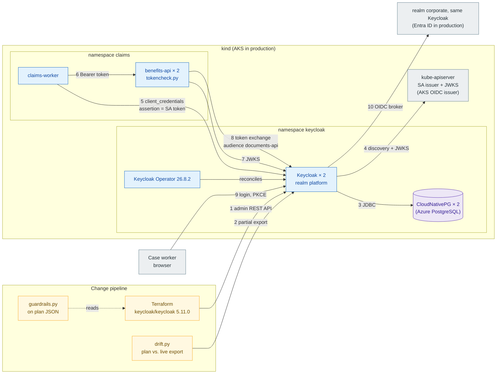

# Identity Platform Lab: Keycloak on Kubernetes, Realms as Code, Tokens Checked

## Objective

Build the identity layer of the [Statutory Health Insurer case](../../case-studies/health-insurer-identity-platform/README.md) with open-source components and watch its interfaces work: Keycloak run by its operator on Kubernetes with PostgreSQL, realms and clients managed with Terraform, a corporate login brokered in, a batch worker that gets tokens without any client secret, an API that validates every token and exchanges it for a downstream call.

The lab has two tracks:

| Track | Needs | What you see | Status in this repository |
|---|---|---|---|
| **Offline** | Python 3.9+ | Token validation (case view I5), guardrails on a Terraform plan (I4, I6, I7) and drift detection (I7), each as starter and solution | **Executed**: solution 37 of 37 checks, starter 12 of 37, reference checks 17 of 17 |
| **Live, local** | Docker, kind, kubectl, Terraform ≥ 1.11, curl | The whole chain on your laptop: CloudNativePG, Keycloak Operator 26.8.2, two realms from Terraform, the API and the worker | **Executed** on 27 November 2026 (macOS, Apple silicon): checks L1 to L7 passed, `terraform plan` shows no changes after apply. The first run found nine problems that static checks had missed, see [Lessons from the First Live Run](#lessons-from-the-first-live-run) |

By the end you can explain and enforce:

- what Keycloak needs from Kubernetes (database, hostname, truststore, service-account issuer) and what changes on a managed cluster
- why realms are managed with Terraform and not with the operator's `KeycloakRealmImport`
- how a workload authenticates to Keycloak with its **service-account token** instead of a client secret, and why the token's audience is the realm URL
- why `full_scope_allowed = false` and explicit audience scopes decide what a token can do
- how token exchange lets the benefits API call the documents API without forwarding the caller's token
- which checks an API must make on every token, and what each forged token looks like
- why plan JSON contains secrets, and how write-only arguments keep them out of plan and state
- what drift Terraform sees, and what it never sees

## Prerequisites

- **Offline:** Python 3.9 or later. Nothing else; no network.
- **Live, local:** a running container engine (Docker Desktop, Colima, OrbStack or Docker Engine; Podman with `KIND_EXPERIMENTAL_PROVIDER=podman`) with about 6 GB of memory, [kind](https://kind.sigs.k8s.io/), kubectl, Terraform 1.11+ (OpenTofu works only in a release with ephemeral variables and write-only arguments; not tested), curl. `./scripts/setup.sh --live` prepares the engine: it starts an installed one, or on macOS offers to install and start Colima with Homebrew (it asks first). Plain `setup.sh` only checks and changes nothing. `live-up.sh` runs the same preparation (`LAB_NO_START=1` to only check). The scripts download pinned releases: CloudNativePG 1.30.2, Keycloak Operator and CRDs 26.8.2, the `keycloak/keycloak` provider 5.11.0, and the images `quay.io/keycloak/keycloak:26.8.2` and `python:3.13-slim`.

## Scenario

The insurer's platform team must give every application one issuer, short-lived audience-bound tokens and a login through the corporate directory, with the identity configuration in Git. Their first realm "worked": logins succeeded, the APIs returned data. A review then found implicit flow on the portal, a wildcard redirect URI, a 30-minute token lifetime, client secrets in the Terraform state, and an API that accepted any token Keycloak had ever signed, including ID tokens and tokens for other APIs. That first version is the starter of this lab.

### Which parts are open source

| In the case (production) | Open source? | In the local track |
|---|---|---|
| Keycloak, Keycloak Operator | Yes (Apache 2.0) | The same, version 26.8.2 |
| Terraform provider `keycloak/keycloak` | Yes (MPL 2.0) | The same, 5.11.0 |
| AKS | No, managed service | kind (one control plane, two workers) |
| Azure Database for PostgreSQL flexible server | No, managed service (PostgreSQL itself is open source) | CloudNativePG 1.30.2, two instances |
| Azure Key Vault, Secrets Store CSI provider | Key Vault no; the CSI driver and Azure provider yes | Kubernetes Secret created by CloudNativePG |
| Microsoft Entra ID (corporate directory) | No | A second Keycloak realm `corporate`, with the same OIDC contract |
| AKS OIDC issuer for service-account tokens | Managed endpoint | The kind API server as issuer |

On a managed cloud only the right-hand column changes: the Kubernetes identity provider points to the cluster's OIDC issuer, Keycloak to the managed database, and the database password comes from the vault through workload identity. The interfaces (OIDC endpoints, JWKS, service-account token federation, token exchange, the admin REST API used by Terraform) are the same.

## Architecture and Interfaces



| # | From → to | Protocol and endpoint | Credential | What the receiver checks | Case view |
|---|---|---|---|---|---|
| 1 | Terraform → Keycloak | Admin REST API `/admin/realms/...` | Local: bootstrap admin, password grant. Production: a master-realm client with only the needed admin roles | Admin token, realm-management roles | I7 |
| 2 | Drift check → Keycloak | `POST /admin/realms/platform/partial-export?exportClients=true` | Read-only admin client | Same | I7, I10 |
| 3 | Keycloak → PostgreSQL | JDBC to `keycloak-db-rw:5432` | Secret `keycloak-db-app` from CloudNativePG (managed cloud: vault → workload identity → Secret, TLS `verify-full`) | Password, `pg_hba` | I3, I8 |
| 4 | Keycloak → service-account issuer | `GET <issuer>/.well-known/openid-configuration`, then `jwks_uri` | None (public documents); cluster CA in Keycloak's truststore | TLS | I6, I8 |
| 5 | Worker → Keycloak | `POST /realms/platform/protocol/openid-connect/token`, `grant_type=client_credentials`, `client_assertion_type=...jwt-bearer` | Projected service-account token, audience `http://keycloak.localtest.me:8080/realms/platform`, 10 minutes | Signature against the cluster JWKS, issuer = Kubernetes identity provider `cluster`, `sub` = `system:serviceaccount:claims:claims-worker`, audience = realm | I6 |
| 6 | Worker → API | `GET /benefits/42`, `Authorization: Bearer` | Access token, 5 minutes | All of I5: algorithm, key, issuer, audience `benefits-api`, time, token type, role `benefits:read` on `benefits-api` | I5 |
| 7 | API → Keycloak | `GET /realms/platform/protocol/openid-connect/certs` | None | Cached; refresh on unknown `kid` at most once a minute | I4, I5 |
| 8 | API → Keycloak | Token endpoint, `grant_type=urn:ietf:params:oauth:grant-type:token-exchange`, `audience=documents-api` | The API's own service-account token as client assertion, plus the caller's token as `subject_token` | Requester may exchange (`standard_token_exchange_enabled`), subject token's audience contains the requester, `documents-api` is in the requester's scope | I6 |
| 9 | Browser → Keycloak | Authorization code with PKCE S256 to client `portal-web` | User session | Exact redirect URI, PKCE verifier | I4 |
| 10 | Keycloak → corporate realm | OIDC broker, client `platform-broker` | Client secret, write-only from Terraform | Signature against the corporate JWKS; group `/sachbearbeitung` → role `case-worker`, re-synchronised at every login | I1, I2 |

**One hostname, two networks.** Every realm's issuer is `http://keycloak.localtest.me:8080/realms/<realm>`. Your machine resolves `*.localtest.me` to 127.0.0.1 and reaches Keycloak through `kubectl port-forward`; pods resolve the same name to the Keycloak service through a CoreDNS rewrite that `live-up.sh` adds. The issuer in a token is therefore the same no matter who asked for it, which is what lets the API compare it exactly. In production the hostname is a real DNS name with TLS.

**Least privilege in tokens.** Every client has `full_scope_allowed = false`. The worker's service account holds `benefits:read` and `documents:read`, but only `benefits:read` is in the worker's scope, so its own token cannot reach the documents API. `documents:read` reaches a token only through the benefits API's exchange, because only that client's scope contains it. Run exercise 4 to see it.

| Path | Content |
|---|---|
| `starter/tokencheck.py`, `solution/tokencheck.py` | Resource-server token validation, standard library only; the solution also runs inside the live API |
| `starter/guardrails.py`, `solution/guardrails.py` | Rules G1 to G12 over `terraform show -json` output |
| `starter/drift.py`, `solution/drift.py` | Plan against a live realm export |
| `starter/terraform/` | The first platform realm, with its flaws marked `TODO` |
| `solution/live/terraform/` | Realms `corporate` and `platform`, clients, roles, scopes, broker, Kubernetes federation |
| `solution/live/*.yaml` | kind cluster, namespaces, PostgreSQL, Keycloak CR, issuer discovery, workloads, realm-import demonstration |
| `solution/live/app/` | `api.py` (benefits API) and `worker.py` (claims worker) |
| `tests/fixtures/` | Test keys (RSA private keys generated for this lab and used nowhere else, see [tests/fixtures/keys/README.md](tests/fixtures/keys/README.md)), JWKS before and after rotation, two plans, one realm export |

## Steps

### Offline track

1. **Run the checks against the starter.**

   ```sh
   ./scripts/setup.sh
   LAB_IMPL=starter python3 tests/run_tests.py
   ```

   The starter passes 12 of 37. Before reading code, pick three failures and write down what an attacker would send. Start with T03: the starter verifies an `HS256` token with the issuer's *public* key as HMAC secret, so anyone who can read the JWKS can sign tokens.

2. **Fix `starter/tokencheck.py`** along its `EXERCISE` comments. Each maps to a row of case view I5:

   | # | Check | Tests |
   |---|---|---|
   | 1 | The server fixes the algorithm to RS256; `none` and `HS256` never reach a key | T02, T03 |
   | 2 | Issuer compared exactly, not by prefix | T05, T06 |
   | 3 | `aud` contains this API | T07 |
   | 4 | `nbf`, `iat`, and a cap on `exp - iat` | T10, T11 |
   | 5 | Only access tokens (`typ` = `Bearer` in Keycloak, or header `typ` = `at+jwt`) | T12 |
   | 6 | Refresh the JWKS on an unknown `kid`, at most once per minute | T15, T16 |
   | 7 | The role must be on this API's client in `resource_access` | T13 |

3. **Run the guardrails on the first realm's plan.**

   ```sh
   python3 solution/guardrails.py tests/fixtures/plan-flawed.json
   ```

   Nineteen findings. Open `tests/fixtures/plan-flawed.json` and search for `w0rker-s3cret`: `terraform show -json` prints sensitive values in clear text, so a plan stored as a pipeline artifact leaks every secret in it. Then complete `starter/guardrails.py`:

   | Rule | Planned value | Why (case view) |
   |---|---|---|
   | G1 | Public client without `pkce_code_challenge_method = "S256"` | Code interception (I4, RFC 9700) |
   | G2 | `implicit_flow_enabled = true` | Tokens in the URL (I4) |
   | G3 | `direct_access_grants_enabled = true` | Password grant: the client sees the password (I4) |
   | G4 | Redirect URI with `*`, or plain `http` outside local hosts | Open redirect, code theft (I4) |
   | G5 | `web_origins` contains `*` | Any site may call the token endpoint from a browser |
   | G6 | Realm `access_token_lifespan` over `5m`, client override over `300` | Stolen token lifetime (I4). Realm values are Go durations, client values seconds |
   | G7 | `revoke_refresh_token` not true, or reuse above 0 | Replayed refresh tokens go unnoticed (I4) |
   | G8 | `ssl_required = "none"` | Tokens and passwords without TLS |
   | G9 | No `brute_force_detection` block | Password guessing (I3) |
   | G10 | Confidential client on a shared secret, or `client_secret` in the plan | Use `federated-jwt` with the workload's token; otherwise `client_secret_wo` (I6, I8) |
   | G11 | `full_scope_allowed` not false (the provider's default is true) | Tokens with every role of the user (I4) |
   | G12 | Broker without signature validation against a `jwks_url`, or `trust_email = true` | The upstream could assert anything (I2) |

   A resource the plan deletes is not judged; the starter falls back to the `before` value and reports a client that will no longer exist.

4. **Read the realm code.** Open `solution/live/terraform/clients.tf` next to the table of interfaces above. Find, for the worker, the three resources that together decide which roles its token carries: the service-account role grants, the scope mapping (`keycloak_generic_role_mapper`) and the default client scopes. Then answer: if `full_scope_allowed` were true on `claims-worker`, which API could the worker call directly that it cannot call now?

5. **Find drift.** `python3 solution/drift.py tests/fixtures/plan-solution.json tests/fixtures/realm-export-platform.json` reports three changes made in the admin console: a longer token lifetime, an extra redirect URI and a client called `debug-cli`. Complete `starter/drift.py`. Which of the three would `terraform plan -detailed-exitcode` also report, and which can it never see?

### Live track (local)

6. **Bring it up.**

   ```sh
   ./scripts/setup.sh --live
   ./scripts/live-up.sh
   ```

   The script creates the kind cluster, adds the CoreDNS rewrite, installs CloudNativePG and the Keycloak Operator, waits for PostgreSQL and two Keycloak pods, applies the realms with Terraform (running the guardrails on the real plan first), and deploys the API and the worker. Watch the Keycloak pods with `kubectl -n keycloak get pods -w` and read the generated StatefulSet: `kubectl -n keycloak get statefulset keycloak -o yaml` shows the JDBC URL, the hostname options and the truststore the operator derived from the CR.

7. **Follow one request.**

   ```sh
   ./scripts/live-verify.sh
   kubectl -n claims logs deploy/claims-worker --tail=4
   ```

   One log line shows the worker's call: the caller token (audience `benefits-api`, role `benefits:read`, lifetime 300 s) and the downstream token from the exchange (audience `documents-api`, role `documents:read`). The next line shows the same token with a forged role, refused with `bad_signature`. Then decode the worker's own service-account token: `kubectl -n claims exec deploy/claims-worker -- cat /var/run/secrets/keycloak/token | cut -d. -f2 | base64 -d`. Compare its `iss`, `sub` and `aud` with interface 5.

8. **See why realms are not imported.** `live-verify.sh` applies `KeycloakRealmImport` `sandbox` with a token lifetime of 300, changes it to 900 and applies again. The realm keeps 300 (check L6). This is the operator's documented behaviour, and the reason the case manages realms with a tool that reconciles.

9. **Cause and catch drift.** Log in to the admin console (`http://keycloak-admin.localtest.me:8080/admin`, credentials in the Secret `keycloak-initial-admin`), add a redirect URI to `portal-web` and create a client `debug-cli`. Run `./scripts/live-verify.sh` again: L7 now fails with both findings, and `terraform plan -detailed-exitcode` returns 2 for the redirect URI only.

10. **Log in as a case worker.** Open `http://keycloak.localtest.me:8080/realms/platform/account`, choose *Corporate login*, sign in as `anna` with the password in `.work/demo-user.txt`, set a new password and enrol a TOTP app. Back in the platform realm, Anna has the role `case-worker` because her corporate group is `/sachbearbeitung`. Remove her from the group in the `corporate` realm and log in again: `sync_mode = "FORCE"` removes the role.

## Validation

- `python3 tests/run_tests.py` reports `solution: 37 passed, 0 failed`; with `LAB_IMPL=starter`, after your work, the same.
- `python3 tests/check_reference.py` reports `reference: 17 passed, 0 failed`.
- `./scripts/run.sh` then `./scripts/verify.sh` succeed.
- Live track: `./scripts/live-verify.sh` reports `status: verified-live` with L1 to L7 passed and `terraform plan -detailed-exitcode: 0`.

## What Was Verified, and What Is Still Open

**Offline track.** All scripts with both implementations, interoperability of the standard-library RS256 code with PyJWT in both directions, the manifests against the CRD schemas of Keycloak Operator 26.8.2 and CloudNativePG 1.30.2, the Terraform attributes against the provider 5.11.0 schema source.

**Live track, executed on 27 November 2026.**

| Component | Version |
|---|---|
| Host | macOS, Apple silicon, Docker CLI with an engine VM of 7 GiB |
| kind / kubectl | v0.33.0 / v1.36.1 |
| Terraform | v1.17.2, provider `keycloak/keycloak` 5.11.0 |
| Keycloak and Keycloak Operator | 26.8.2, `k8s.keycloak.org/v2beta1` |
| CloudNativePG | 1.30.2 |

| Check | What it showed |
|---|---|
| L1 | The worker gets a token with its projected service-account token alone (federated client authentication, no client secret) and the API accepts it |
| L2 | Standard token exchange yields a token with audience `documents-api`, role `documents:read`, `azp` `benefits-api` and the caller's `sub` |
| L3 | A token with a forged role is refused with `bad_signature` |
| L4 | `claims-worker` without a client assertion is refused (401) |
| L5 | `claims-worker` presenting the service-account token of `benefits-api` is refused (400) |
| L6 | A second `KeycloakRealmImport` with lifetime 900 leaves the realm at 300 |
| L7 | `drift.py` finds no drift; `terraform plan -detailed-exitcode` returns 0 after apply |

Open points, after the run:

| Point | Status | What to check |
|---|---|---|
| Kubernetes issuer discovery on kind | **Resolved.** L1 requires Keycloak to fetch the API server's JWKS, which works with the cluster CA in the truststore and anonymous discovery allowed | On a managed cluster: the public OIDC issuer instead of the API server |
| Token exchange audience | **Resolved.** The audience scope plus the role scope mapping make `documents-api` available to `benefits-api` (L2) | The `downstream` field of the API response |
| Client authentication flow | **Works, not inspected.** The apply created the `federated-jwt` execution without error and L1 authenticates through it. Whether the copied built-in flow already contained the authenticator was not checked | Authentication → Flows → `clients-with-federated-jwt` in the admin console |
| Actor claim | **Confirmed gap.** The exchanged token carries the user's `sub` and `azp` `benefits-api`, but no `act` claim, so `documents-api` cannot see the calling service from the token. Delegation (`token-exchange-delegation:v1`) is a preview feature | Case view I6 asks for the calling service as actor: decide between logging the chain through `azp` and a custom protocol mapper, and record the decision |
| Pod Security | **Open.** Namespace `keycloak` enforces `baseline`; `kubectl apply` of the operator printed warnings against `restricted`. The operator-generated Keycloak pods were not checked against `restricted` | `kubectl label --dry-run=server --overwrite ns keycloak pod-security.kubernetes.io/enforce=restricted` lists the violating pods |
| Deprecated scope resource | **Open.** The provider warns that `keycloak_openid_client_default_scopes` is deprecated in favour of `keycloak_client_scope_assignments`. It still works | Migrating touches `clients.tf`, the guardrails and the plan fixtures together |
| Provider documentation | **Unchanged.** The provider's page for `keycloak_kubernetes_identity_provider` still calls the feature preview; in Keycloak 26.8 `kubernetes-service-accounts` and `client-auth-federated` are enabled by default | `kc.sh show-config` or the server info page |

## Lessons from the First Live Run

The offline checks, the CRD schema validation and the provider schema check all passed before the first live run. The live run still failed nine times. Every failure was in the lab's own code or scripts, none in the architecture. All are fixed in this repository.

| # | Symptom | Cause | Fix |
|---|---|---|---|
| 1 | `live-up.sh` stops at once: no container engine | `kind` needs a running Docker-compatible engine. On macOS the `docker` CLI alone is not enough | `setup.sh --live` and `live-up.sh` detect the engine, start Colima, Docker Desktop, OrbStack or Rancher Desktop if installed, and otherwise print how to install Colima (`scripts/lib/container-runtime.sh`) |
| 2 | Keycloak Operator never becomes ready; its log shows `Not Found` | The operator 26.8 also watches `KeycloakOIDCClient` and `KeycloakSAMLClient`. Only two of its four CRDs were applied | Apply all four CRDs and wait for `Established` before the operator |
| 3 | Operator log: client uses deprecated `v2alpha1` | The storage version of `keycloaks` and `keycloakrealmimports` is `v2beta1` | Manifests use `k8s.keycloak.org/v2beta1` |
| 4 | `Keycloak` CR applied, operator running, no Keycloak pod and no StatefulSet | The operator names the truststore volume after the ConfigMap. `kube-root-ca.crt` gives `truststore-configmap-kube-root-ca.crt`, volume names must not contain dots, and the API server rejects the StatefulSet with 422. The CR status shows `HasErrors`; the pod events show nothing | `live-up.sh` copies the CA into the ConfigMap `kubernetes-ca`. The copy does not follow CA rotation |
| 5 | `terraform plan`: `"provider_id": conflicts with copy_from` | A copied flow takes its type from the source flow; the provider rejects both arguments together | `copy_from = "clients"` alone |
| 6 | L6 aborts with `401` from the admin API | The admin token was fetched before the import and a 60 s wait. Master realm access tokens live 60 s | Fetch a fresh admin token for every admin call |
| 7 | L7 reports `client/platform-broker` missing from realm `platform` | In a plan that creates the realms, `realm_id` is unknown (`null`). `drift.py` treated an unknown realm as a match, so the client of realm `corporate` counted for `platform`. The test fixture always had a known `realm_id` | Resolve the realm through `configuration` → `expressions.realm_id.references`. New test D5 covers the unknown case |
| 8 | L6 once read the `sandbox` realm without `accessTokenLifespan`; seconds later the full representation came back | Observed right after the second import job; the cause was not determined | L6 reads up to 12 times, 10 s apart |
| 9 | `terraform plan -detailed-exitcode` returns 2 after a clean apply: `required_actions` loses `UPDATE_PASSWORD` | Keycloak adds `UPDATE_PASSWORD` because the initial password is temporary, and removes both actions after onboarding. Terraform would remove the first and later re-add `CONFIGURE_TOTP`, forcing an onboarded user through onboarding again on every apply | `lifecycle { ignore_changes = [required_actions] }`: set on create, then left to Keycloak |

In the same run, `live-verify.sh` called `terraform plan` without the provider login and without the two ephemeral variables. The plan stopped with exit code 1, and the script first reported that as a plan result. It now passes the bootstrap admin login and placeholders for the write-only secrets, which Terraform never stores or compares.

What these failures have in common:

- **Static validation cannot see what a controller builds.** Failures 4 and 5 come from objects and rules that exist only at reconcile or plan time: the operator's StatefulSet, and the provider's `ConflictsWith` rule, which the published schema does not show. Only running the component catches them.
- **Look at the custom resource before the pods.** When an operator creates nothing, the reason is in the CR's status conditions and the operator log. Pod events stay empty because no pod exists. `live-up.sh` now writes both into `.work/diagnose-*.txt` on every failed wait.
- **Exit code 1 is not drift.** `terraform plan -detailed-exitcode` returns 0 for no changes, 2 for changes and 1 for an error. A drift check that treats any non-zero code as drift, or that reports 1 as a result, reports noise.
- **Test the case the plan really produces.** Fixtures copied from a plan against existing infrastructure hide the unknown values of a first apply (failure 7). The real plan of the first apply belongs in the tests.
- **Keep lifecycle state out of desired state.** Required actions, temporary passwords and similar onboarding state change on the server by design. Code that manages them as desired state shows permanent drift, and applying it undoes the user's onboarding (failure 9).
- **Short-lived credentials need short-lived use.** A script that fetches a token and then waits is wrong by construction (failure 6). The same holds for pipelines that fetch a token in one step and use it minutes later.
- **A clean apply is not the end.** The second plan after apply must be empty. Failure 9 was invisible until then.

## Common Failure Modes

- **Different issuers for the same realm.** A token fetched through `localhost:8080` and one fetched in-cluster through the service name carry different `iss` values, and an API that compares exactly rejects one of them. Fix the hostname in the Keycloak CR, not the API.
- **Projected token with the wrong audience.** The audience of the service-account token must be the realm URL, `.../realms/platform`, not the token endpoint and not the client ID.
- **`sub` claim missing.** Since Keycloak 25 the `sub` claim comes from the client scope `basic`. `keycloak_openid_client_default_scopes` replaces the whole list, so leaving `basic` out removes `sub` from every token.
- **Binding a client flow with `federated-jwt` alone.** Every client that still uses a secret or a signed JWT stops authenticating, realm-wide.
- **Write-only secret on one side only.** The broker secret is written to the corporate client and to the identity provider in the same run. If one of them is recreated without increasing `broker_secret_version`, it receives a new secret and the other keeps the old one: bump the version to resynchronise.
- **Expecting `KeycloakRealmImport` to update a realm.** It creates once and ignores every later change.
- **A ConfigMap or Secret name with a dot in a `Keycloak` truststore.** The operator derives the volume name from it, the StatefulSet is rejected, and no pod appears. Read the `Keycloak` CR's status conditions, not the pod events.
- **Running guardrails on the HCL instead of the plan.** Defaults (such as `full_scope_allowed = true`) and module inputs appear only in the plan.

## Cleanup

```sh
./scripts/live-down.sh   # deletes the kind cluster, the port-forward and the local Terraform state
./scripts/clean.sh       # removes the evidence in artifacts/
```


## Related Topics

- [Case: Statutory Health Insurer, Identity Layer of an Internal Developer Platform](../../case-studies/health-insurer-identity-platform/README.md) and its [review checklist](../../case-studies/health-insurer-identity-platform/review-checklist.md)
- [Workload Identity Federation Lab](../workload-identity-federation/README.md): the same federation idea from CI to the cloud
- [Release Promotion Lab](../release-promotion/README.md): promoting the realm configuration from DEV to PROD
- [Learning Path: Security](../../docs/10-security.md), [Learning Path: Platform Engineering](../../docs/12-platform-engineering.md)

---

**Previous Lab:** [labs/workload-identity-federation/README.md](../workload-identity-federation/README.md)
